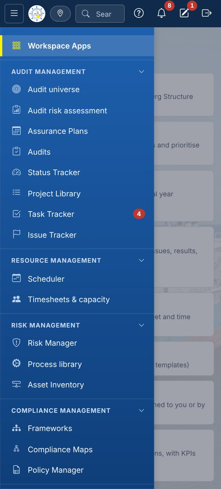
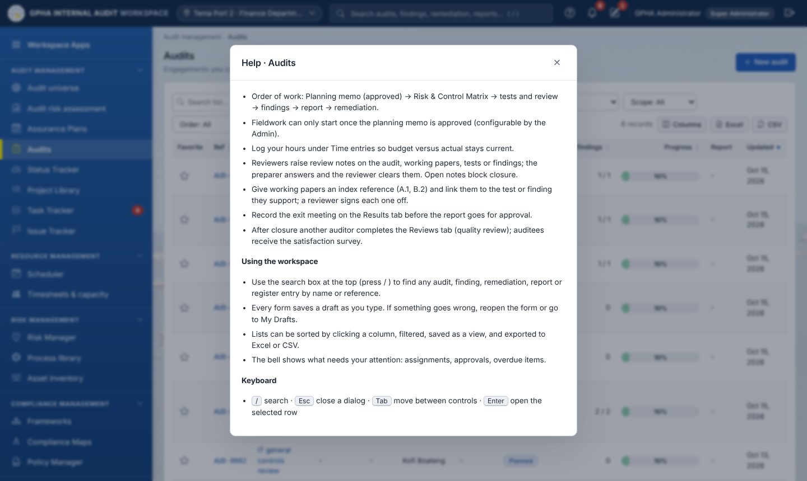
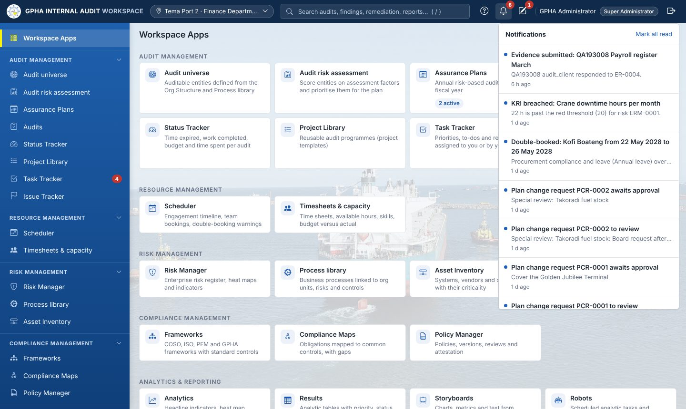
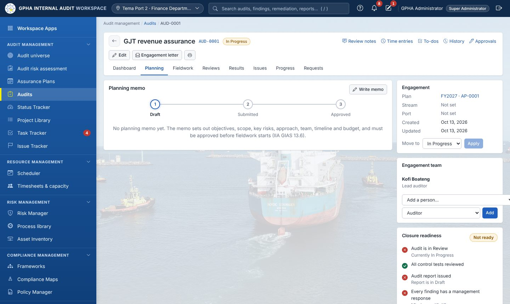
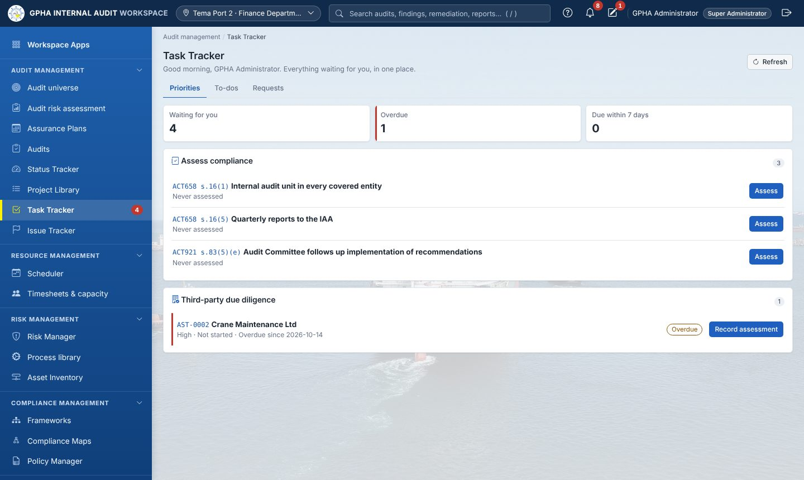
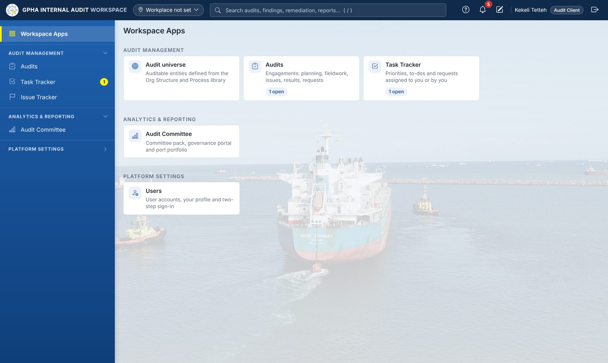

# Document control

| Item | Value |
|---------------------|---------------------------------------------|
| Document | GIAW User Manual (Word) and its companion slide deck `docs/Usermanual.pptx` |
| Version | 2.0, 19 October 2026. Replaces the User Manual 1.0 of 16 October 2026 |
| Owner | GM Audit (Chief Audit Executive), GPHA Internal Audit Department |
| Applies to | Every GIAW user: auditors, managers, the GM Audit, auditees, Audit Committee users and administrators |
| Standards | IIA Global Internal Audit Standards (2024); Internal Audit Agency Act, 2003 (Act 658); Public Financial Management Act, 2016 (Act 921); Internal Audit Regulations, 2011 (L.I. 1994) |

The pictures were taken from the system with demonstration data, so names and numbers in them are examples. Your screens show only the apps and buttons your job role allows.

| If you are… | Read |
|---------------------------------------------|-----------------------------------------|
| New to GIAW | Chapters 1 to 4 |
| Auditor or Senior Auditor | Chapters 1 to 6, 8 and 12 |
| Unit Head, Audit Manager, PIA | All chapters, especially 5, 6, 7 and 8 |
| GM Audit (CAE) | All chapters; chapter 11 lists your duties |
| Auditee (management or staff of an audited unit) | Chapters 1, 3 and 13 |
| Audit Committee member or secretary | Chapters 1, 3 and 10 |
| Administrator | Chapters 1 to 4 and 14, then the Administration Guide |

# 1. What GIAW is

GIAW is GPHA's internal audit management system. It holds the whole internal audit cycle in one place: the audit universe, the annual risk-based plan, every engagement from planning to the issued report, the follow-up of agreed actions, reporting to the Audit Committee and the Internal Audit Agency, and the quality programme of the Internal Audit Department.

It replaces spreadsheets, Word templates and e-mail trails with one controlled record. Every step is done by the right person, approved with an electronic signature where the Standards require it, and kept in a history that cannot be altered.

**What GIAW gives each group**

| Group | What GIAW does for you |
|-----------------------|---------------------------------------------|
| Internal auditors | One workspace per audit: planning memo, risk and control matrix, tests, working papers, evidence requests, findings and the report |
| Managers and the GM Audit | The annual plan, team allocation, reviews and sign-offs, report approval, follow-up, dashboards and Committee packs |
| Auditees | A short list of what Internal Audit needs from you, with a button for each: upload evidence, respond to findings, update actions |
| Audit Committee | Meeting packs, decisions on recommendations, risk acceptances and the governance portal |
| GPHA management | Issued reports, plan status and the implementation of recommendations |

# 2. How GIAW works

## 2.1 The internal audit cycle

{width=100%}

GIAW follows the order of the IIA Standards. Each stage feeds the next, so information is entered once and reused.

| Stage | What happens | Where in GIAW |
|----------------|------------------------------------------|---------------------|
| 1. Universe | Org units and processes are reviewed and defined as **auditable entities** | Audit universe |
| 2. Assurance map | Other assurance providers (management, risk and compliance, external auditors, regulators) are recorded per entity | Audit universe › Assurance map |
| 3. Risk assessment | Ready entities are scored on the assessment factors and ranked | Audit risk assessment |
| 4. Assurance Plan | The annual plan is prepared, reviewed, approved by the Audit Committee, submitted to the IAA and distributed | Assurance Plans |
| 5. Engagement | Each planned audit is started, planned, performed, reviewed and reported | Audits |
| 6. Report | The report passes management review, the review chain and GM Audit approval, then is issued and distributed | Audit › Results |
| 7. Follow-up | Agreed actions are implemented by management, validated by audit and closed (or the risk is formally accepted) | Issue Tracker › Actions |
| 8. Reporting | Quarterly follow-up report, annual Act 921 s.88 statement, Committee packs, KPIs | Issue Tracker, Audit Committee, Analytics |
| 9. Quality | Engagement quality reviews, surveys, the charter, declarations, CPD and external assessments | Quality (QAIP), Professional practice |

## 2.2 Built-in controls you will notice

- **Roles and permissions.** You see only the apps, records and buttons your job role allows. Port staff see their port's work; engagement team members see their engagement.
- **Segregation of duties.** You cannot review, approve, validate or close your own work. Another authorised person must sign.
- **Electronic signatures.** Approvals record your name, decision, comment and time. Depending on the setting you re-enter your password.
- **Gates.** Some steps wait for others. For example, fieldwork cannot start until the planning memo is approved and every team member has declared independence; an audit cannot close until every item on *Closure readiness* is green.
- **History.** Every change is kept: record history on each record, the activity log for the whole system, and append-only follow-up timelines. Nobody can edit or delete these.
- **Never-lost forms.** What you type is saved as a draft automatically.
- **Configuration, not code.** Lists such as audit types, ratings, recipients and deadlines are set by administrators under Configuration.

## 2.3 The main records and how they link

| Record | Linked to |
|------------------|---------------------------------------------|
| Org unit, process | Auditable entities, risks, controls |
| Auditable entity | Assurance providers, risk assessments, plan engagements, audits, findings |
| Assurance Plan | Engagements (one per planned audit), versions, change requests, distribution |
| Audit | Team, auditees, planning memo, risks and controls, tests, working papers, evidence requests, findings, report |
| Finding | Management response, remediation actions, the issued report |
| Remediation action | Progress, evidence files, validation, extensions, risk acceptance, Committee decisions |

# 3. Getting started

## 3.1 Signing in

{width=95%}

1. Open the GIAW address given by IT (for example `https://giaworkspace.com`) in Edge or Chrome.
2. Enter your **username** and **password**, then press **Enter** or select **Sign in**.
3. If two-step verification is on for your role, enter the 6-digit code from your authenticator app. The first time, GIAW shows a QR code to scan.
4. After 5 wrong passwords your account is locked for 15 minutes. An administrator can unlock it sooner.
5. If you leave GIAW idle, you are signed out automatically after the set time.

> GIAW never asks for your password by e-mail. Sign out when you leave your computer (the door icon, top right).

## 3.2 The screen layout

{width=100%}

| Area | What it does |
|-------------------------|---------------------------------------------|
| **Top bar, left** | GPHA logo and name (returns to the home page); **workplace selector** (your port or department, used to filter lists) |
| **Search** (or press `/`) | Finds audits, issues, actions, reports and registers you are allowed to see |
| **? Help** | Help for the page you are on |
| **Bell** | Your notifications: assignments, reviews, reminders, escalations |
| **Pencil** | **My Drafts**: forms you started and did not finish |
| **Your name** | Your profile: password, two-step verification, *Where I work* |
| **Sidebar** | **Workspace Apps** and **My work** at the top, then the app groups: Audit management, Resource management, Risk management, Compliance management, Analytics & reporting, Platform settings |
| **Workspace Apps page** | Every app you can use, as tiles, some with live counts |

On a phone or small tablet the sidebar is hidden. Open it with the menu button (☰) at top left.

{width=40%}

## 3.3 My work

{width=100%}

**My work** is your inbox. It lists the workflow steps waiting for you (reviews, approvals, responses), each with its due date and the time left on the service-level clock. Open an item to go straight to the record. Start your day here or in **Task Tracker › Priorities**.

## 3.4 Help and notifications

{width=100%}

{width=100%}

Select a notification to open the record it is about. Notifications are also sent by e-mail when GPHA has configured an e-mail relay.

# 4. Working with lists, forms and approvals

## 4.1 Lists (registers)

{width=100%}

- **Search** filters as you type; the drop-down filters (Status, Stream, Port…) narrow the list.
- Select a **column heading** to sort; select it again to reverse.
- **Columns** chooses which columns to show. **Excel** and **CSV** export exactly what you see, within your access.
- **Saved views** keep a named set of filters.
- Select a row, or its reference, to open the record.

## 4.2 Forms and never-lost data entry

{width=100%}

- Required fields are marked **\***. Mistakes are shown under the field as you type and again when you save.
- Everything you type is saved as a draft automatically. If your browser closes, reopen the form and select *Restore*, or open **My Drafts**.
- **Save draft** keeps the form for later. The main button (**Create**, **Save**) saves the record.

## 4.3 Electronic signatures and segregation of duties

Approvals, such as approving the plan, reviewing a test, approving a report or closing an audit, are **electronic signatures**. GIAW records your name, the decision and the time. **You cannot approve your own work.** Every change is kept in **History** and in the **Activity logs**.

# 5. The audit universe and the assurance map

## 5.1 Audit universe

{width=100%}

The audit universe is the list of **auditable entities** built from the Org Structure and the Process library. Nothing is copied: the org units and processes stay in their own registers. It has five tabs:

1. **Overview**: the setup flow (review units › review processes › define entities › assess risk), counts and coverage.
2. **Units**: include the units that belong in the universe, or mark them **Not included** with a reason.
3. **Processes**: map each process to the units that perform it.
4. **Entities**: the register of auditable entities.
5. **Assurance map**: other providers of assurance per entity (section 5.3).

{width=100%}

## 5.2 Defining an auditable entity

1. On **Entities** select **New entity**.
2. Choose the **org units** and/or **processes**, the entity type, the **business owner** and write the **scope** and **objectives**.
3. Link risks and controls if known.
4. Save as **Draft**. Set the status to **Ready** when the entity is fully defined (a business owner and a scope are required).

Open an entity to see its definition, risk assessment, assurance providers, audits, findings and history. Only **Ready** entities go to the audit risk assessment; use **Start audit risk assessment** on the entity page. Retire entities that no longer exist; their history stays.

## 5.3 Assurance map (IIA Standard 9.5)

{width=100%}

The assurance map shows, for every entity, who else gives assurance: the first line (management reviews), the second line (risk management and compliance) and external assurance (Ghana Audit Service, regulators, external auditors). Internal Audit's own column shows the entity's last audit.

1. Select **New provider** to add a provider and its line.
2. Open an entity and its **Assurance** tab, then **Add**: choose the provider, what it covers, the date of its last assurance, its result and the **reliance** Internal Audit places on it (None, Partial or Full).
3. Any reliance needs a recorded **basis**: how the provider's competence, objectivity and due care were evaluated.

{width=100%}

Use the map when planning: entities with **No assurance** need attention, and reliance on others can reduce the scope of an audit.

# 6. Risk assessment and the Assurance Plan

## 6.1 Audit risk assessment

{width=100%}

1. Select **Add audit risk assessment**, name it and choose the Ready entities.
2. Check **Settings**: the assessment factors (for example Financial materiality, Fraud risk, Time since last audit) and the rating scale.
3. Score each entity on each factor in **Scoring**. The overall score and rating are calculated.
4. **Conclude**, **Mark as completed**, then **Start planning** to carry the priorities into the Assurance Plan.

## 6.2 Assurance Plans

{width=100%}

{width=100%}

The Assurance Plan is the annual risk-based plan. It goes through these stages:

1. **Planning preparation** (checklist, including the strategy) › **Risk / universe review** › **Audit Managers' planning meeting** (date, attendees, minutes).
2. **Draft plan**: add engagements (entity, quarter, budget hours, lead auditor). The overview shows budgeted hours, planned hours, remaining hours and coverage, including high-risk entities not planned.
3. **Internal review** by the GM Audit (approve, or return with comments).
4. **Submission** and the **Audit Committee decision** (Approved / Approved with amendments / Deferred / Returned).
5. The **approved version** is frozen and numbered, with a Word controlled copy. Record its **submission to the Internal Audit Agency** (date and letter reference).
6. **Distribution** by the GM Audit to each destination (HQ and the ports). Recipients acknowledge receipt.
7. **Execution**: select **Start** on an engagement to create its audit.

Changing an approved plan always goes through a **plan change request (PCR)**. It shows the resource and coverage impact, needs an independent reviewer and the GM Audit's approval, and goes to the Audit Committee when the change is significant.

# 7. Performing an audit

## 7.1 Creating an audit and the team

Audits are normally created by **Start** on a plan engagement. An authorised user can also select **New audit** on the Audits list and enter the title, audit type, port and scope.

**Assurance or advisory.** The audit type decides the nature of the engagement. Types listed as advisory (default: *Advisory*) are advisory engagements: the report gives observations and a conclusion without an overall rating, agreed actions are optional at closure, and the engagement does not count as audit coverage of the entity. The audit page shows the **Nature** next to the stream.

**Engagement team and independence.** Add the team on the audit's Dashboard (one Lead auditor, Auditors, Reviewers). Before fieldwork, **every member** must have signed the annual declaration and declared independence for the engagement. The team panel shows each member's status and flags two threats automatically:

| Flag | Meaning | What to do |
|-------------|---------------------------------------------|---------------------------------|
| **Rotation** | The lead has led audits of the same entity for the set number of consecutive years (default 3) | Change the lead, or the member declares the conflict and a reviewer clears it with safeguards |
| **Cooling-off** | The member worked in an audited unit within the set period (default 12 months) | Same as above |

Auditors record their previous roles under **Professional practice › My declarations › Previous roles**. Only a reviewer can remove a recorded role.

## 7.2 The audit page

{width=100%}

| Part of the page | Use |
|----------------|---------------------------------------------|
| Header | Title, reference (`AUD-0001`), status. **Edit**, **Engagement letter** (Word), print |
| Utility links | **Review notes**, **Time entries**, **To-dos**, **History**, **Approvals** |
| Tabs | **Dashboard · Planning · Fieldwork · Reviews · Results · Issues · Progress · Requests** |
| Dashboard | Scope, **Auditees with access**, working-paper review status, findings summary, independence declarations, engagement details, **Move to** (status), **Engagement team**, **Closure readiness** |

Status moves **Planned › In Progress › Review › Closed**. **Closed** needs an electronic signature by an authorised person who did not prepare the audit, and every item on **Closure readiness** must be green.

## 7.3 Planning tab

{width=100%}

Write the **planning memo**: background, objectives, scope, key risks, approach, team, timeline and budget. Submit it for approval. Send the **engagement letter** (Word) to the auditee. Fieldwork can start only after the memo is approved and the team has declared independence.

## 7.4 Fieldwork tab

{width=100%}

| Sub-tab | What you do |
|--------------------------------------------|---------------------------------------------|
| **Narratives** | Describe how the process works; link the controls each narrative describes |
| **Risk control matrix** | For each **objective**, add **risks** (inherent and residual rating) and **controls** (type, nature, frequency, key control, owner). **From library** copies standard controls. The banner shows coverage gaps |
| **Walkthroughs**, **Test plan**, **Testing** | Record walkthroughs and tests: population, sample size, exceptions, results and conclusion (Effective / Ineffective). An ineffective test can **raise an issue** pre-filled from the test |

**Apply audit programme** loads a Project Library programme. Audits using the **Workplan** workflow show **procedures** instead.

**Sign-offs.** Each page has sign-off circles (up to five levels). The preparer signs first; a reviewer signs when set as **Next Reviewer**. A signed page becomes read-only.

## 7.5 Requests tab (evidence)

{width=100%}

1. Select **Request evidence**. Choose the auditee (who must be on *Auditees with access*), describe what you need, set a due date, optionally link the request to a test or issue, and choose reminders.
2. The auditee uploads files and **submits**.
3. You **accept** or **return** the evidence with a comment. Files are stored encrypted with a SHA-256 fingerprint.

## 7.6 Issues tab (findings)

{width=100%}

1. Select **Add issue**. Enter the title, severity, type, owner, **criteria, condition, cause, effect** and **recommendation**.
2. New issues are **hidden from the auditee** until you **Publish** them. Sending the draft report or recording the exit meeting also publishes them.
3. The auditee records the **management response** (responsible officer and target date). An agreed **remediation action** is raised from the issue.

## 7.7 Reviews tab

{width=100%}

The engagement quality review checklist (mapped to the IIA Standards) is completed by someone other than the preparer. **Review notes** are raised by reviewers, answered by the team and cleared by the reviewer. Open notes block closure.

## 7.8 Progress tab

{width=100%}

Procedures completed, time to deadline, budget against time spent, fieldwork sign-off status and the progress board.

# 8. The audit report

{width=100%}

## 8.1 From draft to issue

| Step | Who | What happens |
|--------------|--------------|------------------------------------------|
| 1. Draft | Audit team | **Create draft report**. Findings and management responses are pulled in. Write the executive summary, overall opinion (or conclusion, for advisory work), background, scope and methodology; choose the overall rating |
| 2. Management review | Auditee | **Send to management**. A response deadline is set (10 working days by default, L.I. 1994 reg. 43(2)). Management adds comments and responds to each finding |
| 3. Review chain | Unit Head, Audit Manager, PIA | **Submit for review**. Each level signs or returns the report |
| 4. Approval | GM Audit | **Approve & issue** (electronic signature). The issued report is frozen |
| 5. Distribution | Audit team | **Record copy sent** for each required recipient (Act 658 s.16). Outstanding recipients are listed |

Export the report to **Word** or **Print / PDF** at any stage; drafts carry a *DRAFT* banner. Record the **exit meeting** on the same tab.

## 8.2 Correcting an issued report (IIA Standard 11.4)

If an issued report contains a significant error or omission:

1. The GM Audit selects **Correct** and records what is wrong.
2. The issued version is kept unchanged under **Earlier versions** (print or Word).
3. The report returns to **Draft** as the next version and goes through review and approval again.
4. When the corrected version is issued, everyone who received an earlier version is listed as **still to receive** the corrected copy. Record each copy sent.

The first issue date is kept for reporting; the corrected version shows its own approval date.

# 9. Follow-up of agreed actions

## 9.1 Issue Tracker and remediation

{width=100%}

**Issues** lists every issue you can see across audits. **Actions** (Remediation & Follow-up) tracks the agreed actions:

{width=100%}

| Step | Who |
|---------------------------------------------|-------------------|
| Action raised from an issue, with owner and due date (default by severity: High 30, Medium 60, Low 90 days) | Auditor |
| Progress updates and implementation evidence (Not / Partially / Fully Implemented) | Action owner |
| **Validation** (follow-up testing): Effective, or Not Effective | A different auditor |
| Closure (electronic signature) after validation, or by the Audit Committee when set | Authorised manager / Committee |
| Overdue actions escalate: owner › Audit Managers › GM Audit › Audit Committee | Automatic |

Revised target dates keep the original date and the reason in the action's timeline.

## 9.2 Risk acceptance (IIA Standard 11.5)

When management decides not to implement an action and to accept the remaining risk:

1. The follow-up manager selects **Propose risk acceptance**, naming who accepts the risk and why (including compensating controls).
2. The **GM Audit** discusses it with senior management, then selects **Decide**: Agree or Disagree, with the conclusion.
3. For the set severities (default **High**), an agreed acceptance goes to the **Audit Committee**, which records **Accept risk** or **Reject risk acceptance** at a meeting.
4. Only then does the action close as **Risk Accepted**. If it is not agreed, the action stays open for implementation.

## 9.3 Statutory reports

The **Statutory reports** tab produces the **quarterly follow-up report** (Act 921 s.83) and the **annual statement on implementation of recommendations** (Act 921 s.88), in Word and Excel, and keeps a register of what was submitted to whom. Recommendations from the Auditor-General, PAC or Parliament close only with that body's closure reference.

# 10. Audit Committee, governance and reporting

## 10.1 Audit Committee

{width=100%}

| Tab | Contents |
|------------------------|---------------------------------------------|
| **Committee pack** | Plan delivery, reports issued and ratings, open findings by risk and age, action status, most overdue actions, items for decision. **Download** produces the Word pack |
| **Meetings & decisions** | Meetings register, attendance, quorum, minutes (approved, then locked), decisions on recommendations: close, withdraw, extend, escalate, accept or reject a risk acceptance |
| **Governance portal** | Read-only view of approved plans, issued reports and dashboards |
| **Port portfolio** | Audit coverage and results by port |

**Recording a decision:** schedule the meeting, mark it **Held** with attendees, select **Record decision**, pick the recommendation (items awaiting the Committee are listed first with the reason) and the decision, then **Approve minutes** to lock them.

## 10.2 Analytics

{width=100%}

Headline KPIs against configured targets (plan delivery, actions closed on time, overdue actions, days to report, satisfaction, time utilisation), the risk heat map, findings per month and repeat findings.

## 10.3 Results, Storyboards and Robots

**Results** holds analytic tables with priorities, assignees and triggers; **Storyboards** combine text, charts and metrics for sharing; **Robots** run fixed analytics on a schedule (for example open High issues, overdue actions).

# 11. Quality and professional practice

## 11.1 Professional practice

{width=100%}

| Tab | Who | Contents |
|------------------------|------------|---------------------------------------------|
| **My declarations & CPD** | Every auditor | Annual declaration (ethics, independence, confidentiality), engagement declarations, CPD hours against the target, certifications, previous roles |
| **Team** | Reviewers | Each auditor's declaration and CPD status; conflicts waiting for review (**Cleared** or **Reassigned**) |
| **Charter & external assessment** | GM Audit, Committee | Internal audit charter versions and approval, review due date, external quality assessments (every 5 years) and the conformance statement |

## 11.2 Quality (QAIP)

{width=100%}

Engagement quality reviews (by someone who did not prepare the audit), post-audit satisfaction surveys (answered by auditees once the report is issued), the yearly QAIP summary and the internal assessment report (Word).

## 11.3 The GM Audit's duties in GIAW

| Duty | Where |
|---------------------------------------------|---------------------|
| Review and approve the Assurance Plan; distribute it | Assurance Plans |
| Approve plan change requests | Assurance Plans › Change requests |
| Approve and issue reports; correct an issued report | Audit › Results |
| Decide risk acceptances | Issue Tracker › Actions |
| Committee packs and meetings | Audit Committee |
| Charter, external assessment, conformance statement | Professional practice |
| Review declared conflicts (with reviewers) | Professional practice › Team |

# 12. Resource, risk and compliance apps

## 12.1 Scheduler and timesheets

{width=100%}

The **Scheduler** shows engagement windows and auditor bookings (engagements, leave, training) by quarter or year; overlaps are highlighted. **Timesheets & capacity** records daily time in quarter hours and shows team capacity, the skills matrix and budget against actual per audit.

## 12.2 Task Tracker

{width=100%}

| Tab | Contents |
|--------------|---------------------------------------------|
| **Priorities** | Everything waiting for you across all apps, with counts waiting, overdue and due within 7 days, and an action button for each |
| **To-dos** | Tasks assigned to you or by you |
| **Requests** | All evidence requests you can see |

## 12.3 Risk Manager, Process library and Asset Inventory

{width=100%}

- **Risk Manager**: the enterprise risk register (inherent, residual and target scores, appetite, treatment), heat maps, strategic objectives and key risk indicators with amber and red thresholds.
- **Process library**: business processes linked to org units, risks, controls and auditable entities.
- **Asset Inventory**: systems, data, facilities and **third parties**, with due-diligence assessments and contract expiry warnings.

## 12.4 Frameworks, Compliance Maps and Policy Manager

- **Frameworks**: COSO, COBIT, ISO 31000, PFM Regulations and GPHA procedures with their standard controls.
- **Compliance Maps**: obligations broken into requirements, each with an owner, status and controls.
- **Policy Manager**: draft, approve (never by the author), publish and run attestation campaigns.

# 13. For auditees (management and staff of audited units)

{width=100%}

You see only the audits you have been added to, and only issues that Internal Audit has published.

1. **Open Task Tracker › Priorities.** Everything waiting for you is listed with an action button.

   {width=100%}

2. **Answer evidence requests**: open the request, **upload** your files, write a short response and select **Submit**. If Internal Audit returns it, it comes back to you with a comment.

   {width=100%}

3. **Comment on the draft report** when it is sent to you, within the deadline shown.
4. **Respond to issues**: give the management response, the responsible officer and the target date.
5. **Update your actions**: record progress and upload implementation evidence. Internal Audit validates and closes the action; you cannot close it yourself.
6. **Complete the satisfaction survey** after the report is issued.
7. **Attest to policies** and **assess your risks** when they appear in Priorities.

{width=100%}

# 14. For administrators

{width=100%}

| Task | Where |
|---------------------------------------------|---------------------|
| Create users, assign job roles and approval levels, unlock accounts | Platform settings › Users, Roles & permissions |
| Org Structure (HQ, ports, departments, unit heads) | Org Structure |
| Settings: audit types and advisory types, assurance lines, rotation and cooling-off, risk acceptances for the Committee, report recipients, deadlines, KPI targets, security | Configuration (one section at a time; every change keeps its history and reason) |
| Automations and notifications | Automations |
| Backups, checks and the restore guide | Backups |
| Activity logs and their integrity check | Activity logs |
| Bulk import | Imports |

The Administration Guide gives full instructions.

# 15. Frequently asked questions

| Question | Answer |
|--------------------------------------------|---------------------------------------------|
| I cannot see an app my colleague sees. | Apps follow your job role. Ask the system owner if you need more access. |
| I cannot approve something I prepared. | That is deliberate (segregation of duties). Another authorised person must sign. |
| My form disappeared when the browser closed. | Reopen the form and select *Restore*, or open **My Drafts**. |
| Fieldwork will not start. | Check that the planning memo is approved and that every team member has signed the annual and engagement declarations; clear any rotation or cooling-off flag. |
| The auditee cannot see my issue. | Publish it. Unpublished issues stay internal. |
| The auditee cannot be chosen for a request. | Add them under **Auditees with access** on the audit's Dashboard first. |
| The audit will not close. | Check **Closure readiness** on the Dashboard; every item must be green. |
| An issued report has an error. | Ask the GM Audit to select **Correct** on the report (chapter 8.2). |
| Management will not implement an action. | Propose a risk acceptance (chapter 9.2). |
| The screen looks wrong after an update. | Press **Ctrl+F5**. |
| I am locked out. | Wait 15 minutes or ask an administrator to unlock your account. |

# 16. Quick reference cards

**Auditor**

1. My work and Task Tracker › Priorities every morning.
2. Sign the annual declaration; declare for each engagement.
3. Audit › Fieldwork: risk and control matrix, tests, sign-offs.
4. Request evidence; accept or return it.
5. Add issues, then publish.
6. Validate actions in Remediation.

**Manager (Unit Head, Audit Manager, PIA)**

1. Assurance Plans: prepare, review, distribute.
2. Start engagements and allocate teams; check the independence flags.
3. Review sign-offs and clear review notes.
4. Review the report in the chain.
5. Close audits (electronic signature).
6. Monitor follow-up; propose risk acceptances when management declines.

**GM Audit**

1. Approve the plan and plan changes.
2. Approve and issue reports; correct issued reports when needed.
3. Decide risk acceptances.
4. Committee pack each quarter; charter and external assessment.

**Auditee**

1. Task Tracker › Priorities.
2. Submit the requested evidence.
3. Comment on the draft report; respond to published issues.
4. Update actions with evidence.
5. Complete the survey; attest to policies and assess your risks when asked.

# 17. Glossary

| Term | Meaning |
|------------------|---------------------------------------------|
| Auditable entity | A defined scope that can be audited: an org unit, a process, or a process within units |
| Assurance map | The register of other assurance providers per entity and the reliance placed on them |
| Assurance Plan | The annual risk-based internal audit plan |
| Advisory engagement | Advice or a review without an assurance opinion; management decides what to implement |
| GM Audit / CAE | General Manager, Audit: the Chief Audit Executive |
| PIA | Port Internal Auditor |
| PCR | Plan change request |
| RCM | Risk and control matrix |
| Finding / issue | A weakness found in an audit: criteria, condition, cause, effect and recommendation |
| Remediation action | The action management agrees to take on a finding |
| Risk acceptance | Management's formal decision not to implement, agreed by the GM Audit and, when required, the Audit Committee |
| Cooling-off | A period after working in a unit during which an auditor does not audit it |
| Rotation | Changing the lead auditor after a set number of consecutive years on the same entity |
| QAIP | Quality assurance and improvement programme |
| IAA | Internal Audit Agency (Ghana) |
