# How to use this manual

This manual tells you, page by page, **what to click, in what order, what happens, and where to go next**. Button and field names are written exactly as they appear on the screen, in **bold**. Each procedure has the same parts:

| Part | Meaning |
|---------------|---------------------------------------------|
| **Where** | How to reach the page (sidebar › app › tab) |
| **Who** | The job role, approval level or permission needed. If you lack it, the button is not shown |
| **Steps** | Numbered clicks and entries |
| **Result** | What GIAW does: the message (toast) you see, the new status, who is notified |
| **Next** | The page or person the work moves to |

**Job roles and approval levels used in this manual**

| Job role | Approval level | Typical person |
|----------------------|------------------|---------------------------------|
| Super Administrator | – | System owner (all permissions) |
| Administrator | – | IT / platform administrator: users, configuration, reference data, backups. Does not perform or approve audit work |
| Manager | **Unit Head** | Unit Head of Internal Audit |
| Manager | **Audit Manager** | Audit Manager |
| Manager | **PIA** | Port Internal Auditor |
| Manager | **GM Audit (CAE)** | General Manager, Audit (Chief Audit Executive) |
| Auditor | – | Senior Auditor, Auditor, Audit Clerk |
| Read-only User | – | Observers and inspectors |
| Audit Client | – | Auditee: management and staff of audited units |

Some permissions belong to the **GM Audit only**: approving the Assurance Plan (`plan.approve`), recording the Committee's plan decision and approving plan changes (`plan.amend`), distributing the plan and seeing every port (`oversight.portfolio`), approving and issuing reports, and deciding risk acceptances.

**Reading the chapters**

| If you are… | Start with |
|---------------------------|---------------------------------------|
| New to GIAW | Chapters 1, 2 and 3 |
| Auditor | 1, 2, 3, then 8 to 12 |
| Unit Head, Audit Manager, PIA | 1 to 3, 5 to 7, 8 to 14 |
| GM Audit | All chapters; chapter 2 lists every point where you sign |
| Auditee | 1 and 18 |
| Audit Committee member or secretary | 1, 2 and 15 |
| Administrator | 1 and 17 |

# 1. Getting around GIAW

## 1.1 Signing in

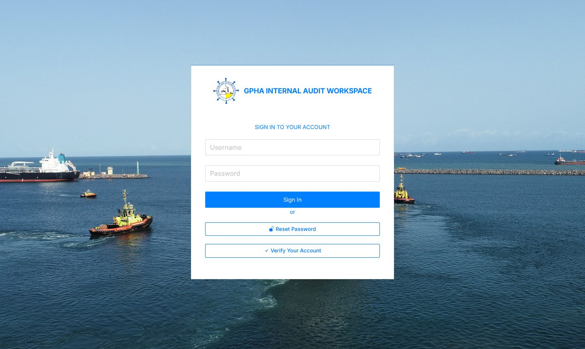{width=80%}

**Where:** the GIAW address in Edge or Chrome (for example `https://giaworkspace.com`). **Who:** everyone.

1. Type your user name in **Username** and your password in **Password**.
2. Click **Sign In**.
3. If your account uses two-step verification, GIAW shows *"Enter the 6-digit code from your authenticator app, then sign in."* and a new box *"6-digit code from your authenticator app"*. Type the code and click **Sign In** again.

**Result:** the workspace opens. Auditees land on **Task Tracker**, Audit Committee accounts on the **Governance portal**, everyone else on **Workspace Apps**. If you were signed out for inactivity, GIAW reopens the page you were on.

| Message | What to do |
|------------------------------------|---------------------------------------------|
| *Invalid username or password* | Retype carefully. After repeated failures the account locks |
| *Invalid authentication code* | Use the newest code; check your phone's clock |
| *Account temporarily locked after repeated failed sign-in attempts…* | Wait, or ask an administrator to **Unlock** you |
| *Account is pending administrator approval* | An administrator must **Approve** your account |
| *Your network account is not registered in the workspace…* | Ask the Internal Audit administrator to add you |

**Forgotten password:** click **Reset Password**. GIAW shows *"Please contact your administrator to reset your password."* An administrator resets it (chapter 17.2).

**Requesting an account:** click **Verify Your Account**, fill **Username**, **Email**, **First Name**, **Last Name**, **Company**, **Password (min 8 characters)** and **Confirm password**, then click **Request Account**. An administrator must approve it.

### First-time two-step set-up

If your role must use two-step verification, the page **Set up two-step verification** opens alone after sign-in.

1. Click **Set up two-step verification**.
2. In your authenticator app choose **Add account** › **Enter a setup key**. Enter the account name shown (*GPHA Internal Audit (your username)*) and the key. On a phone you can tap **open this link**.
3. Type the code in **6-digit code** and click **Turn on**.

**Result:** *"Two-step verification is on"*; the workspace unlocks.

### Idle sign-out and signing out

- When less than a minute is left, a **Still there?** dialog counts down. Click **Stay signed in** to continue (your half-filled form stays open) or **Sign out now**.
- To sign out yourself, click the exit icon at the far right of the top bar (**Sign out**).

## 1.2 The screen

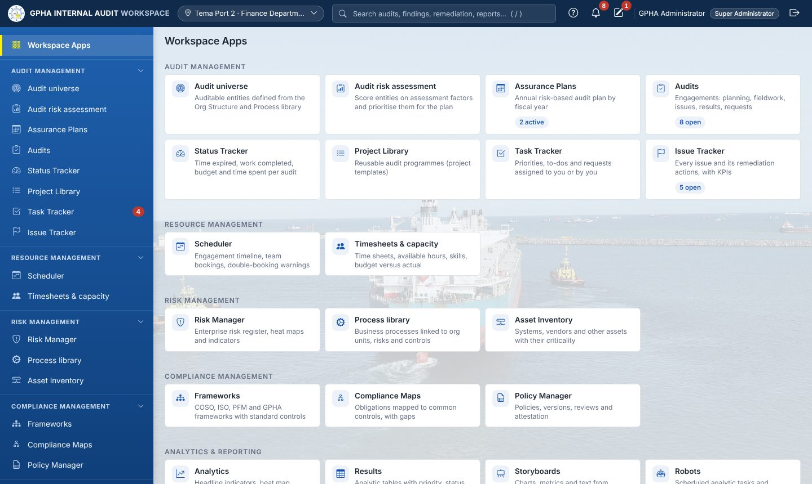{width=100%}

**Top bar, left to right**

| Item | What it does |
|----------------------------|---------------------------------------------|
| **☰** (narrow screens only) | Opens and closes the sidebar |
| Logo *GPHA INTERNAL AUDIT WORKSPACE* | Returns to your home page |
| **Workplace chip** (pin icon) | Shows your workplace, role and approval level. **Change workplace** opens My profile. It does not change what you can see |
| **Search** (press **/**) | Type 2+ characters; use ↑ ↓ and **Enter** to open audits, findings, reports, actions, plans and entities |
| **?** Help | Tips for the page you are on |
| **Bell** | Notifications (1.5) |
| **Pencil** | **My drafts** (1.6) |
| **Your name** | **My profile** (1.7) |
| Exit icon | **Sign out** |

**Sidebar** (only the apps your role allows are shown; click a group heading to fold or unfold it):

| Group | Apps |
|------------------------|---------------------------------------------|
| (top) | **Workspace Apps**, **My work** |
| Audit management | Audit universe, Audit risk assessment, Assurance Plans, Audits, Status Tracker, Project Library, Task Tracker, Issue Tracker |
| Resource management | Scheduler, Timesheets & capacity |
| Risk management | Risk Manager, Process library, Asset Inventory |
| Compliance management | Frameworks, Compliance Maps, Policy Manager |
| Analytics & reporting | Analytics, Results, Storyboards, Robots, Audit Committee, Quality (QAIP) |
| Platform settings | Administration, Org Structure, Users & access, Roles & permissions, Configuration, Backups |

Some apps have a **tab strip** under the title, for example **Audit universe: Overview | Units | Processes | Entities | Assurance map**, **Issue Tracker: Issues | Actions**, **Audit Committee: Committee pack | Governance portal | Port portfolio**, **Quality (QAIP): Quality reviews | Professional practice | Service feedback**. The **breadcrumb** above the title (for example *Audit management / Audits / AUD-0004*) is clickable.

## 1.3 My work — your inbox

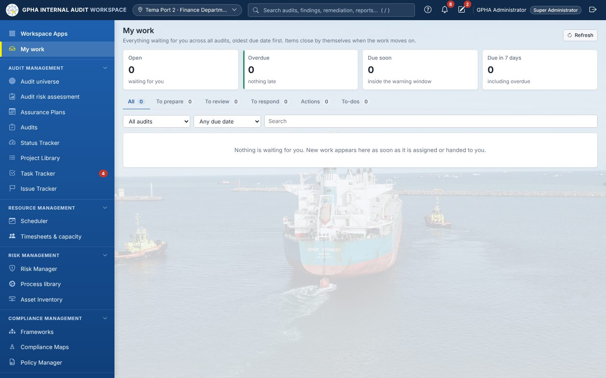{width=100%}

**Where:** sidebar **My work**. **Who:** everyone; it lists only items assigned to you.

My work collects every workflow step waiting for you: *Prepare and sign off, Review and sign off, Review working paper, Answer review note, Clear review note, Provide requested evidence, Check submitted evidence, Review audit report, Approve and issue report, Respond to finding, Implement remediation action, Validate remediation action*, and your open to-dos.

1. Read the tiles: **Open**, **Overdue**, **Due soon**, **Due in 7 days**.
2. Pick a tab: **All**, **To prepare**, **To review**, **To respond**, **Actions**, **To-dos**.
3. Narrow with **All audits** (or one audit), **Any due date / Overdue / Due in 7 days** and **Search**.
4. The **Due** column shows the service-level clock: *Overdue N days*, *Due today*, *Due in N days*. Hover for the exact time.
5. Click a row. **Result:** the audit opens on the right tab, or the record opens.

Items leave the list by themselves when the work moves on. Start every day here.

## 1.4 Task Tracker

**Where:** sidebar **Task Tracker**. Tabs **Priorities | To-dos | Requests**.

### Priorities

Everything waiting for you across all apps, grouped, with **Waiting for you**, **Overdue** and **Due within 7 days** tiles.

| Section | Button | What it opens |
|-----------------------------|----------------------|---------------------------------------------|
| Attest to policies | **Read and attest** | The policy, its statement and **Later**, **I cannot attest** (comment required), **I confirm** |
| Evidence requests | **Provide evidence** | The Evidence requests tab |
| Agreed actions | **Update progress** | The remediation action |
| Assess your risks | **Assess** | The risk record |
| Record indicators | **Record reading** | The indicator reading form |
| Assess compliance | **Assess** | The requirement assessment |
| Third-party due diligence | **Record assessment** | The asset |
| Tasks | **Open** | The To-dos tab |

### To-dos

1. Choose **Assigned to me**, **Assigned by me** or **Closed**.
2. To create one: click **New to-do**, fill **Title** (required), **Assignee** (choose the person, or leave *- unassigned -*), **Due date**, **Description**, then click **Create**. **Result:** *"To-do created"*; the assignee sees it in My work.
3. To change status: pick **Open**, **In Progress** or **Closed** in the row and click **Save** (*"Task updated"*).

### Requests

Lists evidence requests (staff: **Raised by me**, **All open**, **Overdue**; auditees: what was asked of them). Click a row to open it. The steps for auditees and reviewers are in 10.7.

## 1.5 Notifications

1. Click the **bell** (the red number is unread items).
2. Click a notification. **Result:** it is marked read and its record opens.
3. **Mark all read** clears the count.

## 1.6 My drafts

Everything you type in a form is saved automatically until you submit it.

1. Click the **pencil** in the top bar.
2. Click **Continue** to reopen a form with your entries, or **Discard** to delete the draft.

## 1.7 My profile

**Where:** click your name. Five cards:

1. **My details:** edit **Full name** and **Email**, click **Save changes**.
2. **Change password:** **Current password**, **New password** (at least 8 characters, not your username or a common password), **Confirm new password**, click **Change password**. Other sessions are signed out.
3. **Where I work:** pick your **Port, office or department**, click **Save**. This decides which port's work you see and whether you receive the approved plan for your site. **Set it on your first day.**
4. **Two-step verification:** **Set up two-step verification**, or **Turn off** (password and current code) if your role allows.
5. **Recent activity on your account:** your last sign-ins. If you do not recognise one, change your password and tell an administrator.

## 1.8 Forms, drafts and signatures (how every form behaves)

1. Every form for creating or editing a record opens in a **panel on the right** of the workspace. You can still read and click the page on the left.
2. The panel does **not** close when you click elsewhere or press **Esc**. It closes only when you click **×** or **Close**.
3. Required fields have a red **\***. Errors appear under the field in plain words.
4. Drafts save as you type (*"Draft saved HH:MM"*). **Save draft** keeps the form for later.
5. If you refresh the page (or sign in again after being signed out), the panels you had open come back with what you typed.
6. Click the main button (**Create**, **Save**, **Save changes**…). If something is wrong: *"Please correct N field(s) highlighted below. Your entries are saved as a draft."*
7. After a successful save the panel stays open, locked, with *"Saved HH:MM. Close this panel when you have finished."* Check the result, then click **Close**.
8. Closing a changed form before saving keeps the draft. Reopening it shows *"Restored your unsaved entries from…"* with **Discard draft**.
9. A form opened from inside another (for example **Request evidence** from an issue) opens on top. Closing it shows the first one again.

**Electronic signature dialog.** Used for every approval. It says *"By signing you certify this action. Your password is verified and never stored."*

1. If offered, choose **Decision**: **Approve** or **Reject (return for rework)**.
2. Type your **Password** and an optional **Comment**.
3. Click the sign button (**Sign & Approve**, **Sign**, **Sign review**, **Sign & Close**, **Approve & issue**). **Result:** *"Signature recorded"*.

**You can never sign your own work.** GIAW refuses with *"Segregation of duties: the preparer of a record cannot sign it off"*.

## 1.9 Lists

- Type in the search box; use the drop-downs (*Status: All*…); **Clear** resets.
- **Columns** chooses columns (remembered on this computer).
- **Excel** / **CSV** export what you see (needs the export permission).
- Click a column heading to sort; use **10 / 25 / 50 / 100 / page** and ‹ › to page.
- **Saved views:** set filters, click the bookmark-plus icon, name the view, **Save view**.
- Click a row to open the record.

# 2. Who does what: the chains

This chapter shows every hand-over in GIAW. Each row is one step; the chapters that follow give the clicks.

## 2.1 The year at a glance

| # | Step | Who | Where | Chapter |
|-----|-----------------------------|--------------------|---------------------|---------|
| 1 | Org units and heads set up | Administrator | Org Structure | 4.1 |
| 2 | Processes recorded and mapped | Audit staff with library rights | Process library, Audit universe › Processes | 4.2, 4.4 |
| 3 | Units reviewed; entities defined and set **Ready** | Audit staff with library rights | Audit universe | 4.3–4.6 |
| 4 | Other assurance providers recorded | Planners | Audit universe › Assurance map | 4.7 |
| 5 | Audit risk assessment scored, concluded, **Start planning** | Planners | Audit risk assessment | 5 |
| 6 | Planning cycle: preparation → universe review → managers' meeting → draft | Managers (`plan.prepare`) | Assurance Plans | 6.2 |
| 7 | Internal review and approval | GM Audit | Assurance Plans | 6.2 |
| 8 | Submission and Audit Committee decision; version frozen | GM Audit | Assurance Plans | 6.2 |
| 9 | IAA submission recorded | GM Audit | Assurance Plans › Versions & cycle | 6.2 |
| 10 | Distribution and acknowledgement | GM Audit → PIAs / Audit Managers | Assurance Plans | 6.2 |
| 11 | **Start** each engagement → audit created | Auditors / Managers | Assurance Plans | 6.5 |
| 12 | Team, auditees, declarations | Lead auditor / Manager; every member | Audit › Overview | 9 |
| 13 | Planning memo → approval | Lead auditor → Audit Manager / PIA / GM Audit | Audit › Planning | 9.6 |
| 14 | **Move to In Progress** (fieldwork gate) | Lead auditor | Audit › side panel | 9.4 |
| 15 | Fieldwork, evidence, sign-offs, review notes | Team → reviewers | Audit › Fieldwork, Requests | 10 |
| 16 | Issues raised and published; responses | Team → auditee | Audit › Findings | 11 |
| 17 | Report: draft → management → review chain → GM Audit issues → distribution | Team → auditee → Unit Head → Audit Manager → PIA → GM Audit | Audit › Report | 12 |
| 18 | Quality review; close audit (e-sign) | Another auditor; GM Audit | Audit › Supervision & review; header | 10.9, 9.5 |
| 19 | Follow-up of actions → validation → close; risk acceptance | Owner → auditor → follow-up manager / GM Audit / Committee | Issue Tracker › Actions | 13 |
| 20 | Quarterly report and annual statement | Follow-up manager | Issue Tracker › Actions › Statutory reports | 13.8 |
| 21 | Committee meetings, decisions, minutes | Committee secretary (`committee.record`) | Audit Committee | 15 |
| 22 | QAIP, declarations, CPD, charter, EQA | Everyone / GM Audit | Quality (QAIP) | 16 |

## 2.2 Assignment chain (how work reaches people)

| Step | Who sets it | Where | Result |
|------------------------------------|----------------------|------------------------------|---------------------------------|
| Lead auditor for each planned engagement | Planner | Plan › **Add engagement** › **Lead auditor** | Named lead on the plan |
| Audit created with its team | Whoever clicks **Start** | Plan › engagement › **Start** | Planned lead becomes **Lead auditor**; the starter becomes **Auditor** (or Lead if none was planned) |
| Team members added | Lead auditor / Manager (`audit.create`) | Audit › Overview › **Engagement team** › **Add a person…** | Members can work on the audit even outside their port |
| Auditees given access | Audit staff | Audit › Overview › **Add auditee...** | Auditee sees the audit; can receive requests |
| Procedures and tests assigned | Lead auditor | Fieldwork › procedure **Assigned to** / test **Assigned** | Only engagement team members can be chosen |
| Next reviewer of a page | Preparer (after signing) | Sign-offs › **Next Reviewer…** › **Set and Notify Reviewer** | Reviewer notified; item in their My work |
| Issue owner | Auditor | Issue › **Owner** | Owner notified when published |
| Action owner | From the issue owner or the response's **Responsible officer** | Issue › **Raise remediation** | Owner sees **Update progress** in Priorities |
| Evidence request owner | Auditor | Evidence requests › **Owner (provides the evidence)** | Auditee notified, with reminders |

## 2.3 Plan approval chain

| Step | Who | Button | Plan status after |
|----------------------|-------------------------|-----------------------------------|----------------------|
| Preparation | Manager (`plan.prepare`) | **Complete preparation** | Draft |
| Universe review | Manager | **Record universe review** › **Record review** | Draft |
| Managers' meeting | Manager | **Record planning meeting** › **Save meeting** | Draft |
| Submit draft | Manager | **Submit for internal review** › **Submit** | In Review |
| Internal review | GM Audit (not the preparer) | **Approve (e-sign)** › **Sign & Approve**, or **Return with comments** | Submitted / Returned |
| Submission | GM Audit | **Record submission** | Submitted |
| Committee decision | GM Audit | **Record Committee decision** › **Record decision** | Approved (version frozen) / Returned / still Submitted (Deferred) |
| IAA record | GM Audit | **Record IAA submission** | (unchanged) |
| Distribution | GM Audit | **Distribute approved plan** › **Distribute** | Distributed |
| Acknowledgement | Each recipient | **Acknowledge receipt** | (unchanged) |
| Execution | Auditors / Managers | **Start** on each engagement | In Execution |
| Year end | GM Audit | **Close year** › **Archive** | Closed › Archived |

## 2.4 Plan change chain (PCR)

| Step | Who | Button | PCR status |
|---------------|------------------------------|--------------------------------------|------------------|
| Raise | Manager / PIA / Audit Manager | **New change request** › **Preview impact** › **Submit for review** | Submitted |
| Review | Another manager (never the requester) | **Endorse** or **Return** | Endorsed / Returned |
| Approve | GM Audit (not the requester) | **Approve / reject (e-sign)** › **Sign** | Approved (minor) / Awaiting Committee (significant) / Rejected |
| Committee | GM Audit records it | **Record Audit Committee decision** | Approved (new version frozen and re-distributed) / Rejected |

## 2.5 Engagement gates

| Gate | Condition | Where it is checked |
|---------------------------|---------------------------------------------|-----------------------------|
| Fieldwork can start | Planning memo **Approved**, and every team member has signed the annual and the engagement declaration, with no pending conflict or uncleared rotation / cooling-off flag | **Move to › In Progress** |
| Report can go to review | Rating chosen (not for advisory work), executive summary and overall opinion / conclusion written, every finding has a management response | **Submit for review** |
| Audit can close | In Review, all tests reviewed, report issued, responses and actions in place, all review notes cleared | **Close (e-sign)** |

## 2.6 Fieldwork sign-off chain (pages: procedures, tests, test plan, narratives, matrix, findings)

| Level | Who | Button |
|-----------------------|------------------------------|-------------------------------|
| Preparer | The auditor who did the work | **Sign-off** |
| (hand-over) | Preparer | **Next Reviewer…** › **Set and Notify Reviewer** |
| Detail Reviewer | The named reviewer | **Sign-off as Detail Reviewer** |
| General Reviewer | Next named reviewer | **Sign-off as General Reviewer** |
| Supplemental / Specialty Reviewer | If configured | **Sign-off as …** |

Nobody signs two levels. A signed page is read-only; removing a sign-off also removes the later ones. A manager may use **Override Sign-off** when the named reviewer is away.

## 2.7 Working paper and report review chain

The review chain is set by an administrator (default **Unit Head → Audit Manager → PIA**), then the **GM Audit** approves.

| Step | Who | Button | Report status |
|----------------------|----------------------|------------------------------------|----------------------|
| Draft | Audit team | **Create draft report**, **Edit report** | Draft |
| Management comments (optional) | Team → auditee | **Send to management**; auditee **Management comments** | Management Review |
| Submit | Audit team | **Submit for review** | Manager Review (Unit Head) |
| Level 1 | Unit Head | **Review as Unit Head (e-sign)** | Manager Review (Audit Manager) |
| Level 2 | Audit Manager | **Review as Audit Manager (e-sign)** | Manager Review (PIA) |
| Level 3 | PIA | **Review as PIA (e-sign)** | CAE Approval |
| Approval | GM Audit (not a chain signer) | **Approve & issue (e-sign)** | Issued |
| Return at any level | That signer | Decision **Reject (return for rework)** | Draft (chain restarts) |
| Distribution | Audit team | **Record copy sent** | (unchanged) |
| Correction | GM Audit | **Correct** › **Open version N+1** | Draft (version N+1) |

A higher level may sign for an absent lower level. Working papers use the same levels with **Sign off as <level>** on the Report tab.

## 2.8 Follow-up chain

| Step | Who | Button | Action status |
|---------------------------|------------------------------|------------------------------------|-------------------|
| Raise | Auditor | Issue › **Raise remediation** (or **New remediation**) | Open |
| Progress | Action owner (or staff) | **Progress update** › **Save progress** | In Progress |
| Implementation | Action owner | **Record implementation** › **Submit for validation** | Review |
| Validation | A different auditor | **Validate** › **Save validation** | Review (Effective) or back to In Progress |
| Close | Follow-up manager (not the person who raised it) | **Close (e-sign)** › **Sign & Approve** | Closed |
| …or Committee close | Committee secretary | Meeting › **Record decision** › *Close* | Closed |
| Overdue escalation | Automatic | – | Owner (day 1) → Audit Managers (14 days) → GM Audit (30 days) → Audit Committee (60 days) |

## 2.9 Risk acceptance chain

| Step | Who | Button | Result |
|---------------|------------------------------|--------------------------------------|---------------------------------|
| Propose | Follow-up manager (not the person who raised the action) | **Propose risk acceptance** › **Send to the GM Audit** | *Risk acceptance proposed - awaiting the GM Audit* |
| Decide | GM Audit (not the proposer) | **Decide** › Agree / Disagree › **Record decision** | Disagree: action stays open. Agree: closes, or for **High** goes to the Committee |
| Committee | Committee secretary | **Record decision** › *Accept risk* / *Reject risk acceptance* | Closed as Risk Accepted, or reopened for implementation |

## 2.10 Evidence request chain

| Step | Who | Button | Request status |
|---------------|----------------------|--------------------------------------|------------------|
| Request | Auditor | Evidence requests › **Request evidence** › **Send request** | Requested |
| Provide | Auditee (owner) | **Upload**, **Response**, **Submit** | Submitted |
| Review | Auditor | **Accept** or **Return for more** | Accepted (filed as working papers) / Returned |

## 2.11 Independence chain

| Step | Who | Button |
|---------------------------|----------------------|------------------------------------|
| Annual declaration | Every auditor, each year | Professional practice › **Sign now** › **Sign declaration** |
| Engagement declaration | Every team member | Audit › Overview › **Declare for this engagement** › **Sign declaration** |
| Conflict review | Reviewer (`proficiency.manage`, not yourself) | Professional practice › **Team** › row › **Cleared** / **Reassigned** › **Record review** |
| Previous roles | Each auditor | Professional practice › **Previous roles** › **Add** |

# 3. Quick start by role

## 3.1 Your first day (everyone)

1. Sign in (1.1) and set up two-step verification if asked.
2. Click your name › **Where I work** › choose your port or department › **Save**.
3. Change your password if an administrator gave you a temporary one (**Change password**).
4. Auditors and managers: open **Quality (QAIP)** › **Professional practice** › **My declarations & CPD** › **Annual declaration** › **Sign now** › tick the three confirmations › **Sign declaration**. Add your **Previous roles** (units you worked in before Internal Audit).
5. Open **My work** and **Task Tracker › Priorities** to see what is waiting.

## 3.2 Daily routine

| Role | Every day |
|----------------------|---------------------------------------------|
| Auditor | **My work** › open each item; Audit › **Fieldwork** (tests and procedures assigned to you); **Evidence requests** (check submitted evidence); answer **Review notes** |
| Unit Head / Audit Manager / PIA | **My work** › **To review** tab: sign working papers, tests and reports; clear review notes; approve planning memos; validate or close actions |
| GM Audit | **My work** › *Approve and issue report*; plan approvals; risk acceptances to decide (Issue Tracker › Actions); plan change requests |
| Auditee | **Task Tracker › Priorities** › use each button (chapter 18) |
| Committee secretary | **Audit Committee › Committee pack › Meetings & decisions** |

# 4. Audit universe

The universe is built in this order: **Org Structure → Process library → Units → Processes → Entities → Assurance map**, then the **Audit risk assessment** (chapter 5).

## 4.1 Org Structure

**Where:** Platform settings › **Org Structure** (tab **Org Structure**). **Who:** administrators and library editors add and edit units; administrators **Approve** and **Delete**; `system.reference` sets heads and deactivates.

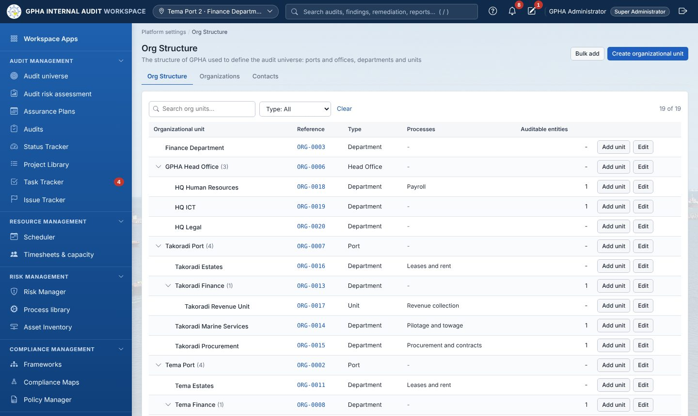{width=100%}

**Add a top-level unit**

1. Click **New unit** (or **Create organizational unit** when the tree is empty).
2. Fill **Name** and **Type**; leave **Parent unit** as **- top level -**.
3. Click **Create**. **Result:** *"Unit created (pending approval)"*; the unit panel opens with status **Pending**.

**Add a unit under another**

1. Click **Add unit** on the parent row (or open the parent and click **Add sub-unit**).
2. Fill **Name** and **Type** (the parent is already set) and click **Create**.

**Approve a unit (administrator):** open the unit › **Approve** › sign (1.8).

**Set the head of unit:** open the unit › **Head of unit** › choose the person › **Save** (*"Head of unit saved"*).

**Edit or move:** open the unit › **Edit or move** › change **Name**, **Type** or **Parent unit** › **Save**.

**Deactivate:** open the unit › **Deactivate** › **Reason** › **Deactivate**. First deactivate or move the units under it. **Reactivate:** tick **Show N deactivated unit(s)**, open it, **Reactivate**.

**Bulk add:** **Bulk add** › **Download the template** › fill it › choose the file › check the preview › **Import**.

**Export:** **Export** gives an Excel file of the structure.

Next: record the processes (4.2).

## 4.2 Process library

**Where:** Risk management › **Process library**. **Who:** library editors (`method.library` or `system.reference`).

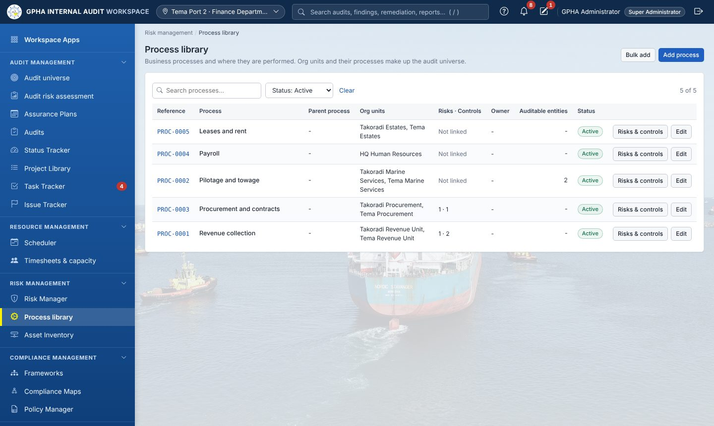{width=100%}

1. Click **Add process**.
2. Fill **Process** (required), **Description**, **Parent process**, **Process owner email**, and tick the units under **Performed in (org units)**.
3. Click **Add process**. **Result:** *"Process saved"*.

- **Bulk add** imports many processes with their units (names separated by **;**).
- **Edit** › **Status** › **Archived** retires a process (the **Status** filter **Archived** shows it again).
- **Risks & controls** › tick **Enterprise risks** and **Standard controls** › **Save links**.

Next: Audit universe (4.3).

## 4.3 Audit universe › Overview

**Where:** Audit management › **Audit universe** › **Overview**.

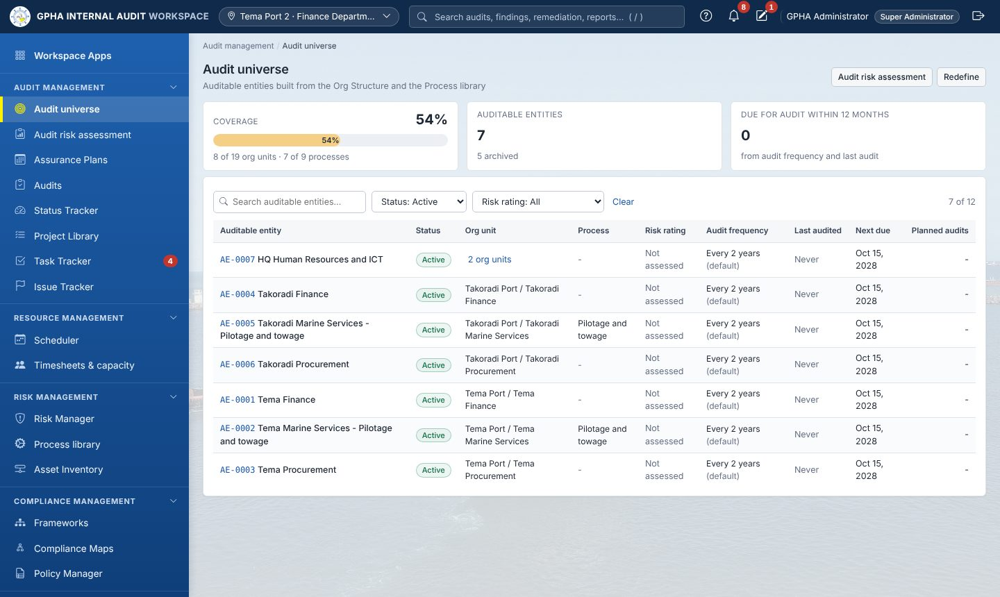{width=100%}

The four setup cards show your progress: **Review units**, **Review processes**, **Define entities**, **Assess risk**. A tick appears when a step is done. Click a card's link to go to that step. The tiles **Org units**, **Processes**, **Defined entities** and **Needs review** open the matching tab.

## 4.4 Units and Processes tabs

### Units: decide what belongs in the universe

**Where:** Audit universe › **Units**. **Who:** library editors.

1. Filter if needed (**Status: Needs review** shows the units still to decide).
2. Tick the units that belong in the audit universe and click **Include selected**. **Result:** *"Units included"*.
3. For units that do not belong, tick them, click **Not included…**, write the **Reason** and click **Save**.
4. Click a row to see the unit panel (processes, entities, audits and findings). **Reset to review** sends it back to *Needs review*.

### Processes: map each process to the units that perform it

**Where:** Audit universe › **Processes**.

1. Filter **Mapping: Unmapped**.
2. Tick one or more processes, click **Map to units**, tick the units, click **Save** (*"Mapping saved"*). To replace a single process's units, click its row instead.
3. To build an entity from processes, tick them and click **New entity** (4.5).

Next: **Continue to entities**.

## 4.5 Entities: define an auditable entity

**Where:** Audit universe › **Entities**. **Who:** library editors.

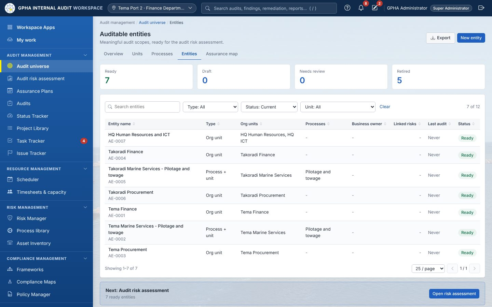{width=100%}

1. Click **New entity**. The page **New auditable entity** opens.
2. Choose **Organizational units** and/or **Processes** in the pickers (type to search, tick items).
3. Check **Entity type** (set automatically: *Org unit*, *Process* or *Process + unit*).
4. Fill **Entity name** (a name is suggested from your choices), **Business owner**, **Effective** dates, **Scope statement**, **Objectives** and **Rationale / notes**. Optionally open **Risks and controls** and tick them.
5. Set **Status**: **Draft** while you work, **Ready** when complete. **Ready needs a business owner and a scope statement.**
6. Check the **Relationships** preview on the right, then click **Save entity**.
7. If GIAW warns **Possible duplicate**, click **Save anyway** only if it really is a different entity.

**Result:** *"Entity created"*; the entity page opens. Next: set the remaining entities to **Ready**, then record other assurance providers (4.7) and run the risk assessment (chapter 5).

## 4.6 The entity page

| Item | What it does |
|----------------------------|---------------------------------------------|
| **Edit** | Opens the entity form; **Save** |
| **Start audit risk assessment** | (Ready entities) opens the assessment wizard with this entity ticked |
| **More** › **Retire** / **Reactivate** / **Delete** | Retire keeps history; Delete only if never used |
| **Overview** tab | Definition, **Audit frequency** drop-down (saves at once), relationships, scope, **Edit links** for risks and controls |
| **Risk assessment** tab | Open or latest assessment and its rating |
| **Assurance** tab | Other assurance providers (4.7) |
| **Audits**, **Findings**, **History** tabs | Past and planned audits, findings and every change |

## 4.7 Assurance map (other assurance providers)

**Where:** Audit universe › **Assurance map**. **Who:** planners (`plan.prepare` or `method.library`).

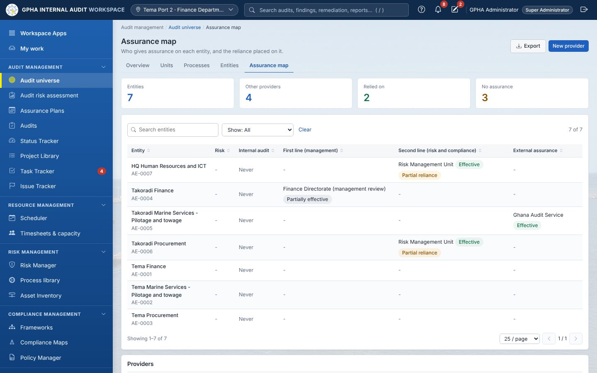{width=100%}

**Add a provider**

1. Click **New provider**.
2. Fill **Provider** (for example *Risk Management Unit*), **Line** (*First line (management)*, *Second line (risk and compliance)*, *External assurance*), **Contact**, **What it covers**.
3. Click **Save** (*"Provider saved"*). Edit a provider by clicking it in the **Providers** list (you can set it **Inactive**).

**Record what a provider covers on an entity**

1. Click the entity's row on the map (its **Assurance** tab opens) and click **Add**.
2. Choose the **Provider**; fill **What it covers**, **Last assurance**, **Next planned**, **Result** and **Reliance by Internal Audit** (**None**, **Partial**, **Full**).
3. If reliance is Partial or Full, write the **Basis for reliance (competence, objectivity, due care)** (at least 20 characters) and give **Last assurance**. Add the **Report / evidence reference**.
4. Click **Save**.

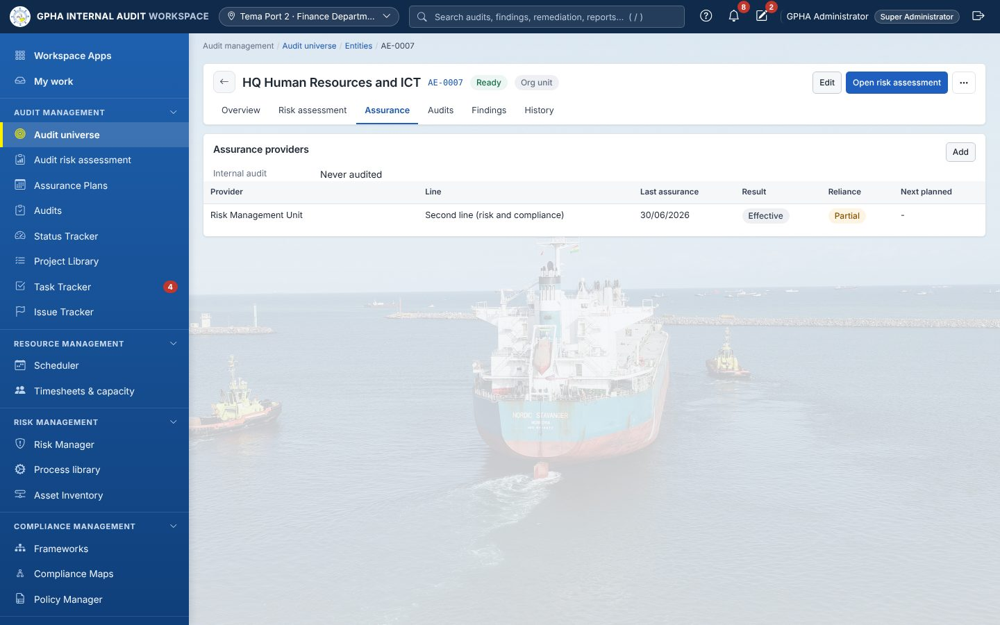{width=100%}

Use **Show: No assurance** to find entities nobody covers. Next: chapter 5.

# 5. Audit risk assessment

**Where:** Audit management › **Audit risk assessment** (tabs **Assessments** | **Settings**). **Who:** planners (`plan.prepare`, `plan.amend` or `method.library`). **Start planning** needs `plan.prepare` or `plan.amend`.

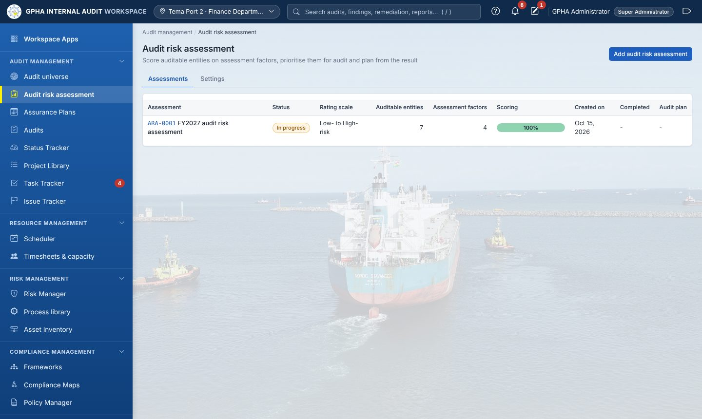{width=100%}

## 5.1 Settings (once)

1. Open **Settings**. Under **Assessment factors** click **Add assessment factor**.
2. Fill **Name**, **Description (what a high score means)** and **Scoring** (**Scored by the auditor**, or an automatic option filled from GIAW records).
3. Click **Add assessment factor**. Repeat for each factor (for example *Financial materiality*, *Fraud risk*, *Time since last audit*).
4. Check the default scale (**Low- to High-risk** or **Very low- to Very high-risk**; administrators change it).

## 5.2 Add an assessment (four-step wizard)

1. On **Assessments** click **Add audit risk assessment**.
2. **Name** (unique) › **Next**.
3. Tick **Include** for the Ready entities to assess › **Next**.
4. Tick the factors › **Next**.
5. Choose the rating scale › **Finish**. **Result:** *"Audit risk assessment added (Draft)"*; the **Scoring** tab opens.

## 5.3 Score

1. In the matrix choose a score in every cell (entity × factor). Each choice saves at once; **Overall score** and **Risk rating** update.
2. **Refresh automatic scores** fills the automatic factors again.
3. When *"N of M scores"* is complete, click **Conclude**.

## 5.4 Conclude and complete

1. Switch **Select** on for each entity to audit.
2. In **Prioritized auditable entities for audit**, drag or use **Move up** / **Move down**; **Add note** to explain a priority.
3. Write the **Conclusion** (it saves automatically and prints on the PDF).
4. Click **Mark as completed** › **Continue**. **Result:** *"Assessment completed"*; the entities get their rating. (**Revert to in progress** is possible until the assessment is linked to a plan.)

## 5.5 Start planning

1. Click **Start planning**.
2. Choose **Add audit plan** (new plan; enter **Plan year (new plan)**) or **Link to existing audit plan** (choose the draft plan).
3. Click **Generate and include**. **Result:** *"N engagement(s) added to AP-…"*. Each prioritised entity becomes a **Planned** engagement spread over Q1–Q4, and the plan opens.

Next: the planning cycle (6.2).

# 6. Assurance Plans

## 6.1 Plan list and a new plan

**Where:** Audit management › **Assurance Plans**. **Who:** Managers (`plan.prepare`) create plans; staff view them.

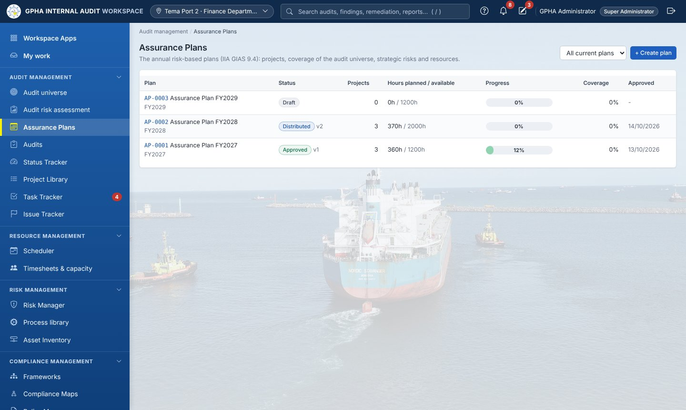{width=100%}

The list shows each plan with its status, **Projects**, **Hours planned / available** (red when over), **Progress**, **Coverage** and approval date. Click a row to open the plan.

1. Click **+ Create plan**.
2. Fill **Plan year**, **Plan name**, **Total available resources (hours)**, **Planning period from / to** and **Description / basis of the plan**.
3. Click **Create plan**. **Result:** *"Plan created"*; status **Draft**. (You may also have created the plan through **Start planning**, 5.5.)

**The plan page**

- **Header:** **Edit** (Draft only), **Revise plan**, **Close year**, **Archive** and print. Under the title, the status bar shows **Draft › In Review › Submitted › Approved › Distributed › In Execution › Closed**. Click it to open **Approval & launch**.
- **Tabs:** **Overview | Projects | Objectives | Narratives | Coverage | Strategic risks | Resources | Approval & launch | Change requests | Activities**.

**Overview** (the annual programme at a glance):

- **Getting started** lists the lifecycle and the next step: define the audit universe, assess and prioritise risk, create the plan, add projects, approve and launch, perform the audits.
- **Key metrics:** **Projects in the plan** (of the maximum, 100 by default: Configuration › Plan configuration), **Strategic risks aligned**, **Entity coverage** and **Allocated hours** against the available hours.
- **Projects and strategic alignment:** each project's progress, phase, the strategic risks it addresses and its assignees.
- **Coverage by entity category**, with **View by entity**.
- **Strategic risks:** Risk Manager risks linked to the plan's entities or audit risks, with their impact and the strategic objective they threaten.
- **Resources and progress:** planned against available hours, hours charged and overall plan progress.

**How progress is counted:** each project's phases are scored *not started* 0, *in process* 1 or *completed* 2. The phases are the planning memo, each fieldwork step (process narratives, risk & control matrix, walkthroughs, test plan, testing; or work programme and execute procedures) and the report. Progress is the total divided by twice the number of phases; a closed audit is 100%.

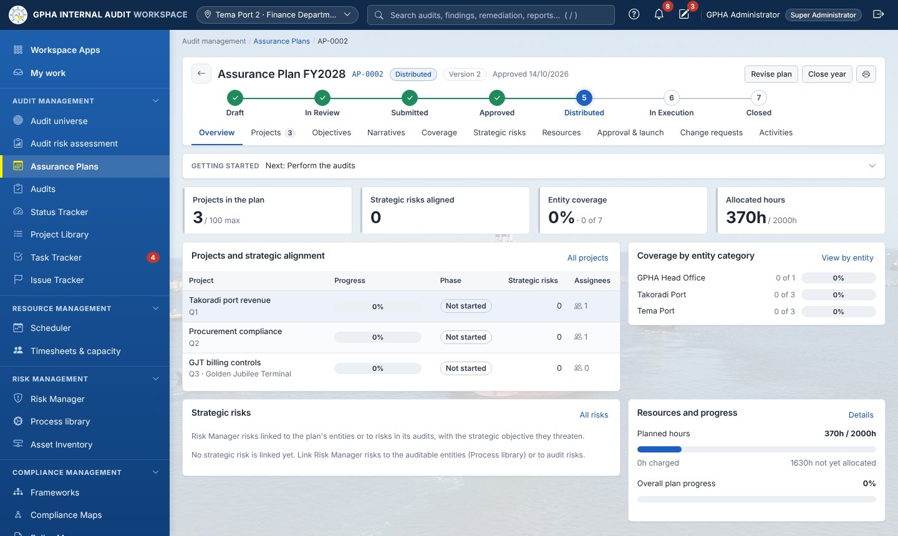{width=100%}

## 6.2 The planning cycle, step by step

The **Annual planning cycle** card on **Approval & launch** shows the next button. Steps must be done in order; out of order GIAW says *"The plan is at '<stage>'; this step belongs to '<stage>'"*.

**Step 1 — Planning preparation** (Manager)

1. Click **Complete preparation**.
2. Tick all five items: *Internal Audit strategy and objectives reviewed*, *Prior-year plan results and open findings reviewed*, *Management and stakeholder concerns gathered*, *Staff, skills and available hours confirmed*, *Regulatory and Board requirements noted*. Add **Notes (strategy themes, key inputs)**.
3. Click **Complete preparation**. **Result:** *"Preparation recorded"*.

**Step 2 — Risk / universe review** (Manager)

1. Click **Record universe review**. The dialog shows the units by risk and those due under the audit cycle. (**Open Audit Universe** if ratings need updating.)
2. Write **Review notes** (at least 10 characters) and click **Record review**. **Result:** *"Universe review recorded"*.

**Step 3 — Audit Managers' planning meeting** (Manager)

1. Click **Record planning meeting**.
2. Fill **Meeting date**, **Attendees**, **Minutes / what was agreed**. Click **Save meeting**. **Result:** *"Planning meeting recorded"*.

**Step 4 — Draft the plan** (Manager): add and adjust engagements (6.3), then:

1. Click **Submit for internal review**, add **Notes for the reviewer**, click **Submit**. **Result:** *"Submitted"*; status **In Review**; the GM Audit is notified.

**Step 5 — Internal review** (GM Audit; never the preparer)

- **Approve:** click **Approve (e-sign)** › **Decision: Approve** › **Password** › **Sign & Approve**. Status **Submitted**.
- **Return:** click **Return with comments** › **What needs to change** › **Return to preparer**. Status **Returned**; the preparer edits and resubmits (Step 4).

**Step 6 — Submission** (GM Audit)

1. Click **Record submission**.
2. Fill **Approving authority** (default *Audit Committee*), **Date submitted**, **Submission reference / memo no.**, **Notes**. Click **Record submission**.

**Step 7 — Audit Committee decision** (GM Audit records it)

1. Click **Record Committee decision**.
2. Choose **Decision** (*Approved*, *Approved with amendments*, *Deferred*, *Returned for revision*); fill **Meeting date**, **Minute / resolution reference** and, for amendments, **Committee comments / amendments**.
3. Click **Record decision**. **Result:** if approved, *"Approved version N frozen"*, status **Approved**. *Deferred* keeps it at the Committee; *Returned* sends it back to Step 4.

**Step 8 — IAA submission record** (GM Audit)

1. Open **Approval & launch**. **Controlled copy** downloads the Word copy of the version.
2. In the *Internal Audit Agency* column click **Record IAA submission**, fill **Date submitted** and **Letter / submission reference**, click **Record submission**. **Result:** *"IAA submission recorded"*.

**Step 9 — Distribution** (GM Audit)

1. Click **Distribute approved plan**.
2. Under **Destinations** tick the sites (HQ, each port). A site showing *NOBODY REGISTERED* has no PIA or Audit Manager with that site as **Where I work**: fix that first (1.7).
3. Optionally tick **Also send a copy to**, write a **Covering note**, click **Distribute**. **Result:** *"Plan distributed"*; status **Distributed**; recipients are notified.

**Step 10 — Acknowledgement** (each recipient): open the plan and click **Acknowledge receipt**. The **Distribution** table shows who has acknowledged.

**Step 11 — Execution:** engagements can now be started (6.5). Status becomes **In Execution** with the first start. At year end the GM Audit uses **Close year** (refused while audits are open) and then **Archive**.

## 6.3 Adding projects to the plan

**Where:** plan › **Projects** › **+ Add to plan**. **Who:** Managers (`plan.prepare`); only while the plan is Draft. A panel offers three ways:

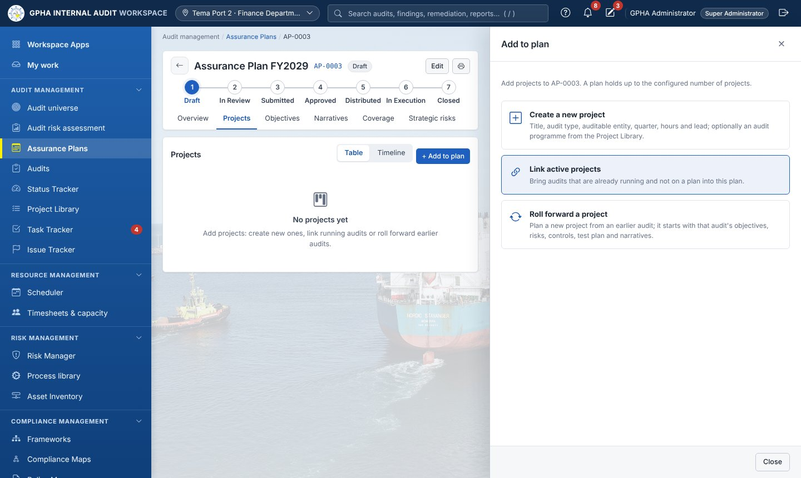{width=100%}

**Create a new project**

1. Fill **Project title**, **Audit type** (decides the fieldwork workflow and whether it is advisory), **Auditable entity**, **Responsible site (HQ / port)**, **Quarter**, **Budget hours**, **Lead auditor**, **Audit programme (Project Library)** (optional) and **Rationale**.
2. Click **Add**. The panel shows *"Saved"*; click **Close**. On each row use **Edit** or **Remove**.

**Link active projects:** tick audits that are already running and not on a plan, choose the **Quarter**, click **Done**.

**Roll forward a project**

1. Choose the **Audit to roll forward** (any earlier audit), then fill **New project title**, **Quarter**, **Budget hours** and **Lead auditor**.
2. Click **Save and roll forward**. The project keeps the earlier audit's entity, audit type and site.

**What the audit receives when the project starts:**

- a **rolled-forward** project receives the earlier audit's objectives, risks, controls with their test plan, and narratives (not its results);
- a project with an **audit programme** receives the programme's objectives, risks, controls and test steps;
- otherwise the **auditable entity's** linked risks and controls are scoped in.

Other things you can do here:

- **Table / Timeline** switches the view; the timeline can group by site, quarter, lead or status.
- **Exclude from audit plan** removes a linked audit from the plan (the audit is kept).
- On an approved plan, **Link active projects** needs a reason and the GM Audit; other changes go through a change request (6.6).

## 6.4 Objectives, narratives, coverage, strategic risks and resources

- **Objectives:** every engagement objective of the plan's audits, with the audit, lead, target, and counts of risks, controls and narratives. **+ New objective** adds one to a started audit; **Add risk / control** opens the audit's risk & control matrix. Objectives live inside each audit (IIA GIAS 13.3).
- **Narratives:** the process narratives of the plan's Internal Control audits. **Import narrative** › choose a **.docx**, **.xlsx** or **.txt** document, the **Objective (audit)** and optionally a **Narrative title** › **Import**. The document's text becomes the narrative.
- **Coverage:** **Show coverage in** **Entities** (one column per auditable entity) or **Categories** (one column per entity category). Use **Entity category** and **Entities not covered** to filter.
- **Strategic risks:** Risk Manager risks addressed by the plan, with their impact, how many projects address each and their average progress. Below them, every auditable entity by risk and whether it is covered.
- **Resources:** planned against available hours (red when over), hours by quarter, budget against hours charged per project, and hours by lead auditor.

## 6.5 Starting a project

**Who:** Auditors and Managers (`audit.create`). The plan must be approved and distributed.

1. On a **Planned** engagement row click **Start**.
2. **Result:** *"Audit project created"*. The audit opens on its **Overview** with the planned lead as **Lead auditor** and you as **Auditor**; scope and plan links are filled in. The row now shows **Open audit**.

Next: chapter 9.

## 6.6 Changing an approved plan (plan change request)

**Where:** plan › **Change requests** › **New change request** (or **Request a change** on **Projects**). **Who:** Managers, PIAs, Audit Managers.

1. Fill **Title** and **Reason for the change**.
2. Under **Affected plan items**, for each item choose **Change** (*Add an engagement*, *Change an engagement*, *Cancel an engagement*), the **Engagement**, and the new **Title**, **Auditable unit**, **Responsible site**, **Quarter**, **Budget hours**, **Lead**. **Add item** for more.
3. Click **Preview impact**: hours before and after, engagements, coverage, high-risk units losing coverage, hours by lead and quarter.
4. Click **Submit for review**. Status **Submitted**.
5. **Reviewer** (another manager): open it › **Endorse** (optionally tick *Treat as significant*) or **Return** with what needs to change.
6. **GM Audit:** **Approve / reject (e-sign)** › **Sign**. Minor changes are applied at once; significant changes wait for the Committee.
7. **Committee (significant):** GM Audit clicks **Record Audit Committee decision** › **Decision**, **Meeting date**, **Minute / resolution reference** › **Record decision**.

**Result:** the engagements change, a new version is frozen and re-distributed, and recipients acknowledge again.

**Full revision instead:** **Revise plan** › **Reason for the revision** › **Reopen for revision**; the plan repeats Steps 4 to 9.

# 7. Scheduler and timesheets

## 7.1 Scheduler

**Where:** Resource management › **Scheduler**. **Who:** resource managers and planners book.

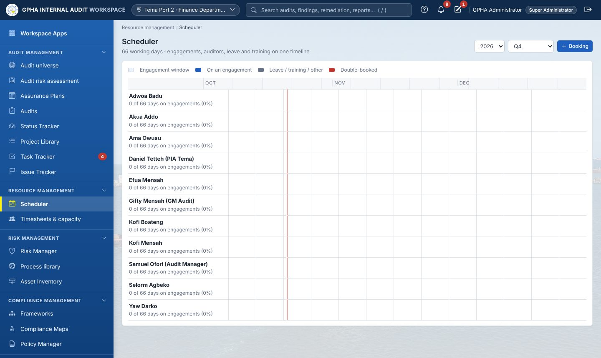{width=100%}

1. Choose the year and **Whole year** or a quarter.
2. To book someone: **+ Booking** › **Auditor**, **Kind** (*Engagement*, *Leave*, *Training*, *Other work*), **Engagement**, **Role on the engagement**, **Description**, **From**, **To**, **Hours**, **Notes** › **Book**. Overlaps are allowed but warned (*"Saved, but A and B overlap…"*) and shown in red.
3. To set fieldwork dates: click an engagement bar (or a row under *Engagements without dates*) › **Start**, **End**, tick **Book the lead auditor for these dates** › **Save dates**. Dates must stay inside the planned quarter; to move quarters raise a plan change request (6.6).

## 7.2 Timesheets & capacity

**Where:** Resource management › **Timesheets & capacity**.

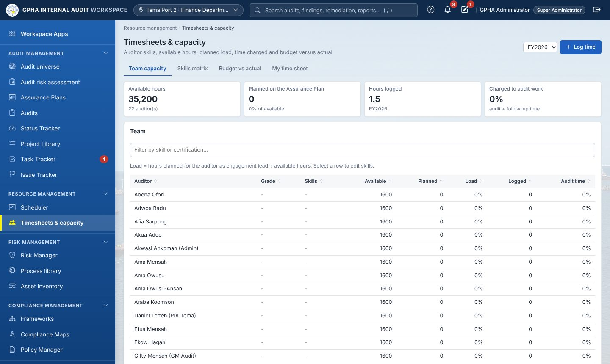{width=100%}

1. Click **Log time**.
2. Fill **Date**, **Hours** (quarter hours, for example 1.25), **Category** (*Audit*, *Follow-up*, *Training*, *Administration*, *Leave*, *Other*), **Audit** (required for Audit and Follow-up), **Work done**.
3. Click **Save time**. A day cannot exceed 24 hours.

Managers also use **Team capacity** (available, planned and logged hours; load turns amber above 85 %), **Skills matrix** and **Budget vs actual**. Click a person to edit **Grade / position**, **Available hours per year**, **Skills** and **Certifications** › **Save profile**.

# 8. Audits list and creating an audit

**Where:** Audit management › **Audits**. **Who:** everyone sees the audits in their port and engagement teams; **New audit** needs `audit.create` (Auditors, Managers).

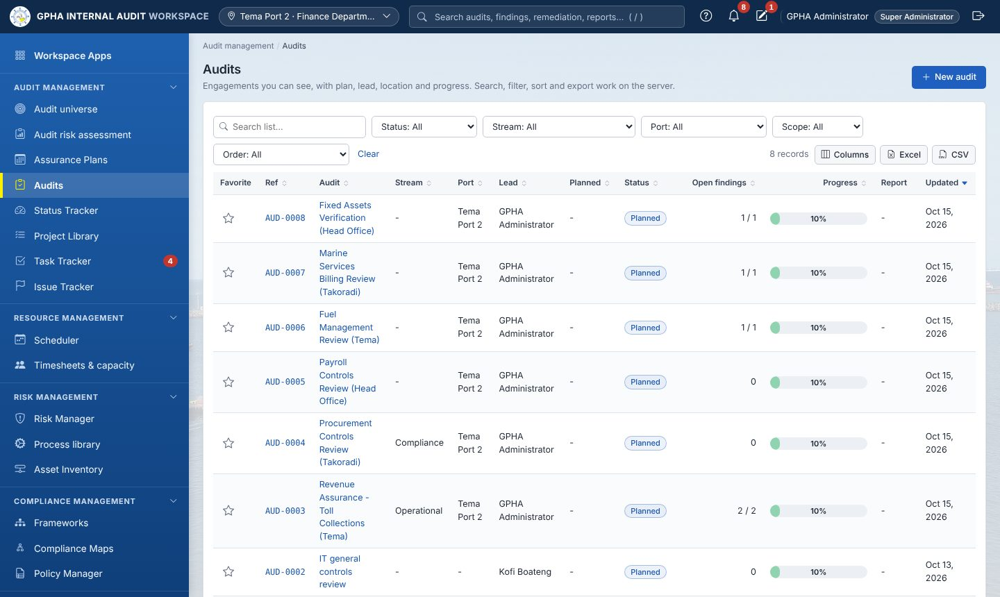{width=100%}

The list is the engagement register. Each row shows the **Ref** (with the favourite star), the **Engagement** (with its nature, *Assurance* or *Advisory*, and audit type underneath), **Lead auditor**, **Planned period**, **Phase**, **Status**, **Open findings** (with how many are rated High), **Report** and **Progress**. **Columns** adds **Nature**, **Audit type**, **Port**, **Plan** and **Updated**.

**Phase** places each audit in the IIA cycle: **Plan** (GIAS 13, status Planned), **Perform** (GIAS 14, In Progress), **Communicate** (GIAS 15.1, Review), **Monitor** (GIAS 15.2, closed with findings still open) and **Completed**.

1. Filter with **Status** (*Planned*, *In Progress*, *Review*, *Closed*), **Audit type**, **Port**, **Scope: My port**, **Order: Show favorites first**, or type in the search box.
2. Click a row to open the audit. Click the star to mark a favourite.

**Creating an audit outside the plan** (normally audits are started from the plan, 6.5):

1. Click **+ New audit**.
2. Fill **Title**, **Audit type**, **Port** (defaults to yours), **Scope**, **Description / background**.
3. Click **Create**. **Result:** *"Audit created"*; status **Planned**; you are the **Lead auditor**. The audit type decides the workflow (*Workplan* or *Internal Control*) and whether the engagement is **Advisory**.

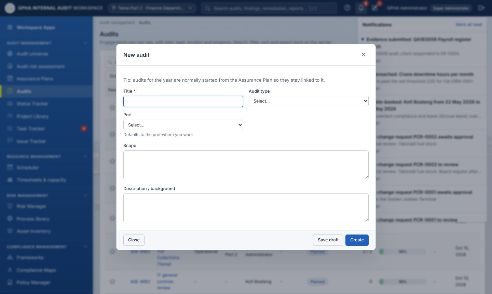{width=90%}

# 9. The audit page: set-up, planning and closing

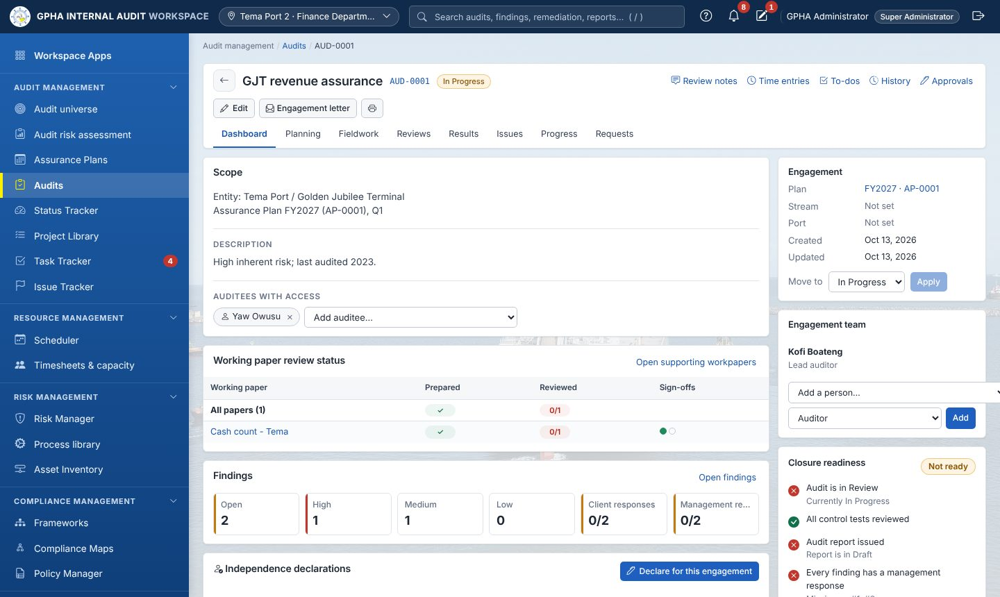{width=100%}

## 9.1 Header, tabs and side panel

| Item | Use |
|----------------------------|---------------------------------------------|
| **Edit** | Change title, type, port, scope (*"Audit saved"*) |
| **Engagement letter** | Downloads the Word letter to the auditee |
| Printer icon | Prints the page |
| **Submit for approval** | (status Review) marks the audit *In Approval* |
| **Close (e-sign)** | (status Review, GM Audit) closes the audit (9.5) |
| Phase tracker | **Plan (GIAS 13) › Perform (GIAS 14) › Communicate (GIAS 15.1) › Monitor (GIAS 15.2)**. The current phase is highlighted; click a phase to open its tab |
| Tabs | **Overview · Planning · Fieldwork · Findings · Report · Supervision & review · Evidence requests · Progress · Feedback survey** |
| Utility links (right) | **Review notes** (10.8), **Time entries** (10.12), **To-dos**, **History**, **Approvals** |
| Side panel | **Engagement** facts (Plan, Audit type, Nature, Port), **Move to**, **Engagement team**, **Closure readiness** |

The tab names can differ slightly for some audit types (set by administrators).

## 9.2 Overview: auditees and the engagement team

**Give auditees access** (do this before any evidence request)

1. In the **Scope** card, under **Auditees with access**, open **Add auditee...** and choose the person. **Result:** *"Access granted"*.
2. To remove someone, click **×** on their name (*"Access removed"*).

**Build the engagement team** (Lead auditor or Manager)

1. In the side panel **Engagement team**, choose **Add a person…** and a role: **Auditor**, **Reviewer** or **Lead auditor**.
2. Click **Add**. **Result:** *"Team updated"*. If GIAW shows *"Objectivity: …"* in red, the person has a rotation or cooling-off flag (9.3).
3. Choosing a new **Lead auditor** makes the previous lead an Auditor. To remove a member click **×** › **Remove**.

Each member shows a chip: **Not declared**, **Conflict pending review**, **Reassigned**, **Declared** or **Cleared**, and any red flag such as *"Led audits of this entity in the previous 3 consecutive years (rotation after 3)"* or *"Worked in Tema Finance as Accounts officer until 30 Jun 2026 (cooling-off 12 months)"*.

## 9.3 Independence declarations for the engagement

**Who:** every team member.

1. On the Overview, in **Independence declarations**, click **Declare for this engagement**.
2. Tick *I confirm my independence and objectivity as stated*, *I will comply with the Code of Ethics and the Standards*, *I will keep information confidential (Act 658 s.20)*.
3. If you have a conflict or a rotation / cooling-off flag, also tick *I have a relationship, interest or circumstance to disclose* and write the **Details of the conflict or impairment**.
4. Click **Sign declaration**. **Result:** *"Declaration signed"*, or *"Signed - your disclosure was sent for review"*.

**Reviewer** (`proficiency.manage`, not the declarer): Quality (QAIP) › **Professional practice** › **Team** › *Disclosures awaiting your review* › click the row › **Decision: Cleared** (with safeguards) or **Reassigned** › **Safeguards / reasons** › **Record review**. A cleared conflict lifts the flags; a reassigned member must be replaced on the team.

While the audit is Planned, a box *"Before fieldwork can start:"* lists what is still missing.

## 9.4 Moving the audit through its statuses

**Where:** side panel › **Move to** › choose › **Apply** (*"Status updated"*).

| From | To | Condition |
|------------------|------------------|---------------------------------------------|
| Planned | **In Progress** | Planning memo approved (9.6) and all declarations complete (9.3) |
| In Progress | **Review** | Fieldwork done; report on its way |
| In Progress | Planned | Back to planning |
| Review | In Progress | More work needed |
| Review | Closed | Only by **Close (e-sign)** (9.5) |

When fieldwork starts, auditees are told *"Audit fieldwork has started"*.

## 9.5 Closure readiness and closing the audit

The **Closure readiness** card lists: *Audit is in Review*, *All control tests reviewed*, *Audit report issued*, *Every finding has a management response*, *Every open High/Medium finding has an agreed action* (optional for advisory work), *All review notes cleared*. Each must be green (items marked *not required by configuration* are skipped).

**Who closes:** the GM Audit (`audit.close`), never the preparer.

1. With the audit in **Review**, click **Close (e-sign)**.
2. Type **Password** and **Comment**, click **Sign & Close**. **Result:** status **Closed**; the entities' last-audit date is updated (not for advisory work) and auditees are invited to the **Feedback survey**.

## 9.6 Planning tab: the planning memo

**Who:** the team writes it (`audit.plan`); an Audit Manager, PIA or the GM Audit approves it (`audit.memo_approve`), never the preparer.

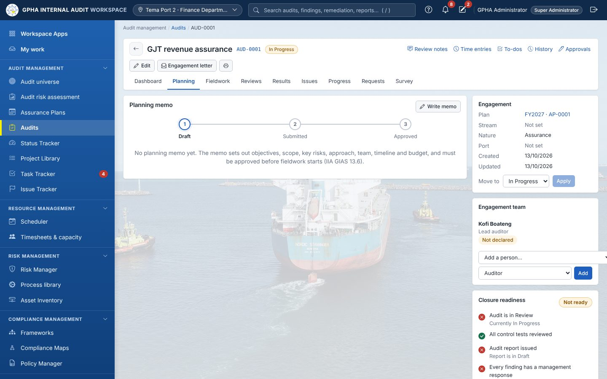{width=100%}

1. Open **Planning** and click **Write memo** (later **Edit memo**).
2. Fill **Background**, **Objectives**, **Scope**, **Key risks**, **Approach and work programme**, **Engagement team**, **Fieldwork start**, **Fieldwork end**, **Budget (hours)**.
3. Click **Save memo** (*"Planning memo saved"*). **Word** downloads it.
4. Click **Submit for approval** (enabled when every required section is filled; its tooltip lists what is missing). **Result:** *"Memo submitted for approval"*; Audit Managers and the GM Audit are notified.
5. **Approver:** opens the memo › **Review & sign** › **Decision** (**Approve** or **Reject (return for rework)**) › **Password** › **Sign**. Approved: the preparer is told *"Fieldwork can start."* Returned: the memo shows *"Returned by the reviewer: …"*; edit and submit again.
6. Send the **Engagement letter** (header) to the auditee.

Next: Overview › **Move to** › **In Progress** (9.4), then the **Fieldwork** tab (chapter 10).

# 10. Fieldwork

**Where:** audit › **Fieldwork**. **Who:** the team (`audit.fieldwork`). The work locks when the audit is closed.

The Fieldwork tab is laid out as the numbered steps of the IIA Global Internal Audit Standards. Each step in the step bar shows its progress (for example *"1 of 2 walked through"*, or a warning such as *"1 risk without a control"*); a green tick means the step is complete. The page opens on the first step not yet complete. Under the step bar, each step names its standard and says what to do. Counts appear as one short line, and only for what exists.

| Step (Internal Control) | Standard | What you do |
|-------------------------------|-----------|-----------------------------------------------|
| 1 **Process narratives** | GIAS 13.2 | Describe how the process works |
| 2 **Risk & control matrix** | GIAS 13.2–13.4 | Rate the risks to each objective; map the controls |
| 3 **Walkthroughs** | GIAS 14.1 | Test of design: is each control designed to address its risk? |
| 4 **Test plan** | GIAS 13.6 | Method, sample size and attributes for each key control |
| 5 **Testing** | GIAS 14.2–14.3 | Test operating effectiveness; exceptions become findings |

The **Workplan** workflow has two steps: 1 **Work programme** (GIAS 13.3–13.6) and 2 **Execute procedures** (GIAS 14.1–14.2).

## 10.1 Approach

The **Approach** line at the top shows the workflow, the testing rounds and the auditable entities. Click it to open the settings:

1. **Workflow:** choose **Workplan** (objectives › risks › procedures › execute) or **Internal Control** (narratives, risk & control matrix, walkthroughs, test plan, testing). It locks once work exists.
2. **Testing rounds** (Internal Control): **1 round** (*Testing*), **2 rounds** (*Interim*, *Final*) or **4 rounds** (*Q1–Q4*).
3. **Choose entities** › tick › **Save**; **Scope from entities** › **Add N item(s)** copies their risks and controls.
4. **Apply audit programme:** choose a **Programme** from the Project Library › **Apply**. Objectives, risks, controls and test steps (or procedures) are added.

## 10.2 Step 1: Process narratives

1. If there are no objectives yet, click **Add objective** › **Objective**, **Description** › **Add** (the engagement objectives, GIAS 13.3).
2. Click **Add new narrative** › **Objective**, **Title**, **Description**, **Controls described in this narrative** › **Add narrative**.
3. Click a narrative to **Edit**, sign off or **Delete Narrative**.

## 10.3 Step 2: Risk & control matrix

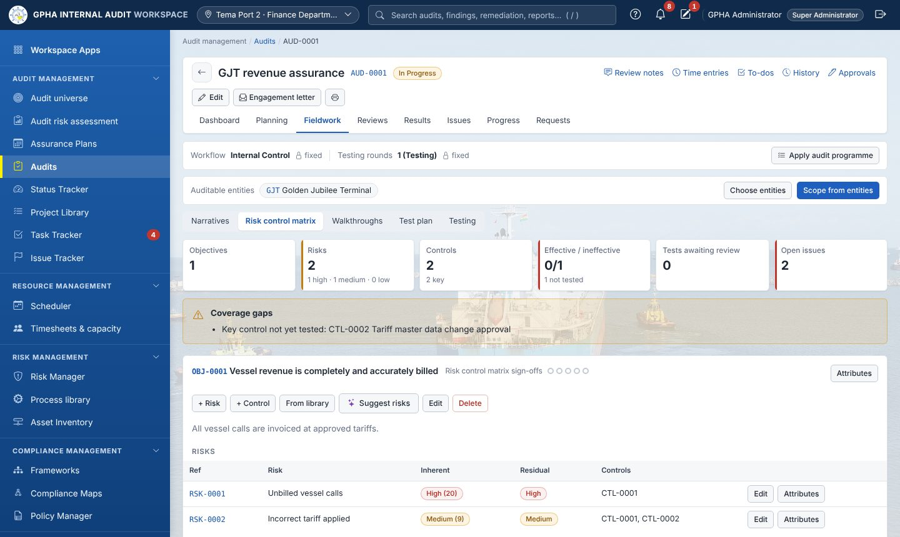{width=100%}

Each objective is one matrix, in the IIA format: a row for each risk and each control that mitigates it. Columns: **Risk**, **Inherent** rating, **Control** (with its owner), **Key**, **Type** (with nature and frequency), **Design** (from the walkthrough: *Adequate*, *Deficient* or *Not assessed*), **Operating** (from testing: *Effective*, *Ineffective* or *Not tested*) and **Residual** rating. A risk with no control shows *No mitigating control*; a control not linked to a risk is listed under *Not linked to a risk*.

1. Click **Add objective** › **Objective**, **Description** › **Add**.
2. On the objective click **+ Risk** › **Risk**, **Likelihood** (1–5), **Impact** (1–5), **Tests enterprise risk (Risk Manager)**, **Description** › **Save** (*"Risk saved - inherent High (16)"*).
3. Click **+ Control** › **Control**, **Control owner email**, **Type** (*Preventive / Detective / Corrective*), **Nature** (*Manual / Automated / IT-Dependent Manual*), **Frequency**, **Key control**, **Mitigates risks** (at least one), **Control description** › **Save**.
4. Click a risk or control in the matrix to edit it; the sliders icon opens its attributes.
5. **Suggest risks** (when AI is on): tick suggestions › **Add ticked risks**.
6. The **⋯** menu on the objective: **Add controls from the library** (filter, tick, optionally *Map them to these risks*, **Add to matrix**), **Edit objective**, **Objective attributes**, **Delete objective**.

A banner lists *Risks without a mitigating control*.

## 10.4 Steps 3 and 4: Walkthroughs and test plan

1. **Walkthroughs** › **Start walkthrough** (or **Open**) on a control. Record the walkthrough and give the **Design conclusion** (*Designed appropriately* / *Design failure*).
2. **Test plan** › **Edit** on a control › **Testing method** (*Inquiry, Observation, Inspection, Re-performance, Data analytics*), **Total sample size** (blank uses the default for the frequency), **Test steps / attributes** › **Save**. The table shows **Method**, **Sample size** and **Attributes to test**.

## 10.5 Step 5: Testing

1. Open **Testing**. With 2 or 4 rounds, choose the round (for example **Interim**) above the table. If key controls have no test yet, click **Prepare <round> round** (*"N test(s) prepared"*).
2. On each row: tick **Tested this round?**, set **Assigned** (a team member), click **Open**.
3. In the test: fill **Population size**, click **Draw random sample** (or enter **Sample size**), record **Exceptions found**, **Results / exceptions noted**, choose **Conclusion** (*Effective / Ineffective*) and **Status** (*Completed*). Click **Save**.
4. Sign the test (10.8). The reviewer signs next in the sign-off chain; the last level marks it *Reviewed*.
5. If the conclusion is **Ineffective**, click **Raise issue**. **Result:** the finding appears on the **Findings** tab (chapter 11).
6. The paperclip **Request evidence** asks the auditee for documents for that test (10.7).

GIAW checks: the sample cannot exceed the population; an ineffective conclusion needs exceptions; exceptions mean the control cannot be *Effective*.

## 10.6 Workplan procedures

1. **Work programme** › **Add objective** › on it **+ Risk** and **+ Procedure** › **Procedure**, **Steps**, **Risks addressed**, **Assigned to** (team members only), **Due date** › **Add procedure**.
2. **Execute procedures** › filter **Assigned: Me** › click a row.
3. Fill **Procedure results**, answer **Were issues identified?** (*No Issues* / *Issue(s) noted*).
4. Click **Save and sign-off** (*"Signed off as Preparer"*), or **Save**. If issues were noted, click **Raise issue**.
5. Set the **Next Reviewer** (10.8).

## 10.7 Evidence requests: asking the auditee for evidence

**Who:** auditors (`audit.evidence`). The auditee must be on **Auditees with access** (9.2).

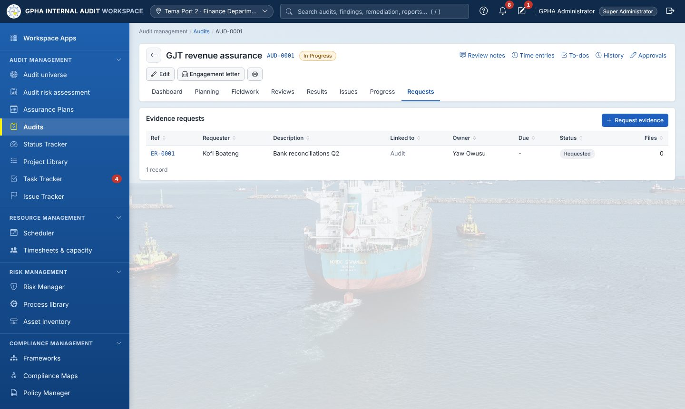{width=100%}

1. Open **Evidence requests** › **+ Request evidence** (or the paperclip on a test or procedure).
2. Fill **What is needed**, **Description (period, format, sample)**, **Owner (provides the evidence)**, **Due date**, **CC**, **Reminder** (*Send now only*, *…then a daily reminder*, *…weekly reminder*) and **Message**.
3. Click **Send request**. **Result:** *"Evidence requested - the owner has been notified"*.

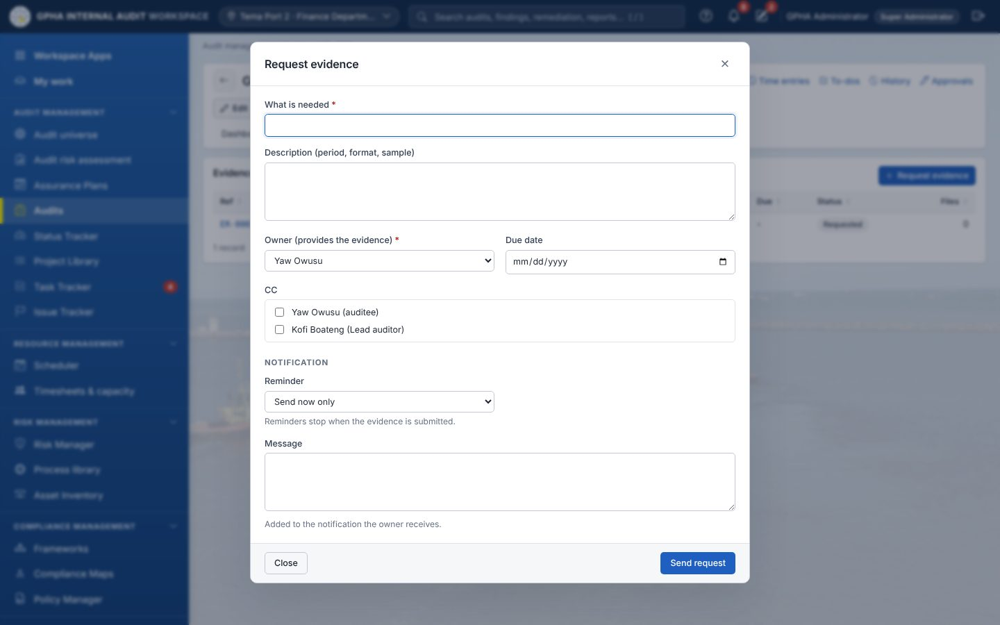{width=100%}
4. **Auditee:** opens it (Task Tracker › Priorities › **Provide evidence**) › **Add a file** › **Upload** (repeat) › **Response** › **Submit**.
5. **Auditor:** opens the submitted request › **Comment** › keep *File accepted documents as working papers* ticked › **Accept**, or **Return for more** (comment required).
6. While open, staff can change the reminder, **Send reminder now** or **Cancel request**.

## 10.8 Sign-offs and review notes

**Sign-offs on a page** (procedure, test, test plan, narrative, matrix, finding): click the sign-off circles (**Open sign-offs**).

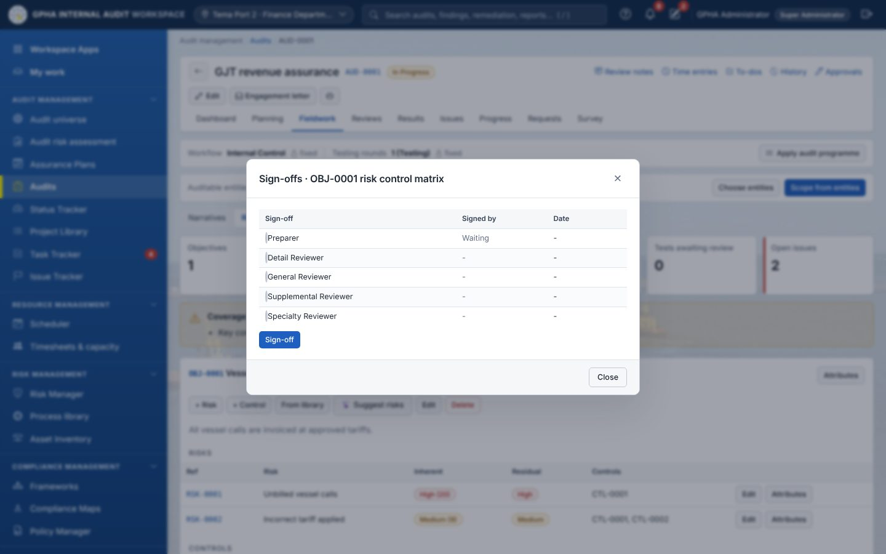{width=90%}

1. **Preparer:** click **Sign-off**. A test needs a conclusion first.
2. Choose the reviewer in **Next Reviewer…** and click **Set and Notify Reviewer** (*"Reviewer notified"*).
3. **Reviewer:** opens it from **My work** › **Sign-off as Detail Reviewer** (then the next level, as configured). The last level marks the page *Reviewed*.
4. A manager may use **Override Sign-off (<level>)** if the named reviewer is away.
5. To change a signed page, the signer (or an Audit Manager) clicks **×** › **Remove**; later sign-offs are removed too.

**Review notes** (utility link **Review notes**)

1. **Reviewer:** **Raise review note** › **About** (*The audit as a whole*, a working paper, test or finding) › **Note to the preparer** › **Raise note**.
2. **Preparer:** **Answer** › **Your answer** › **Send answer**.
3. **Reviewer:** **Clear**. Open notes block closing the audit.

## 10.9 Supervision & review tab: engagement quality review

**Who:** an auditor who did not prepare the audit; audit in Review or Closed.

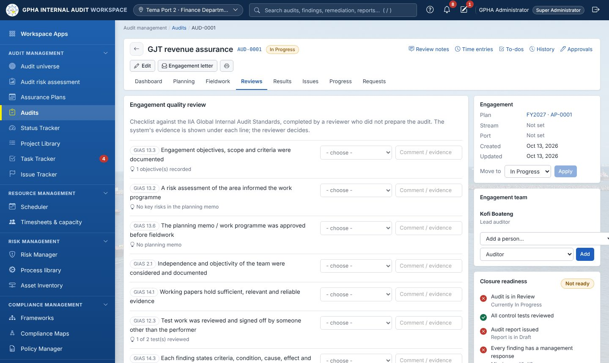{width=100%}

1. For each IIA standard line choose *Conforms*, *Partially conforms*, *Does not conform* or *N/A*, with **Comment / evidence** (required for partial or non-conformance).
2. Write the **Overall conclusion**.
3. Click **Save**, then **Complete review** (*"Quality review completed"*). The badge shows *N% conformance*.

## 10.10 Working papers

**Where:** audit › **Report** › *Supporting workpapers*. **Who:** `audit.workpapers` or `audit.fieldwork`.

1. Enter a **Title**, optionally choose a **File**, click **Create working paper**. Using an existing title creates a new version.
2. **Form** opens the GPHA working paper template: **Fill in / edit** › **Save form**; **Print**.
3. **Cross-ref** links the paper to a test or finding (**Working-paper reference**, **Supports test**, **Supports finding** › **Save**).
4. Review: each chain level clicks **Sign off as <level>** (Unit Head › Audit Manager › PIA). Editing a signed paper restarts its review.

## 10.11 Progress tab

Shows procedures completed, time to deadline, budget against time spent, the **Fieldwork status** (sign-offs per page) and the **Progress board** (*Not started › Prepared › In review › Signed off*).

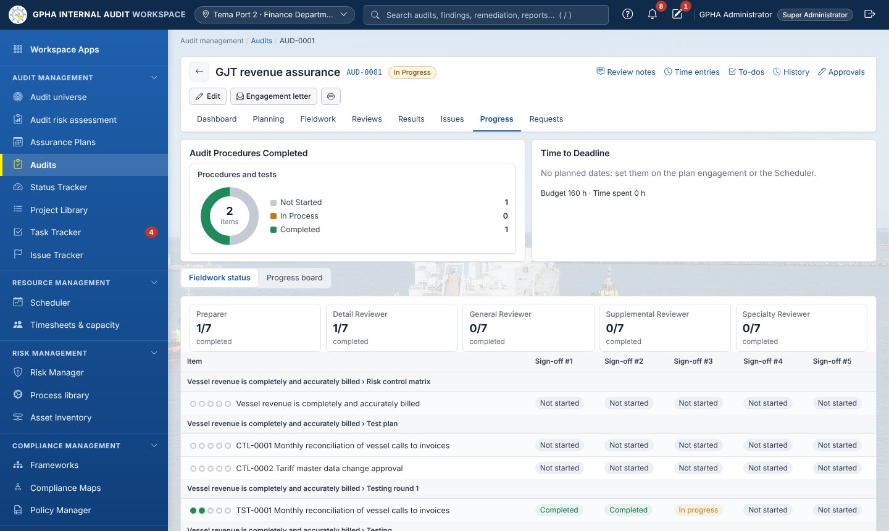{width=100%}

## 10.12 Time entries

Utility link **Time entries** › **+ Log time** › **Date**, **Hours**, **Category**, **Audit**, **Work done** › **Save time**. The card shows budget, hours charged and remaining hours.

# 11. Issues (findings)

**Where:** audit › **Findings** (and across audits in **Issue Tracker › Issues**). **Who:** auditors (`audit.findings`) while the audit is not closed; auditees see published issues only.

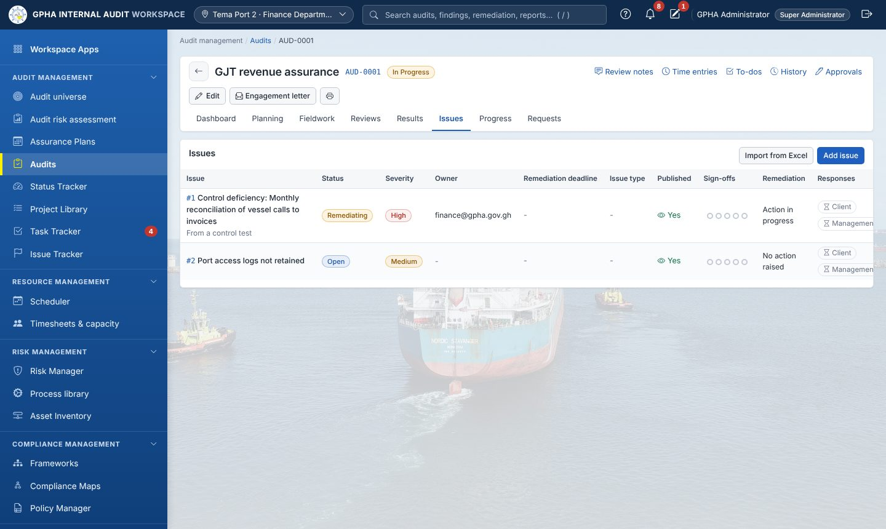{width=100%}

## 11.1 Raise an issue

1. Click **Add issue** (or **Raise issue** from a test or procedure, which pre-fills it).
2. Fill **Title/Headline**, **Severity** (*Low / Medium / High*), **Issue type**, **Status** (*Open*), **Owner** (e-mail of the responsible manager), **Criteria (what should be)**, **Condition (what was found)**, **Recommendation**. Under *Show more*: **Effect (Risk / Impact)**, **Cause**, **Root cause - 5 Whys**, **Additional notes**.
3. Click **Create** (*"Finding created"*).

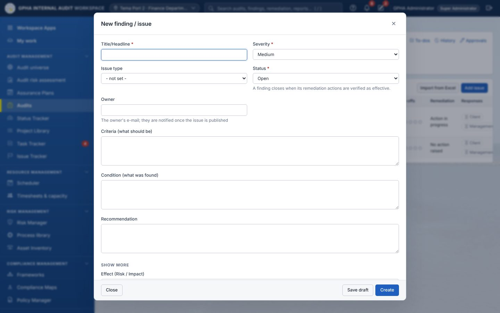{width=100%}

Many issues at once: **Import from Excel** › **Download the template** › fill › choose the file › **Import**.

## 11.2 Review and publish

1. Open the issue: the header says *"Not published - the auditee cannot see this issue yet"*.
2. Have it reviewed: **Sign-offs** (the preparer cannot review their own issue).
3. Click **Publish** (*"Published - the owner has been notified"*), or publish all with **Publish N to the auditee**. Sending the draft report to management or recording the exit meeting also publishes the issues.

## 11.3 Management response (auditee)

1. The auditee opens the issue (from the notification, Priorities or the audit's **Findings** tab).
2. Under *Responses (GPHA working paper template)* fill **Audit client response (Head of Department)**, **Management response - action plan**, **Responsible officer** and **Target date**.
3. Click **Save**. **Result:** the report records that a response was received; the open action takes the target date and owner.

Audit staff tick **Confirmed at the exit meeting** when the client response is agreed; it is then locked.

## 11.4 Raise the remediation action

1. On the issue click **Raise remediation**. **Result:** *"Action REM-… raised"*; the issue becomes *Remediating*. The due date is the target date, or by severity (High 30, Medium 60, Low 90 days).
2. The issue closes by itself when its last action is closed after validation (chapter 13).

**Issue Tracker › Issues** lists every issue you can see, with charts **By Issue Type**, **By Severity**, **At a glance**, filters (Status, Severity, Owner, Issue type, Published, Deadline, Entity) and the **KPIs** sub-tab.

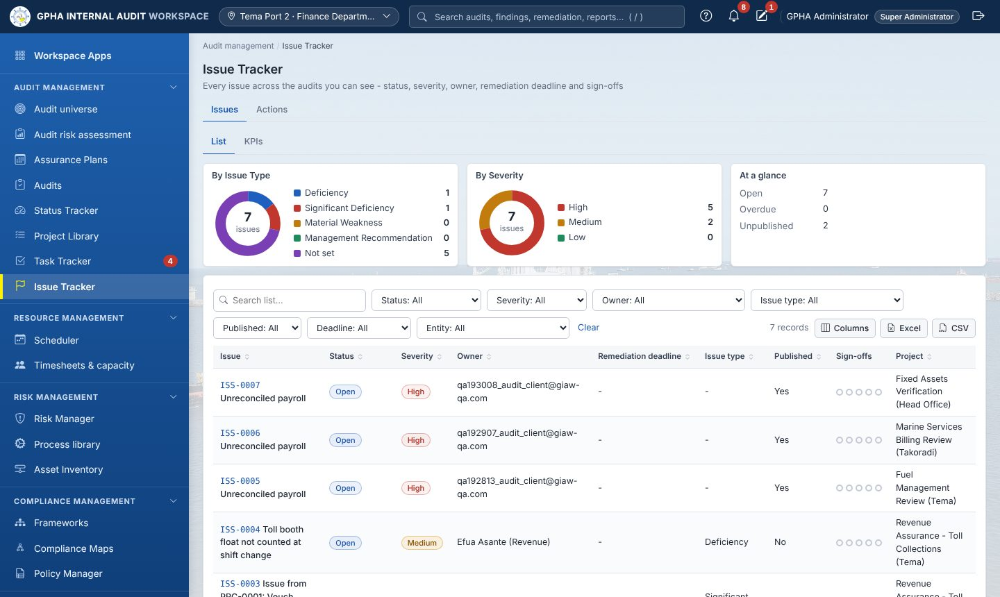{width=100%}

# 12. The audit report

**Where:** audit › **Report**. **Who:** the team prepares; the review chain signs; the GM Audit issues; auditees see the report in Management Review and once Issued.

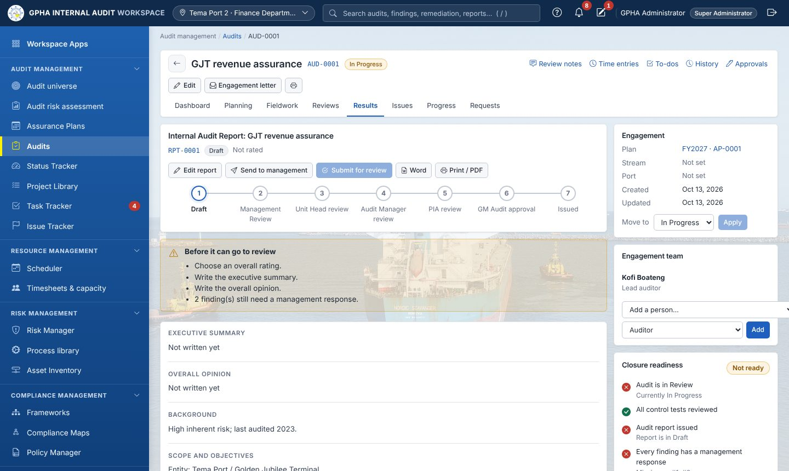{width=100%}

## 12.1 Draft the report

1. Click **Create draft report** (*"Draft report created"*, reference **RPT-…**).
2. Click **Edit report**. Fill **Report title**, **Overall rating** (*Satisfactory, Needs Improvement, Unsatisfactory*; not for advisory work), **Executive summary**, **Overall opinion** (*Conclusion* for advisory work), **Background**, **Scope and objectives**, **Methodology**, **Distribution list**.
3. Click **Save report**.

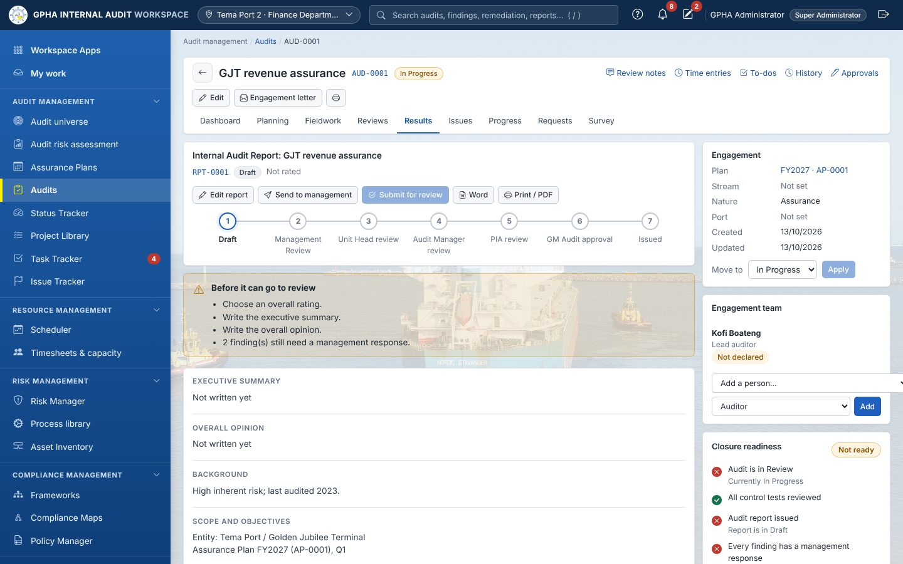{width=100%}

## 12.2 Send the draft to management (recommended)

1. Click **Send to management** (*"Sent to management for comments"*). Status **Management Review**; all issues are published; the response deadline is set (10 working days, skipping weekends and public holidays). The box shows *"Management response due by <date> (L.I. 1994 reg. 43(2))"*.
2. **Auditee:** opens the report › **Management comments** › **Management comments on the draft report** › **Save comments**, and responds to each issue (11.3).

## 12.3 Exit meeting

**Record exit meeting** › **Date held**, **Attendees (names and roles)**, **What was agreed** › **Save** (*"Exit meeting recorded"*).

## 12.4 Submit for review and sign through the chain

1. When the box *"Before it can go to review"* is empty, click **Submit for review**. **Result:** *"Submitted for Unit Head review"*; the Unit Heads are notified.
2. **Unit Head:** opens it from **My work** › **Review as Unit Head (e-sign)** › **Decision: Approve** › **Password** › **Sign review**. It moves to the Audit Manager.
3. **Audit Manager:** **Review as Audit Manager (e-sign)** › **Sign review**. It moves to the PIA.
4. **PIA:** **Review as PIA (e-sign)** › **Sign review**. It moves to **CAE Approval**.
5. Any reviewer may choose **Reject (return for rework)** with a comment: the report returns to **Draft** and the chain starts again after resubmission.

Rules: the preparer cannot sign; nobody signs two levels; a higher level may sign for an absent lower one.

## 12.5 GM Audit approval and issue

1. **GM Audit:** **Approve & issue (e-sign)** › **Decision: Approve** › **Password** › **Approve & issue**. **Result:** status **Issued**; the findings are frozen in the report; auditees and the team are notified. (A chain reviewer cannot also give this approval.)
2. **Word** and **Print / PDF** export the report. Drafts carry *"DRAFT - … - NOT FOR DISTRIBUTION"*.

## 12.6 Distribution of the issued report

1. In **Distribution of the issued report** click **Record copy sent**.
2. Choose **Recipient** (*Director-General (Management)*, *Audit Committee*, *Internal Audit Agency (Director-General)*, *Auditor-General*), **How** (*Letter, E-mail, Hand delivery, Portal / system, Meeting*), **Date sent**, **Letter / e-mail reference**.
3. Click **Record**. Repeat until *"Still to receive a copy"* disappears (Act 658 s.16).

## 12.7 Correcting an issued report

**Who:** GM Audit.

1. On the issued report click **Correct**.
2. Describe the **Error or omission to correct** (at least 20 characters) and click **Open version N+1**.
3. The report returns to **Draft** as the next version. The issued version is kept under **Earlier versions** (**Print**, **Word**).
4. Edit, then repeat 12.4–12.5. After re-issue the distribution card lists *"Still to receive version N"*: send the corrected copy to everyone who had the old one and record each copy.

# 13. Follow-up of agreed actions

**Where:** **Issue Tracker › Actions** (*Remediation & Follow-up*). Sub-tabs **Register**, **Follow-up**, **Statutory reports**.

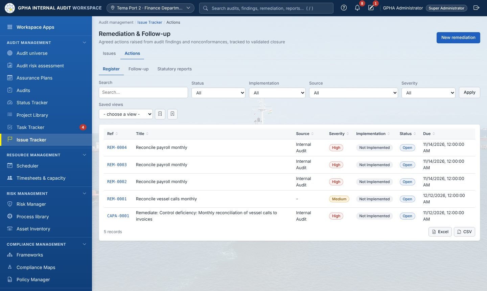{width=100%}

**Who:** the action owner records progress; an auditor validates (`followup.validate`); a follow-up manager closes and manages (`followup.manage`); the GM Audit decides risk acceptances.

Open an action: its page shows **Copy**, **Close (e-sign)**, **Edit**, print; tabs **Information, Tasks, History, Approval cycles**; the **Follow-up** card with the stepper *Open › Implemented › Validated › Closed*; **Evidence files**; and the **Follow-up timeline**.

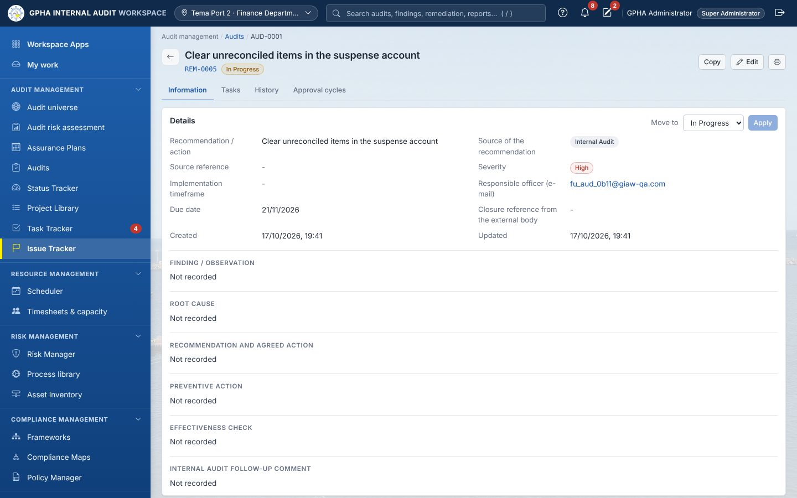{width=100%}

## 13.1 Owner: progress and implementation

1. **Progress update:** **Status now** (*Partially Implemented* / *Not Implemented*), **What has been done so far** › **Save progress**.
2. **Evidence files** › **Attach file** (stored encrypted).
3. When done: **Record implementation** › **What was done, when, and where the evidence is** › **Submit for validation**. Status **Review**; the auditor is notified.

## 13.2 Auditor: validation

1. Open the action (My work › *Validate remediation action*) › **Validate**.
2. **Is the action effective?** › *Effective* (fill **Follow-up testing performed**) or *Not Effective* (fill **Validation notes**).
3. Click **Save validation**. *Not Effective* sends it back to the owner. The implementer cannot validate.

## 13.3 Follow-up manager: close

1. When validated *Effective*, click **Close (e-sign)** › **Password** › **Sign & Approve**. The linked issue closes too.
2. Recommendations from the Auditor-General, PAC or Parliament need that body's closure reference first (**Edit** › **Closure reference from the external body**).
3. If configured, internal recommendations are closed by the Audit Committee instead (15.3).

## 13.4 Revise a target date

**Revise target date** › **New target date**, **Reason (agreed with management)** › **Revise target date**. The original date is kept and escalation restarts.

## 13.5 Risk acceptance (management will not implement)

1. **Follow-up manager:** **Propose risk acceptance** › **Accepted by (name and position)**, **Why the risk is accepted, and any compensating controls** › **Send to the GM Audit**.
2. **GM Audit:** on the action the box says *"Risk acceptance proposed - awaiting the GM Audit"* › **Decide** › **Decision** (*Agree / Disagree*), **Discussion with senior management and conclusion** › **Record decision**.
3. *Disagree*: the action stays open. *Agree*: Medium and Low actions close as **Risk Accepted**; **High** actions show *"awaiting the Audit Committee"* and appear in the Committee's list (15.3).

## 13.6 Withdraw or reopen

- **Propose withdrawal** › **Why it is no longer relevant or feasible** › **Send to the Audit Committee**.
- **Reopen** (closed actions) › **Why the action is reopened** › **Reopen**.

## 13.7 Escalation and the Follow-up tab

| Days overdue | Who is told |
|---------------|---------------------------------|
| From day 1 | Owner and creator |
| 14 | Audit Managers |
| 30 | GM Audit |
| 60 | Administrators; listed in the Committee pack |

The **Follow-up** tab shows overdue actions, the **Aging of open actions** (*Not yet due, 1-30, 31-60, 61-90, Over 90 days*; **Export**) and actions **Awaiting auditor validation**. **Run escalation check** runs it immediately.

## 13.8 Statutory reports

1. Open **Statutory reports**. Choose **Quarterly follow-up report** (year and quarter) or **Annual statement (Act 921 s.88)** (year; due by 30 June).
2. Check the figures; download **Word** or **Excel**.
3. Click **Record submission** › tick **Submitted to**, **Date submitted**, **Letter / e-mail reference** › save. A frozen copy is kept in the *Register of follow-up reports submitted*.

# 14. Other apps

## 14.1 Status Tracker and Project Library

- **Status Tracker:** one line per active audit (time expired, work completed, budget, time spent, status). Star favourites; **Show favorites first**.
- **Project Library:** **+ New programme** › **Name**, **Audit type**, **Description**; for each step **Objective**, **Risk**, **Likelihood**, **Impact**, **Control**, **Control type**, **Test type**, **Test procedure** (**+ Add step**) › **Save programme**. Use it in an audit with **Apply audit programme** (10.1).

## 14.2 Analytics

KPIs against targets (plan delivery, actions closed on time, overdue actions, days from fieldwork to report, satisfaction, time charged), entities by assessed risk, findings raised, repeat findings and common themes. Choose the year at the top.

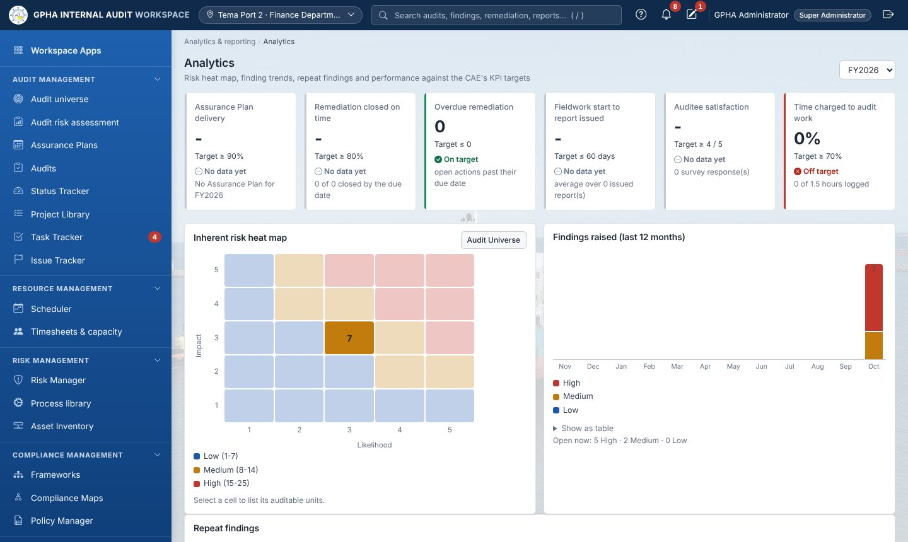{width=100%}

## 14.3 Risk Manager

**Overview** (opens first):

- **Category filter:** choose one risk category or *All risk categories*.
- **Key figures:** **Entities at highest risk** (entities with a High residual risk), **Above target** (residual over the target score) and **KRI breaches** (indicators at red). Click a figure to open the matching list.
- **Risk breakdown:** residual risks per category, split High / Medium / Low. Click a bar to open that category's register.
- **Risk heat map:** choose **Residual** or **Inherent**; click a cell to list its risks.
- **Tasks** on the right:
  - **My risks and indicators:** risks I own, reviews due in 30 days, overdue reviews, indicators to record, my indicator breaches.
  - **My unit's risks:** open, no owner and overdue, for the unit set under **Where I work**.
  - **Quick actions:** new risk, strategic objective, record readings, register, strategy map.
- Clicking a task number opens the **Register** filtered to it. A *Showing:* chip lists the filter; **×** removes it.

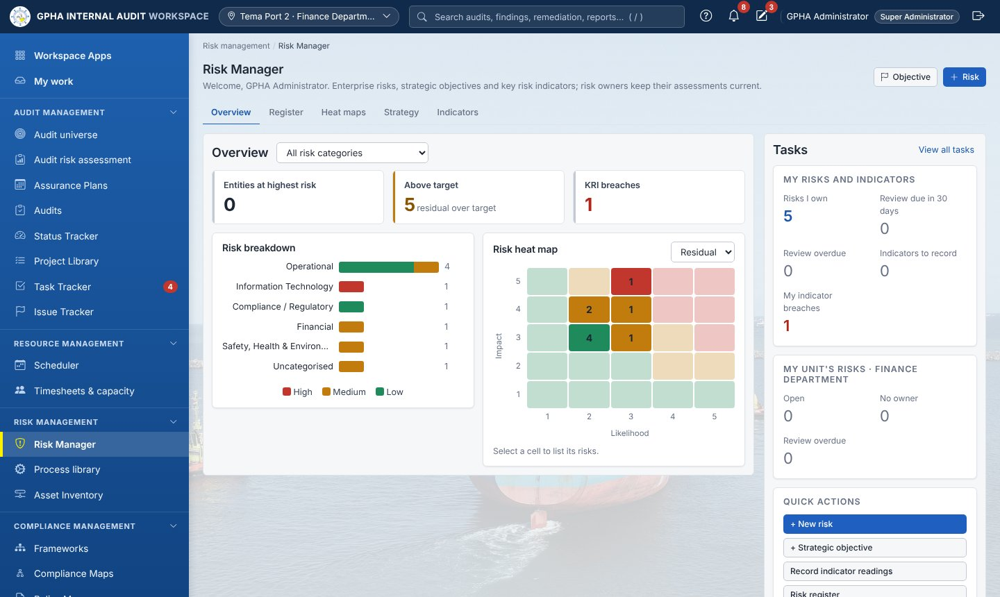{width=100%}

1. **+ Risk** › **Risk (event)**, Category, **Strategic objective**, **Risk owner**, **Division / entity**, **Causes**, **Consequences**; inherent, residual and target likelihood and impact; **Risk appetite**, **Treatment**, **Status**, **Treatment plan** › **Create**. Residual cannot exceed inherent.
2. On a risk: **Assess** › scores, **How well are the controls working?**, **What changed and why** › **Record assessment**.
3. **+ Indicator** › **Indicator**, **Unit**, **Frequency**, **A higher value is worse**, **Amber threshold**, **Red threshold**, **Who records it** › **Add indicator**; **Record reading** › **Period**, **Value**, **Comment** › **Record**.
4. **Linked records** › **+ Link** connects controls, requirements, assets, the audit universe and policies.
5. Tabs **Overview**, **Register**, **Heat maps** (click a cell to list its risks), **Strategy** (**Objective** to add strategic objectives), **Indicators**.

## 14.4 Compliance Maps

1. **+ Obligation** › **Code**, **Kind**, **Title**, **Issued by**, **Version / year**, **Effective from**, **Compliance owner** › **Create**.
2. **+ Requirement** › **Section / clause**, **Owner**, **Requirement**, **Text**, and tick **Controls that meet it** › **Add requirement** (no controls shows **Gap**). **Import CSV** for many.
3. Click a requirement › **Assess compliance** › **Status** (*Compliant, Partially compliant, Non-compliant, Not applicable*), **Evidence and gaps** › **Record assessment**.

## 14.5 Policy Manager

1. **+ Policy** › **Title**, **Category**, **Review every (months)**, **Policy owner**, **Approver**, **Applies to**, **Purpose and scope**, **Policy text** › **Create draft**.
2. **Edit draft vN** › **What changes in this version**, **Policy text**, optional attachment › **Save draft** › **Submit for approval**.
3. **Approver** (not the author): **Review** › **Read the draft** › **Decision** (*Approve / Return for changes*) › **Record decision**.
4. **Publish**. Then **Ask staff to attest** › **Title**, **Due by**, audience, **Statement they confirm** › **Send**. Staff answer from Task Tracker › Priorities.

## 14.6 Asset Inventory and Frameworks

- **Asset Inventory:** **+ Asset** › **Name**, **Type** (a *Third party* type turns on contract fields), **Criticality**, **Information classification**, **Owner**, contract details › **Create**. Third parties: **Due-diligence assessment** › **Assessed on**, **Third-party risk rating**, **Outcome**, **Areas reviewed**, **Findings and conditions** › **Record**.
- **Frameworks:** **+ Framework** and **+ Standard control** (or **Import CSV**). Standard controls feed **From library** in the risk control matrix.

## 14.7 Results, Storyboards and Robots

- **Results:** **+ Add collection**, **+** to add a table; each table has **Table**, **Interpretations** (**New interpretation**) and **Triggers**.
- **Storyboards:** **Add Storyboard**, **Add Text / Chart / Metric**, **Share Storyboard**.
- **Robots:** **+ Create**, **Create task** (analytic, frequency, start) › **Confirm and create task**; **Run now**; **Task runs**.

# 15. Audit Committee

**Where:** Analytics & reporting › **Audit Committee** (tabs **Committee pack | Governance portal | Port portfolio**). **Who:** staff and governance users view; the secretary records (`committee.record`).

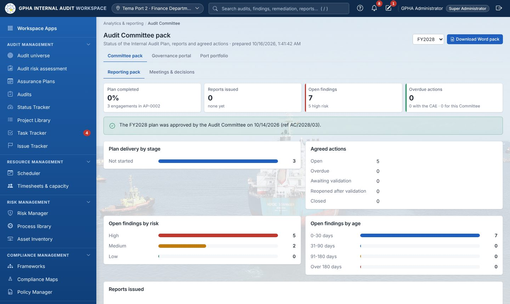{width=100%}

## 15.1 Committee pack

**Reporting pack** › choose the year › **Download Word pack** (plan delivery, reports issued, open findings, implementation of actions with items for decision, plan changes, conformance).

## 15.2 Schedule and record a meeting

1. **Meetings & decisions** › **New meeting** › **Date and time**, **Type** (*Ordinary, Extraordinary, Special*), **Venue**, **Agenda** › **Create**.
2. After the meeting, open it › **Record proceedings** › **Status: Held**, **Present**, **Apologies**, **Quorum formed**, **Quarterly follow-up report considered**, **Minutes** › **Save**.

## 15.3 Record decisions

1. On the held meeting click **Record decision**.
2. Choose the **Recommendation** (items awaiting the Committee are listed first with the reason, for example *Risk acceptance agreed by the GM Audit - for decision*), the **Decision** (*Close, Withdraw, Extend deadline, Escalate to management, Accept risk, Reject risk acceptance, Noted*), **New due date** (extensions), **Minute / external closure reference**, **Notes**.
3. Click **Record decision**. The decision is applied to the action at once (closed, withdrawn, extended, escalated, risk accepted or reopened).

## 15.4 Approve the minutes

Click **Approve minutes** (needs attendees and minutes). **Result:** *"Minutes approved and locked"*. **Minutes (Word)** downloads them.

## 15.5 Governance portal and Port portfolio

- **Governance portal:** read-only KPIs, approved plans and issued reports (**Word**, **Print**).
- **Port portfolio:** one row per port; click to see its audits. A PIA sees only their port.

# 16. Quality and professional practice

**Where:** Analytics & reporting › **Quality (QAIP)** (tabs **Quality reviews | Professional practice | Service feedback**).

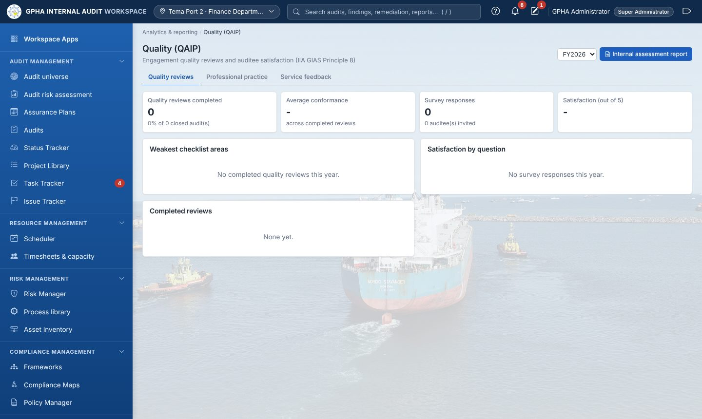{width=100%}

## 16.1 Quality reviews and the QAIP report

Engagement quality reviews are done on each audit's **Supervision & review** tab (10.9). Here choose the year to see reviews completed, average conformance, survey responses and satisfaction, the weakest checklist areas and auditee comments. **Internal assessment report** downloads the Word report.

## 16.2 Post-audit survey (auditees)

1. After the report is issued or the audit closed, the auditee opens the audit › **Feedback survey**.
2. Rate each statement from 1 to 5, add **Anything else? (optional)**, click **Send feedback**. Each auditee answers once.

## 16.3 Professional practice

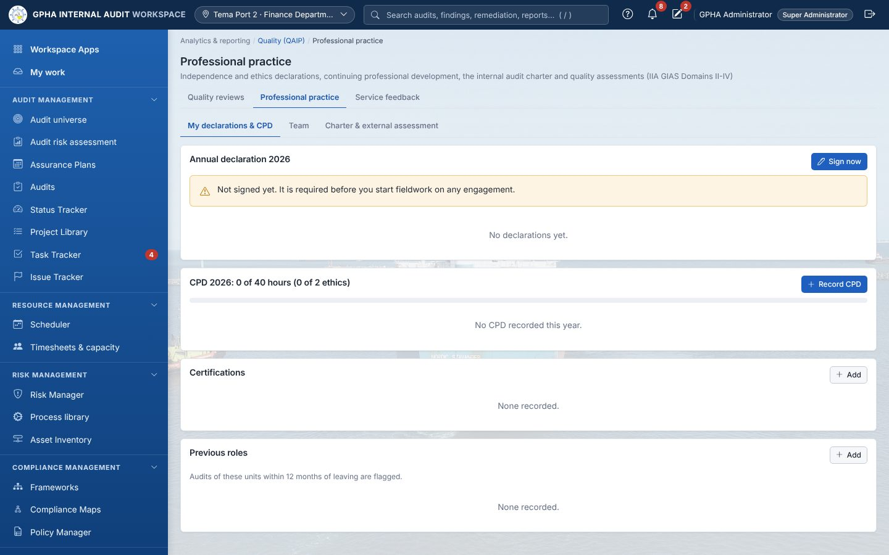{width=100%}

**My declarations & CPD** (every auditor)

1. **Annual declaration** › **Sign now** › tick the three confirmations (and disclose if needed) › **Sign declaration**.
2. CPD: **Record CPD** › **Activity**, **Provider**, **Category**, **Date**, **Hours**, **Of which ethics hours**, **Certificate / evidence reference** › **Save**. The bar shows hours against the target.
3. **Certifications** › **Add** › **Certification**, **Issuer**, **Membership / certificate no.**, **Obtained**, **Expires** › **Add**.
4. **Previous roles** › **Add** › **Org unit**, **Role**, **From**, **To (empty if current)** › **Add**. Only a reviewer can remove a role.

**Team** (reviewers): each auditor's declaration and CPD status, and *Disclosures awaiting your review* (9.3).

**Charter & external assessment** (GM Audit; Committee secretary records approval)

1. **New version** › **Edit draft** › **Submit to Committee**.
2. Secretary: **Record approval** › **Date approved**, **Minute reference**, **Meeting**. The previous charter becomes *Superseded*.
3. **Record assessment** (external quality assessment) › type, assessor, independence, completed date, conclusion, report reference, date reported to the Committee, scope, improvement plan. One is due every 5 years.

## 16.4 Service feedback

**New** › **Subject**, **Description**, **Source**, **Owner email** › **Create** (a *Handle feedback* task is created). Open it to **Edit** or **Move to** *In Progress* / *Closed* › **Apply**.

# 17. Administration

**Where:** Platform settings. The **Administration** page shows tiles, **Needs attention** items and links to each area.

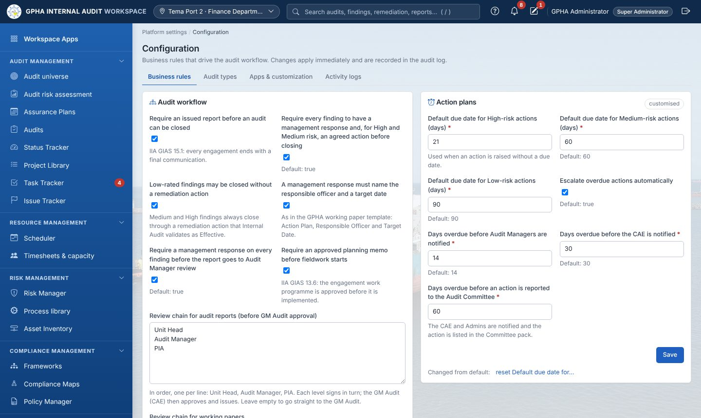{width=100%}

## 17.1 Setting GIAW up (order for a new installation)

1. **Org Structure:** HQ, ports, departments and units; approve them; set each **Head of unit** (4.1). Mark the HQ and port entities that *Receive the approved Assurance Plan* on **Organizations**.
2. **Users & access:** create every user with the right **Role** and, for Managers, the **approval level** (17.2). Ask everyone to set **Where I work**.
3. **Configuration:** audit types and advisory types, review chains, report recipients, deadlines, escalation days, rotation and cooling-off periods, KPI targets, security (17.4).
4. **Project Library** and **Frameworks:** audit programmes and standard controls.
5. **Backups:** confirm the schedule and run a first backup (17.6).

## 17.2 Users & access

**Who:** `system.users`. Only a Super Administrator changes administrator accounts.

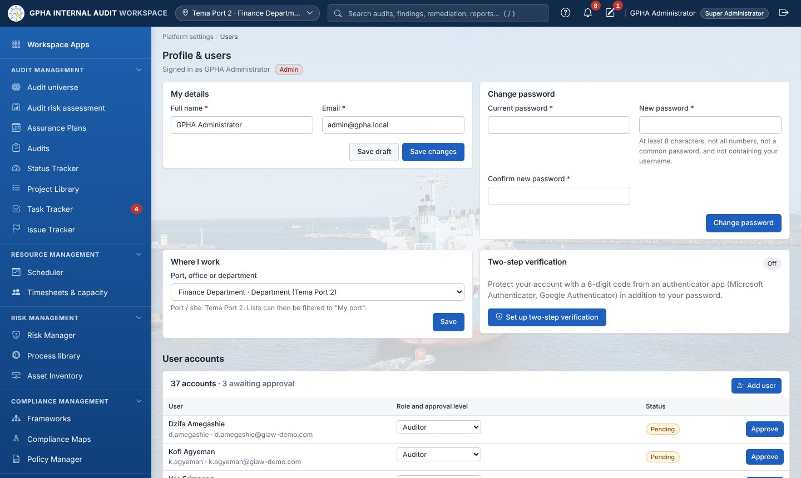{width=100%}

**Create a user**

1. Click **+ Add user**.
2. Fill **Full name**, **Username**, **Email**, **Role**, **Initial password** (at least 8 characters).
3. Click **Create user**. The panel shows *"Saved"*; click **Close**.
4. Click the new user's row. In **Role** choose the job role (*Super Administrator, Administrator, Manager, Auditor, Read-only User, Audit Client*). For a **Manager**, choose the approval level: **Unit Head**, **Audit Manager**, **PIA** or **GM Audit (CAE)**. The change saves at once and the person is signed out.
5. **Edit details** › **Workplace** (decides which port's audits they see) › **Save changes**.

**Other account actions** (user panel): **Approve** (self-registered accounts), **Deactivate** / **Reactivate**, **Unlock**, **Reset two-step**, **Reset password** (**New password**, **Repeat new password**), **Sign out everywhere**, **Delete account** (only if the account has no recorded work).

Tabs **All, Active, Awaiting approval, Locked, Deactivated, No sign-in for 90+ days** and filters help you review accounts regularly.

## 17.3 Roles & permissions

**Permission matrix:** tick or untick permissions per role, then **Save** under that role (**Reset** restores the standard set). **Access by module** and **People by role** show who can do what; change a person's role or approval level there too.

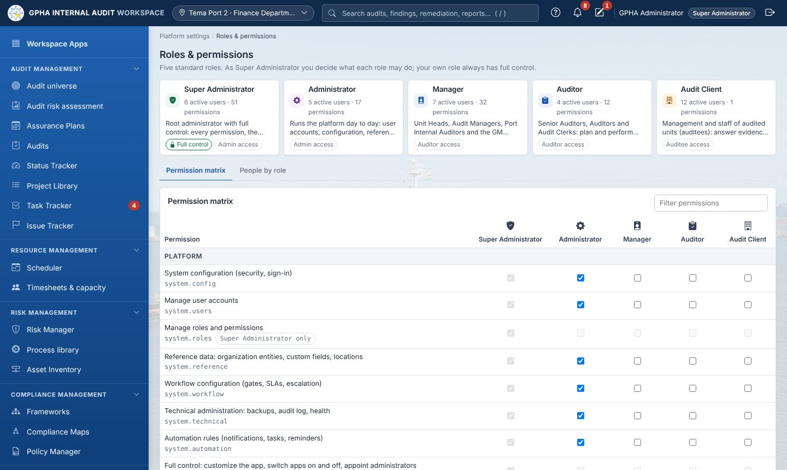{width=100%}

## 17.4 Configuration

**Where:** Platform settings › **Configuration** (tabs **Business rules | Audit types | Apps & customization | Data import | Audit trail**).

1. On **Business rules**, open the section drop-down (General, Audit process, Issues & follow-up, Organization & access, Performance & services, Workflow, Custom fields, Data) or type in **Find a setting…**.
2. Change the values. A bar shows *"N unsaved changes"*.
3. Type a **Reason (optional)** and click **Save changes** (or **Discard**).
4. **⋯** › **Reset to default** › **Reset** restores one setting; **History** shows every change with old and new value, who and why.

Settings used most often: *Audit types* and *Audit types that are advisory engagements*; *workpaper* and *report review chain*; *Who must receive a copy of every issued audit report*; draft report response days; action due days by severity and escalation days; *Lead auditor rotation* and *Cooling-off after working in a unit*; *Risk acceptances the Audit Committee decides*; *Lines on the assurance map*; KPI targets; idle sign-out and two-step requirements.

## 17.5 Automations, Data import and Apps & customization

- **Automations** (Robots › **Automations**): **+ New rule** › **Rule name**, **When**, optional **+ Condition**, **Action** (*Notify* or *Create a task*), **To**, **Title**, **Message** › tick **Active** › **Save rule**.
- **Data import:** on an import card, **Template** › fill › **Import** › check the preview › **Import**. **Import history** keeps every run.
- **Apps & customization** (Super Administrator): workspace name, app names, switch apps on or off › **Save**.

## 17.6 Backups and the audit trail

- **Backups:** **Run backup now** (*"Backup created and checked"*); **Verify** a set; the trash icon deletes a set (never the only one); **Restore guide** explains server-side restores.
- **Audit trail** (Configuration › **Audit trail**): preset tabs (*All activity, Sign-ins, Failed, User administration, Settings & system, Exports*), filters, **Export CSV**. The chip **Tamper-protected** confirms the records cannot be changed.

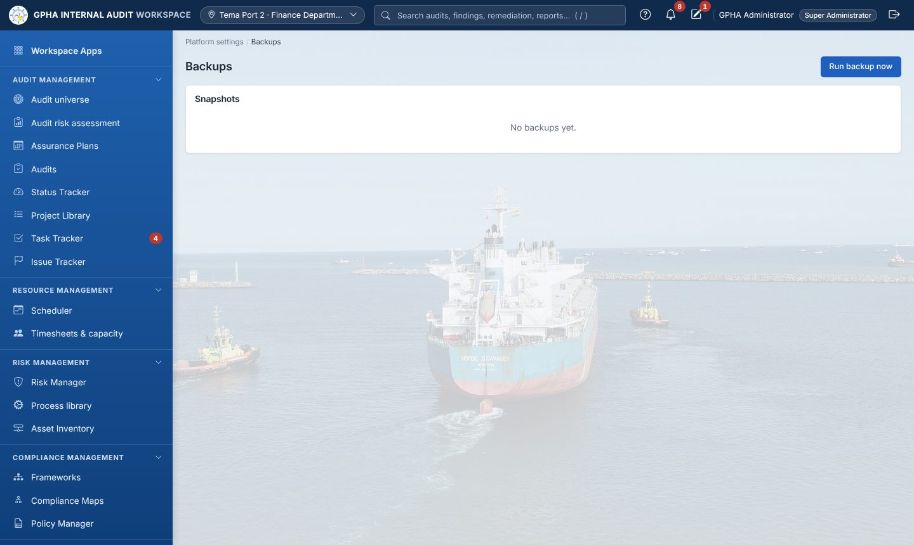{width=100%}

# 18. For auditees, step by step

You see only the audits you were added to and only the issues Internal Audit has published. Everything starts in **Task Tracker › Priorities**.

{width=100%}

**1. When the audit starts.** You receive the **Engagement letter** and the notice *"Audit fieldwork has started"*. Open **Audits** to see it.

**2. Provide evidence.**

1. In Priorities, under *Evidence requests*, click **Provide evidence** (or open **Task Tracker › Requests**).
2. Open the request, read what is needed and the due date.
3. **Add a file** › **Upload** (repeat for each file).
4. Write a short **Response** and click **Submit** (*"Submitted to the audit team"*).
5. If Internal Audit clicks **Return for more**, the request comes back with a comment: add what is missing and **Submit** again.

{width=100%}

**3. Comment on the draft report.** When you receive *"Draft audit report for your comments"*, open the audit › **Report** › **Management comments** › write your comments › **Save comments**, before the due date shown.

**4. Respond to each issue.** Open the audit › **Findings** › click the finding › fill **Audit client response (Head of Department)**, **Management response - action plan**, **Responsible officer**, **Target date** › **Save**.

**5. Implement the agreed actions.** In Priorities, under *Agreed actions*, click **Update progress**:

1. **Progress update** › **Status now**, **What has been done so far** › **Save progress**.
2. **Evidence files** › **Attach file**.
3. When finished, **Record implementation** › **Submit for validation**. Internal Audit validates and closes it; you cannot close it yourself.

**6. Answer the survey.** After the report is issued, open the audit › **Feedback survey** › rate each statement › **Send feedback**.

**7. Attest to policies and assess your risks** when they appear in Priorities (**Read and attest** › **I confirm**; **Assess**).

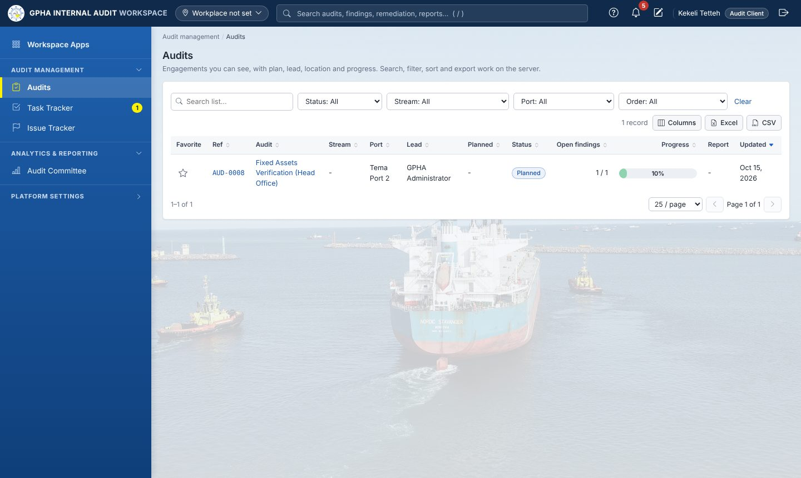{width=100%}

# 19. Messages and what to do

| Message | Meaning and what to do |
|---------------------------------------------|---------------------------------------------|
| *Segregation of duties: the preparer of a record cannot sign it off* | Someone else must sign. Choose a different reviewer or approver |
| *Fieldwork cannot start until the planning memo is approved…* | Submit the memo and have it approved (9.6) |
| *Fieldwork cannot start (IIA GIAS 2 and 7.1 - independence): …* | Every member signs the annual and engagement declarations; flagged members declare and get cleared (9.3) |
| *Assign an auditee to this audit first…* | Add the auditee under **Auditees with access** (9.2) |
| *Not ready for review: …* | Complete the items in *"Before it can go to review"* (12.4) |
| *You have already signed an earlier stage of this document* | Another person must sign the next level |
| *Only the CAE can approve and issue a report* | Only the GM Audit issues reports |
| *An auditor must validate the implementation as Effective before the action can be closed* | Validate first (13.2) |
| *Recommendations from <body> are closed by that body…* | Record the external closure reference (13.3) |
| *The plan is at '<stage>'; this step belongs to '<stage>'* | Do the planning cycle steps in order (6.2) |
| *Engagements start after the Audit Committee-approved plan has been distributed by the GM Audit* | The GM Audit distributes the approved plan first (6.2 step 9) |
| *nobody is registered to receive the plan at <site>* | The site's PIA or Audit Manager sets **Where I work** (1.7) |
| *The audit cannot be closed yet: …* | Fix each red item on **Closure readiness** (9.5) |
| *Password verification failed* | Retype your password in the signature dialog |
| The page looks wrong after an update | Press **Ctrl+F5** |

# 20. Glossary

| Term | Meaning |
|------------------|---------------------------------------------|
| Advisory engagement | Advice without an assurance opinion; observations, no rating; management decides what to act on |
| Approval level | Unit Head, Audit Manager, PIA or GM Audit; decides which review step a Manager signs |
| Assurance map | Other assurance providers per entity and the reliance placed on them |
| Assurance Plan | The annual risk-based internal audit plan |
| Auditable entity | A defined scope that can be audited: an org unit, a process, or a process within units |
| CAE / GM Audit | Chief Audit Executive: the General Manager, Audit |
| Cooling-off | A period after working in a unit during which an auditor does not audit it |
| E-signature | An approval confirmed with your password; recorded with your name and time |
| Engagement | A planned audit; it becomes an audit when started |
| Escalation | Automatic reminders to higher levels when an action is overdue |
| Finding / issue | Criteria, condition, cause, effect and recommendation found in an audit |
| Next Reviewer | The person the preparer names to sign the next level |
| PCR | Plan change request |
| PIA | Port Internal Auditor |
| QAIP | Quality assurance and improvement programme |
| RCM | Risk and control matrix |
| Remediation action | The action management agrees to take on a finding |
| Risk acceptance | Management's formal decision not to implement, agreed by the GM Audit and, when required, the Audit Committee |
| Rotation | Changing the lead auditor after a set number of consecutive years on the same entity |
| Workplan / Internal Control | The two fieldwork methods: procedures, or the risk and control matrix with tests |
