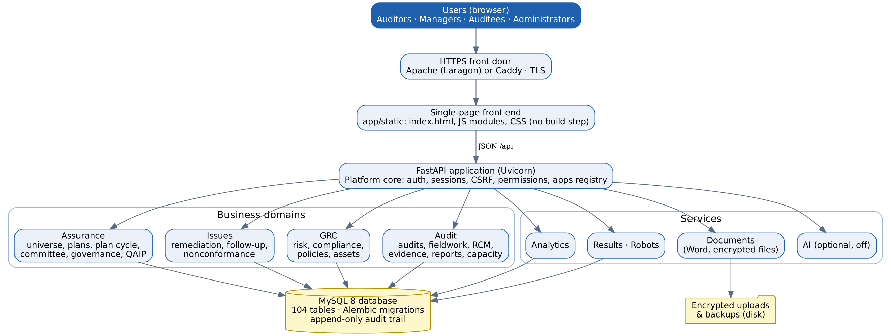
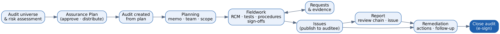

# Document control

| Item | Value |
|-----------------|---------------------------------------------|
| System | GPHA Internal Audit Workspace (GIAW) |
| Document | Technical Documentation |
| Version | 1.0 (first issue) |
| Code baseline | Repository `C:\dev\GPHAIAWORKSPACE`, commit `4e0d386`, database migration `0034_drop_workspace_prefs` |
| Audience | Developers, technical administrators, IT security reviewers, support engineers |
| Owner | GIAW system owner (GPHA Internal Audit), to be named |
| Related documents | Technology Stack (02), Administration Guide (03), Governance & Operations (04), User Manual (05), Training Guide (06), `mainBLUEPRINT.md` |

**Change history**

| Version | Date | Change | By |
|-----------|-----------|-----------|------------|
| 1.0 | 16 Oct 2026 | First issue | GIAW project |

# 1. Purpose and scope

GIAW is GPHA's internal audit management system. It supports the full internal audit cycle:

- the audit universe and risk assessment;
- the annual Assurance Plan;
- engagements: planning, fieldwork, testing, working papers, evidence, issues and reports;
- remediation and follow-up;
- reporting to the Audit Committee;
- quality assurance.

It also covers related governance, risk and compliance (GRC) registers: Risk Manager, Compliance Maps, Policy Manager and Asset Inventory.

This document describes how the system is built and how it behaves technically. How to install and run it is in the Administration Guide (03). How to use it is in the User Manual (05).

# 2. System overview

{width=100%}

GIAW is a **modular monolith**:

- One Python web application (FastAPI) serves both the JSON API (`/api/...`) and the browser front end (`/` and `/static/...`).
- All data sits in one MySQL database.
- Uploaded files and backups are stored encrypted on the server's disk.

There is no separate front-end build, message queue or cache server. Background work (scheduled backups, overdue-action escalation, automations and robots) runs inside the application process on timers.

| Layer | Package | Responsibility |
|----------------|--------------------------|---------------------------------------------|
| Front end | `app/static` | Single-page application: `index.html`, 20 JavaScript files, one stylesheet, self-hosted fonts and icons |
| Platform core | `app/core`, `app/platform` | Configuration, database, sessions, CSRF, permissions, audit trail, record history, approvals and e-signatures, users, roles, organizations, notifications, tasks, drafts, saved views, data import/export, backups, app registry |
| Audit domain | `app/domains/audit` | Audits, fieldwork (RCM, tests, procedures, narratives, sign-offs), evidence requests, planning memos, methodology, capacity and time, reports, service feedback |
| Assurance domain | `app/domains/assurance` | Audit universe, audit risk assessments, Assurance Plans, plan cycle and change requests, scheduler, Audit Committee, governance portal, QAIP |
| Issues domain | `app/domains/issues` | Remediation actions, follow-up and statutory returns, nonconformances |
| GRC domain | `app/domains/grc` | Risk Manager (objectives, risks, KRIs), Compliance Maps, Policy Manager and attestations, Asset Inventory and third-party due diligence, cross-register links |
| Services | `app/services` | Analytics, Documents (Word output, encrypted file storage), Results / Storyboards / Robots, optional AI drafting |

**Size of the code base (baseline above):**

- about 31,300 lines of Python;
- about 12,400 lines of JavaScript and CSS;
- 104 database tables;
- 34 migrations;
- 390 API paths with 501 operations.

# 3. Business modules and apps

The **app registry** (`app/platform/apps/registry.py`) is the single list of apps. It drives:

- the sidebar;
- the Workspace Apps page;
- *Apps & customization*.

The Super Administrator can rename an app or switch it off. A switched-off app disappears from the interface, and its API paths answer `404` for everyone. **Core** apps cannot be switched off.

| Group | App | Main screens / features | Core |
|---------------------|---------------------------------------------|---------------------------------------------|-----------|
| Home | Workspace Apps | Home page with every app and feature as a tile | Yes |
| Home | My Drafts | Autosaved forms waiting to be finished (top bar) | Yes |
| Audit management | Audit universe | Auditable entities defined on the Org Structure and Process library | Yes |
| Audit management | Audit risk assessment | Scoring of entities on assessment factors | – |
| Audit management | Assurance Plans | Annual plan, approval cycle, versions, distribution, change requests, timeline | Yes |
| Audit management | Audits | Engagements from planning to closure | Yes |
| Audit management | Status Tracker | Time expired, work completed, budget and time spent per audit | – |
| Audit management | Project Library | Reusable audit programmes (project templates) | – |
| Audit management | Task Tracker | Priorities, To-dos, Requests | – |
| Audit management | Issue Tracker | Issues and their remediation actions (tabs: Issues, Actions) | Yes |
| Resource management | Scheduler | Engagement windows and staff bookings | – |
| Resource management | Timesheets & capacity | Available hours, utilisation, time sheets, skills | – |
| Risk management | Risk Manager | Strategic objectives, enterprise risks, heat maps, KRIs | – |
| Risk management | Process library | Business processes linked to org units, risks and controls | – |
| Risk management | Asset Inventory | Systems, data, facilities and third parties with due diligence | – |
| Compliance management | Frameworks | Frameworks and standard controls library | – |
| Compliance management | Compliance Maps | Obligations, requirements and the controls that meet them | – |
| Compliance management | Policy Manager | Drafting, approval, publication, attestation campaigns | – |
| Analytics & reporting | Analytics | KPIs, trends, heat map, repeat findings | – |
| Analytics & reporting | Results · Storyboards · Robots | Analytic tables with triage; shared storyboards; scheduled analytic tasks | – |
| Analytics & reporting | Audit Committee | Committee pack, meetings, decisions (tabs include Governance portal, Port portfolio) | – |
| Analytics & reporting | Quality (QAIP) | Quality reviews, professional practice, service feedback (tabs) | – |
| Platform settings | Org Structure | Ports, departments, units, organizations, contacts (tabs) | Yes |
| Platform settings | Users, Roles & permissions, Configuration, Backups, Automations | Platform administration | Yes / – |

**Merged apps.** Some pages are tabs of a host app rather than separate sidebar entries. They are defined in `HOST_GROUPS` in `app/static/js/ui.js`:

| Host | Tabs |
|---------------|---------------------------------------------|
| Task Tracker | Priorities, To-dos, Requests |
| Issue Tracker | Issues, Actions |
| Audit Committee | Committee pack, Governance portal, Port portfolio |
| Quality | Quality reviews, Professional practice, Service feedback |
| Org Structure | Org Structure, Organizations, Contacts |
| Configuration | Business rules, Audit types, Apps & customization, Activity logs |
| Robots | Robots, Automations |

# 4. Core workflows

{width=100%}

| Object | States (as implemented) | Key controls |
|-------------------|---------------------------------------------|---------------------------------------------|
| Assurance Plan | Draft → In Review → Submitted → Returned / Approved → Distributed → In Execution → Revised → Closed → Archived | Plan-cycle stages must be recorded before approval (`plan_cycle_enforced`). An approved version is frozen and changes go through plan change requests (`PCR-nnnn`). Significant changes go to the Audit Committee. Engagements start only after distribution (`plan_distribution_before_execution`). |
| Plan engagement | Planned → Started / Cancelled | Starting an engagement creates the audit |
| Audit | Planned → In Progress → Review → Closed | Closing needs an e-signature from someone other than the preparer, and the closure checklist: report issued, findings responded to and actioned, tests reviewed, review notes cleared (configurable gates) |
| Control test | Not Started → In Progress → Completed → Reviewed; conclusion Not Tested / Effective / Ineffective | Reviewer differs from performer. An ineffective test can raise an issue. |
| Sign-offs | Up to five configurable levels (default Preparer, Detail Reviewer, General Reviewer, Supplemental Reviewer, Specialty Reviewer) | Preparer signs first (configurable). Optional password on every sign-off. Removing a sign-off also removes the later ones. Signed pages become read-only. |
| Issue (finding) | Open → Remediating → Closed; Draft until published | Hidden from the auditee until published. Publishing twice is refused (409). |
| Evidence request | Requested → Submitted → Accepted / Returned; Cancelled | Assignee must be an auditee of the audit. Auditees cannot accept their own evidence. A second acceptance is refused. |
| Report | Draft → Management Review → Manager Review → CAE Approval → Issued | Configurable review chain. Segregation of duties at each level. Findings frozen at issue. |
| Remediation action | Open → In Progress → Review → Closed; implementation Not / Partially / Fully Implemented / Withdrawn | The owner cannot close alone. Closing needs a validated follow-up. Overdue actions escalate to Audit Managers (14 days), the CAE (30 days) and the Audit Committee (configurable). |
| Enterprise risk | Active / Retired; reviewed every `erm_review_months` | Assessment history is kept; overdue reviews appear in the owner's Task Tracker |
| Third party (asset) | Active; due diligence Not started → … | Re-assessed every `third_party_review_months`; due assessments appear in the owner's Task Tracker |

# 5. Data architecture

- **Database:** MySQL 8 (InnoDB, `utf8mb4`), accessed through SQLAlchemy 2.1 ORM models.
- **Schema changes:** managed by **Alembic** (`alembic/versions`, 34 revisions; head `0034_drop_workspace_prefs`).
- **Automatic migration:**
  - at start-up;
  - and, if the database was unavailable, by a schema watcher every 30 seconds.
- **Time:** every date-time is stored as **naive UTC**. A `before_flush` hook in `app/core/database.py` converts any time-zone-aware value supplied by an API caller.
- **References:** human-readable references (`AUD-`, `ER-`, `REM-`, `ERM-`, `AST-`, `PCR-`, `NC-`, `SF-`, `ORG-`, `SH-`) come from a sequence table (`app/core/refs.py`).
- **Append-only records:** `audit_logs`, `record_history` and `approval_cycles` are protected by database triggers, so UPDATE and DELETE are rejected. That is why the MySQL setting `log_bin_trust_function_creators=1` is needed.
- **No hard deletes once records have progressed:** signed, linked or progressed records cannot be deleted, and users with activity are deactivated.

**Main entity groups**

| Group | Representative tables |
|------------------------|---------------------------------------------|
| Identity and access | `users`, `sessions`, `role_permissions`, `app_config`, `auditor_profiles` |
| Organization | `organizations` (entities with type, parent, port), `custom_fields`, `processes`, `locations`, `entity_units` |
| Universe and planning | `audit_entities`, `entity_org_units`, `entity_processes`, `audit_risk_assessments`, `ara_*`, `assurance_plans`, `plan_engagements`, `plan_cycle_events`, `plan_versions`, `plan_distributions`, `plan_change_requests`, `plan_changes`, `schedule_bookings` |
| Engagements | `audits`, `audit_team_members`, `audit_auditees`, `planning_memos`, `objectives`, `risks`, `controls`, `risk_controls`, `control_tests`, `procedures`, `narratives`, `signoffs`, `signoff_reviewers`, `review_notes`, `working_papers`, `evidence_requests`, `evidence_files`, `time_entries` |
| Issues and follow-up | `findings`, `capa` (remediation actions), `followup_submissions`, `nonconformances`, `criteria` |
| Reporting and governance | `audit_reports`, `report_distributions`, `committee_meetings`, `committee_decisions`, `quality_reviews`, `audit_surveys`, `ia_charters`, `external_assessments`, `declarations`, `cpd_records`, `certifications` |
| GRC | `strategic_objectives`, `enterprise_risks`, `risk_assessments`, `key_risk_indicators`, `kri_readings`, `regulations`, `requirements`, `policies`, `policy_versions`, `attestations`, `assets`, `third_party_assessments`, `grc_links` |
| Platform services | `notifications`, `tasks`, `form_drafts`, `saved_views`, `automation_rules`, `automation_runs`, `results_*`, `storyboards`, `robots`, `robot_tasks`, `robot_runs`, `ai_requests`, `audit_logs`, `record_history`, `approval_cycles`, `reference_sequences` |

The live map of modules and the tables each one owns is available from `GET /api/platform` for technical administrators. It is generated from the ORM, so it always matches the code.

# 6. Security architecture

| Control | Implementation |
|---------------------|---------------------------------------------|
| Authentication | Username and password, hashed with bcrypt. Optional Active Directory (LDAP bind; the network password is never stored). Optional TOTP two-step verification, which can be enforced per role. |
| Sessions | Server-side sessions in an HttpOnly, SameSite=Lax cookie (Secure when `GPHA_COOKIE_SECURE=true`). Lifetime `GPHA_SESSION_TTL_HOURS` (12 h). A password change, deactivation or role change ends the user's other sessions. |
| CSRF | Every state-changing request needs the `X-CSRF-Token` header matching the session (`app/core/deps.py`) |
| Brute force | Account lockout after `GPHA_LOGIN_MAX_ATTEMPTS` (5) failures for 15 minutes. Per-IP sign-in throttle (10 per minute by default). The same message is shown for an unknown user and a wrong password. |
| Authorization | Deny by default. 51 permissions in 9 categories, assigned to job roles and editable on *Roles & permissions*. Record-level scoping: auditees see only audits they are assigned to and published issues they own. Port and team scoping for audit staff (configurable). Switched-off apps answer 404. |
| Segregation of duties | The preparer cannot approve: plan approval, test review, report levels, audit closure, policy approval and remediation closure are all checked server-side (`app/core/approvalsvc.py`) |
| Electronic signatures | Password re-entered and verified on approval actions, never stored. Every decision is recorded in `approval_cycles`. |
| Audit trail | Every sign-in and write is logged in `audit_logs` (actor, action, target, time, IP), plus per-record `record_history`. Both are append-only. |
| Files | Extension allow-list, size limit (`GPHA_MAX_UPLOAD_MB`, 25 MB), SHA-256 hash, encryption at rest with `GPHA_ENCRYPTION_KEY`. Download only through authorized API calls. |
| Transport and browser | HTTPS through Apache or Caddy. Headers: Content-Security-Policy (`self` only), X-Frame-Options DENY, nosniff, Referrer-Policy, Permissions-Policy, HSTS when secure, `Cache-Control: no-store` on `/api`. API docs and OpenAPI are disabled in production. |
| Secrets | Kept in `.env` only (never in source control); `GPHA_AI_API_KEY` is never stored in the database. In production the app refuses to start with default or weak secrets (`config.py` production guard). |
| Backups | Encrypted snapshots (`*.enc`), retention count, scheduled interval. Restore verification script. |
| AI (optional) | Off by default. Provider, model and endpoint set by the administrator (http/https only). Personal data removed before sending (configurable). Every request logged in `ai_requests`. Output is a draft the user must accept. |

# 7. Interfaces

## 7.1 REST API

- **Base path:** `/api`.
- **Format:** JSON (UTF-8).
- **Errors:** `{"detail": ..., "errors": [{"field", "message"}]}` with HTTP `422` for validation, `401` unauthenticated, `403` forbidden, `404` not found or out of scope, `409` state conflict, `423` locked account, `429` throttled, `503` database unavailable.
- **Lists:** server-side search, filter, sort and paging on registers (`/register` endpoints), plus Excel and CSV export.
- **Reference while developing:** the full interactive reference is at `/docs` (Swagger) when `GPHA_ENVIRONMENT` is not `production`.

| Area | Representative endpoints |
|----------------------|---------------------------------------------|
| Auth | `POST /api/auth/login`, `/logout`, `GET /api/auth/me`, `/api/auth/mfa/*` |
| Users and roles | `/api/users`, `/api/roles`, `/api/roles/{code}/permissions` |
| Configuration and apps | `/api/config`, `/api/config/lists`, `/api/apps` |
| Organizations | `/api/organizations`, `/api/org-structure`, `/api/processes` |
| Universe and planning | `/api/audit-universe`, `/api/audit-risk-assessments`, `/api/assurance-plans`, `/api/plan-change-requests/{id}/*` |
| Audits | `/api/audits`, `/api/audits/register`, `/api/audits/status-tracker`, `/api/audits/{id}/team`, `/auditees`, `/rcm`, `/evidence-requests`, `/progress`, `/signoff-status` |
| Fieldwork | `/api/objectives`, `/api/controls/{id}/tests`, `/api/control-tests/{id}`, `/api/signoffs/{type}/{id}` |
| Issues and actions | `/api/audits/{id}/findings`, `/api/findings/{id}/publish`, `/api/findings/register`, `/api/capa`, `/api/follow-up/*` |
| Evidence | `/api/evidence-requests`, `/{id}/files`, `/submit`, `/review` |
| Reports and committee | `/api/reports/register`, `/api/committee/*`, `/api/governance/overview`, `/api/portfolio/ports` |
| GRC | `/api/grc/risks`, `/kris`, `/objectives`, `/regulations`, `/policies`, `/attestations`, `/assets`, `/links` |
| Results and robots | `/api/results/*`, `/api/storyboards`, `/api/robots`, `/api/robot-tasks`, `/api/robot-runs` |
| Platform | `/api/portal` (Task Tracker priorities), `/api/tasks`, `/api/notifications`, `/api/drafts`, `/api/views`, `/api/search`, `/api/audit-logs`, `/api/admin/backups`, `/api/automations`, `/health` |

## 7.2 External integrations (all optional)

| Integration | Settings | Notes |
|-----------------------------------|-------------------------------------|---------------------------------------------|
| E-mail (GPHA relay / Microsoft 365) | `GPHA_SMTP_*`, `GPHA_APP_BASE_URL` | Empty host means in-app notifications only |
| Active Directory | `GPHA_LDAP_*` | First sign-in creates a pending account for approval |
| AI provider | Configuration › AI, `GPHA_AI_API_KEY` | `anthropic`, `azure_openai`, `openai_compatible` (e.g. Ollama on a GPHA server) |

# 8. Front end

- A plain JavaScript single-page application with no build step. Scripts load in a fixed order from `index.html`: `api.js`, `ui.js`, `forms.js` … `app.js`.
- **Design system:** `ui.js` (components such as tables, tabs, modals and forms) and CSS tokens in `styles.css`.
  - GPHA brand colours: blue `#1e60ae` and yellow `#fef200`.
  - Floating port cover image.
  - 272 px GPHA-blue sidebar.
- **Navigation:** `navigate(view)` renders a page. Unknown views fall back to the Workspace Apps page.
- **Never-lost data entry:** forms autosave drafts locally and on the server, and drafts are restored on reopen.
- **Accessibility:** skip link, labelled dialogs with focus trap, `aria-current`, `aria-sort`, keyboard focus rings, reduced motion. An automated axe-core check reported 0 violations on all 38 desktop screens (QA run, 15 October 2026).

# 9. Background jobs

| Job | Interval (setting) | Purpose |
|----------------|------------------------------------|---------------------------------------------|
| Backup scheduler | `GPHA_BACKUP_INTERVAL_HOURS` (24) | Encrypted snapshot plus retention |
| Escalation check | `GPHA_ESCALATION_CHECK_MINUTES` (60) | Overdue action escalation |
| Automations | Hourly | Rule engine: reminders, tasks, notifications (12 built-in rules) |
| Robots | Per task schedule | Fixed read-only analytics publishing into Results tables |
| Schema watcher | 30 s | Migrates the database automatically after an outage |

# 10. Engineering practice

| Practice | Detail |
|------------------|---------------------------------------------|
| Source control | Git; the repository is private. `.env`, `uploads/` and `backups/` are git-ignored. |
| Code style | `ruff` (line length 120; rules E, F, I, B, UP) |
| Tests | 150 pytest tests against an isolated MySQL test database (`gpha_workspace_test`, rebuilt every run); 9 Playwright browser tests (`tests/ui`) |
| Security checks | `bandit`, `pip-audit` (no known vulnerabilities on 15 Oct 2026), secret scan |
| Commands | `uv run pytest -q --ignore=tests/ui` · `uv run --group ui pytest tests/ui` · `uv run ruff check .` |
| Migrations | `uv run alembic revision -m "..."`, reviewed. Applied automatically at start-up. |
| Definition of done | `mainBLUEPRINT.md` §10: migrations reproducible, API validation and access control, all UI states, workflow history, tests pass, security and accessibility checked, documentation updated, owner sign-off |

# 11. Known limitations and open technical items

| ID | Item | Status |
|-----------|---------------------------------------------|---------------------------------------------|
| QA-02 | No optimistic locking: two editors on one record, the second save wins silently | Open (Medium) |
| QA-03 | Audit Committee member accounts cannot be created (Committee tier mapped to Auditee) | Open, needs a GPHA decision |
| QA-08 | Two scroll areas not keyboard-focusable at phone width; Configuration slightly too wide at 390 px | Open (Low) |
| – | Malware scanning of uploads not built (blueprint Module 6) | Open, needs a hosting decision |
| – | Third-party risk engine (scored questionnaires, tiering, exceptions, quantification) | Not in scope until GPHA decides (QA report §5) |
| – | Tested on MariaDB 10.11 in the build sandbox; the target is MySQL 8.4 on Windows | Repeat tests on staging |

# 12. Glossary

| Term | Meaning |
|------------------|---------------------------------------------|
| Audit universe | The list of auditable entities (units, processes, systems) |
| Assurance Plan | The annual risk-based internal audit plan |
| RCM | Risk and control matrix of an audit |
| Issue / finding | An audit observation with criteria, condition, cause, effect, recommendation |
| Remediation action | The management action agreed to fix an issue |
| PCR | Plan change request |
| CAE / GM Audit | Chief Audit Executive / General Manager, Audit |
| PIA | Port Internal Auditor |
| KRI | Key risk indicator |
| TPRM | Third-party risk management |
| QAIP | Quality Assurance and Improvement Programme |
