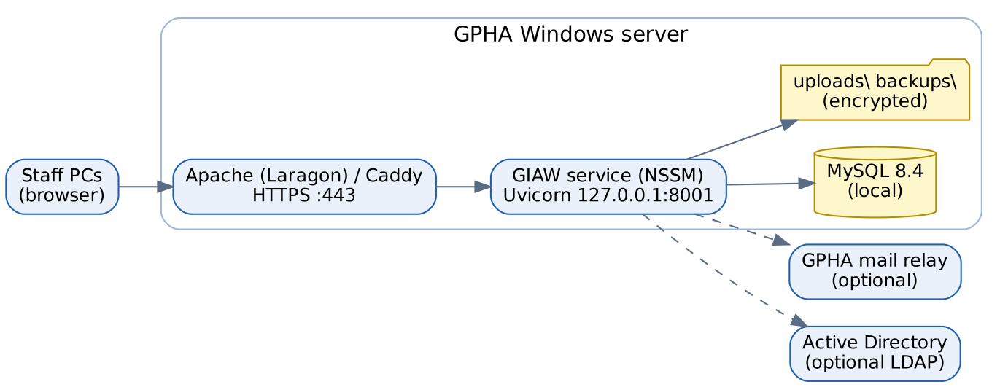

# Document control

| Item | Value |
|-----------------|---------------------------------------------|
| Document | Technology Stack |
| Version | 1.0 |
| Baseline | Commit `4e0d386`; versions below are those locked in `uv.lock` on 16 October 2026 |
| Audience | IT management, infrastructure, security review, developers |
| Recorded decision | 15 October 2026: the stack is **FastAPI + MySQL** with a plain JavaScript front end. React, TypeScript, Vite, Tailwind, Celery and Redis are **not** used. |

# 1. Stack at a glance

| Layer | Technology | Version | Why it was chosen |
|-------------------------------|---------------------------------------|---------------------------------------------|---------------------------------------------|
| Language | Python | 3.12+ (tested on 3.13) | Widely known; strong libraries for data, documents and security |
| Package and environment manager | uv | current | One command installs exact, locked versions (`uv sync --frozen`) |
| Web framework | FastAPI | 0.143.0 | Typed, fast and automatic validation; built-in API documentation |
| ASGI server | Uvicorn | 0.54.0 | Production-grade server for FastAPI; runs as a Windows service |
| Web toolkit | Starlette | 1.7.0 | Underlying FastAPI; middleware for security headers |
| Data validation | Pydantic / pydantic-settings | 2.14.1 / 2.15.0 | Field-level validation and environment configuration (`GPHA_` prefix) |
| ORM | SQLAlchemy | 2.1.4 | Mature ORM with transactions and events |
| Migrations | Alembic | 1.20.0 | Versioned, reviewable schema changes; applied at start-up |
| Database | MySQL | 8.x (production target 8.4 LTS; Docker dev image 8.0) | GPHA-supported, robust, free; InnoDB with triggers for the append-only trail |
| Database driver | PyMySQL | 1.2.3 | Pure-Python driver, no compiler needed on Windows |
| Password hashing | bcrypt | 5.0.0 | Industry-standard slow hash |
| Encryption at rest | cryptography | 50.0.2 | Encrypts uploads and backups (`GPHA_ENCRYPTION_KEY`) |
| Sessions and signing | itsdangerous | 2.2.0 | Signed tokens |
| Directory sign-in | ldap3 | 2.9.1 | Optional Active Directory bind |
| Word documents | python-docx | 1.2.0 | Reports, packs, engagement letters, controlled copies |
| Excel | openpyxl | 3.1.5 | Register exports and Excel import |
| Uploads | python-multipart, aiofiles | 0.0.32, 25.1.0 | Multipart file upload, async file I/O |
| E-mail validation | email-validator | 2.3.0 | Validates addresses |
| Front end | Plain HTML, CSS and JavaScript (ES2020) | – | No build step, so no Node toolchain on the server; easy to audit and maintain |
| Icons and fonts | Bootstrap Icons, Inter (self-hosted) | – | No external CDN calls; works offline and passes a strict CSP |
| HTTPS front door | Apache (Laragon) or Caddy 2 | – | TLS termination and reverse proxy (`deploy/laragon/gpha-audit.conf`, `deploy/Caddyfile`) |
| Windows service | NSSM | – | Runs Uvicorn as a service that restarts after failure |
| Development database | Docker Desktop + `mysql:8.0` | – | Same engine as production, on port 3307 |
| Tests | pytest, httpx, Playwright (Chromium) | 9.1.1, 0.28.1, 1.64.0 | API, integration and browser tests |
| Code quality | ruff, bandit, pip-audit | 0.17.0 | Lint, static security analysis, dependency vulnerability check |
| Diagrams (docs) | Graphviz | – | Architecture and workflow diagrams in these documents |

# 2. Runtime topology

{width=100%}

| Component | Where | Port | Notes |
|----------------|-----------------------------------|------------------------------|---------------------------------------------|
| Browser | Staff PCs | – | Recent Edge or Chrome; phones and tablets are supported |
| Apache / Caddy | GPHA server | 443 (HTTPS) | TLS certificate from GPHA (or `tls internal`) |
| GIAW (Uvicorn) | GPHA server | 127.0.0.1:8001 | Only reachable through the proxy |
| MySQL 8.4 | GPHA server (or a GPHA DB server) | 3306 (prod), 3307 (dev Docker) | Needs `log_bin_trust_function_creators=1` |
| File storage | Server disk: `uploads\`, `backups\` | – | Encrypted; include in server backups |
| SMTP relay | GPHA Exchange / Microsoft 365 | 25/587 | Optional |
| Active Directory | GPHA domain controllers | 389/636 | Optional |

# 3. Server sizing (recommendation)

These are **provisional recommendations** for about 50 to 150 users. Confirm them with GPHA IT.

| Resource | Minimum | Recommended |
|----------------|------------------------------------|-----------------------------------|
| Operating system | Windows Server 2019 / Windows 10 Pro | Windows Server 2022 |
| CPU | 2 vCPU | 4 vCPU |
| Memory | 4 GB | 8 GB |
| Disk | 60 GB | 200 GB (uploads grow with evidence) |
| Backup target | Separate disk or share | Off-server copy, encrypted |

# 4. Environments

| Environment | Purpose | Data | Database |
|---------------------|---------------------------------------------|---------------------------------------------|-------------------------|
| Development | Building and testing (developer PC: `.\run.ps1`, http://127.0.0.1:8001) | Demo data only (`scripts/seed_demo.py`) | Docker MySQL on port 3307 |
| Test (automated) | pytest | Created and dropped each run | `gpha_workspace_test` |
| Staging (recommended) | UAT and release rehearsal | Copy of production structure, synthetic or masked data | MySQL 8.4 |
| Production | Live use | Real GPHA data; starts empty | MySQL 8.4 |

# 5. What is deliberately not used, and why

| Not used | Reason |
|------------------------------------|---------------------------------------------|
| React / TypeScript / Vite / Tailwind | Adds a build pipeline and toolchain the GPHA team would have to maintain. The plain JavaScript design system covers the needs. |
| Celery / Redis | Background work is light; in-process schedulers are enough and need no extra servers |
| External CDNs and analytics | Data protection and offline resilience; strict Content-Security-Policy |
| Cloud-only services | GPHA hosts the system on its own infrastructure |

# 6. Upgrade and support policy (recommendation)

- Pin all versions in `uv.lock`. Upgrade quarterly in staging first, run the full test suite and `pip-audit`, then release.
- Apply Windows and MySQL security patches monthly.
- Keep Python on a supported release (3.12 or later).
- Review this document at every major release.
