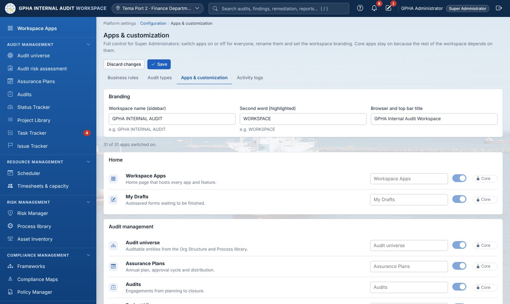
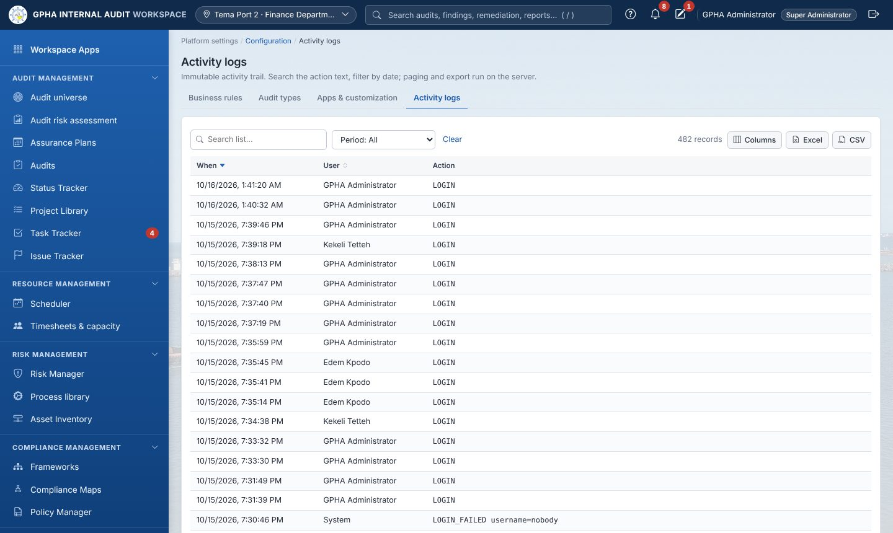
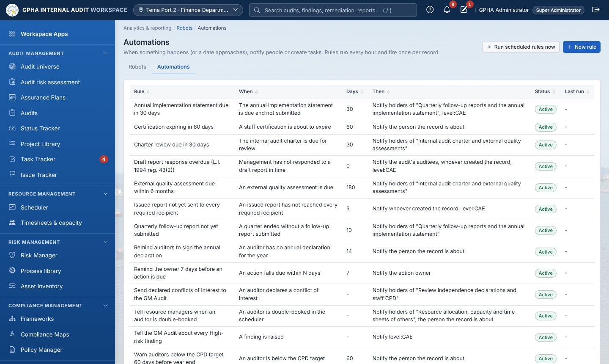

# Document control

| Item | Value |
|-----------|---------------------------------------------|
| Document | Administration Guide |
| Version | 1.0 |
| Audience | Super Administrators, Administrators (platform), GPHA IT (server, database, network) |
| Baseline | Commit `4e0d386` |

> **Security rule.** Never put `.env`, the encryption key, backups or database dumps in e-mail, chat or source control.

# 1. Administration roles

| Who | GIAW job role | Main duties |
|-----------------------------------------|--------------------------------|---------------------------------------------|
| Super Administrator (at least two people) | `super_admin` | Full control: the Roles & permissions matrix, appointing administrators, Apps & customization (switch apps on or off, rename, branding) |
| Administrator | `admin` | Day-to-day platform running: users, configuration, reference data, workflow rules, methodology libraries, backups, activity logs. Does not perform or approve audit work. |
| GPHA IT | (server access, not a GIAW role) | Server, Windows service, MySQL, HTTPS certificate, network, off-server backups, patching |
| GIAW system owner | (business) | Approves configuration changes and new users; owns the decision register |

# 2. Installation

## 2.1 Development or demonstration PC

1. Install Docker Desktop, [uv](https://docs.astral.sh/uv/) and Git.
2. Get the code into `C:\dev\GPHAIAWORKSPACE`.
3. Copy `.env.example` to `.env` and adjust it.
4. Open PowerShell in the folder and run `.\run.ps1`. The script:
   - starts Docker and the MySQL container (`gpha-mysql`, port 3307);
   - installs dependencies (`uv sync`);
   - checks the database and applies migrations;
   - starts the app.

   It refuses to start if the database cannot be reached.
5. Open <http://127.0.0.1:8001> and sign in with the bootstrap administrator from `.env`.
6. Optional: load demo data with `uv run python -m scripts.seed_demo`. **Never** do this on production.

## 2.2 Production server (Windows)

Follow `deploy/PRODUCTION.md`. Summary:

| # | Step | Command / action | Who |
|-----------|--------------------|---------------------------------------------|-------------------|
| 1 | Server ready | Windows Server, Laragon (Apache + MySQL 8), uv, NSSM, Git; static IP and DNS name (e.g. `audit.gpha.gov.gh`) | IT |
| 2 | Get the code | Clone to e.g. `C:\apps\gpha-audit`. Do **not** copy `.env`, `uploads\`, `backups\` or a development database. | IT |
| 3 | Database | Run `deploy\mysql\create-production-database.sql` (set the password); add `log_bin_trust_function_creators=1` under `[mysqld]` in `my.ini` | DBA |
| 4 | Configuration | `powershell -ExecutionPolicy Bypass -File deploy\windows\1-new-production-env.ps1`: generates the keys on the server and asks for the database account, folders and first administrator | IT |
| 5 | Install | `deploy\windows\2-install.ps1`: installs dependencies, creates the empty schema and the first administrator, runs the readiness check | IT |
| 6 | Service | `deploy\windows\3-install-service.ps1 -Nssm C:\tools\nssm\win64\nssm.exe`: runs on `127.0.0.1:8001`, starts with Windows, restarts on failure | IT |
| 7 | HTTPS | Copy `deploy\laragon\gpha-audit.conf` into Apache `sites-enabled`, set the server name and certificate, enable `mod_ssl mod_proxy mod_proxy_http mod_headers mod_rewrite`. Alternatively use `deploy\Caddyfile`. | IT |
| 8 | First sign-in | Browse to the HTTPS address, sign in, set up your own two-step verification, then empty `GPHA_ADMIN_PASSWORD=` in `.env` | Super Admin |
| 9 | Reference data | Organizations (ports, departments, units, plan destinations), users and job roles, audit types, audit universe, criteria library | Admin / Audit Admin |
| 10 | Configuration review | Reporting recipients, follow-up and professional-practice texts, KPI targets, escalation days, public holidays, e-mail | GM Audit |
| 11 | Backup proof | `uv run --no-dev python -m scripts.verify_backup`; keep the output and repeat quarterly | IT |
| 12 | Readiness | `uv run --no-dev python scripts/production_check.py`: all items OK except the two-step switch | IT |
| 13 | Go-live | Configuration › Security: choose the roles and tick *Enforce two-step verification*; announce the address | Super Admin |

With `GPHA_ENVIRONMENT=production`, the app **refuses to start** until:

- `GPHA_SECRET_KEY` is a random value of 32 or more characters;
- `GPHA_ENCRYPTION_KEY` is set (back it up: encrypted files are unreadable without it);
- `GPHA_ADMIN_PASSWORD` is not the default;
- `GPHA_COOKIE_SECURE=true`;
- the database is MySQL.

## 2.3 Updating to a new release

1. Take a backup (Backups screen, or wait for the scheduled one) and confirm it completed.
2. `nssm stop GPHA-Audit`
3. `git pull`, then `uv sync --no-dev --frozen`
4. `nssm start GPHA-Audit`. Database changes are applied automatically at start-up.
5. Check `/health` and sign in. Users press **Ctrl+F5** once.

# 3. Environment settings (`.env`)

| Setting | Default | Purpose |
|---------------------------------------------|------------------------------------|---------------------------------------------|
| `GPHA_ENVIRONMENT` | development | `production` turns on the start-up guard and hides the API docs |
| `GPHA_SECRET_KEY` | dev value | Application secret (generate for production) |
| `GPHA_ENCRYPTION_KEY` | derived | Encrypts working papers, evidence and backups (**back up separately**) |
| `GPHA_DATABASE_URL` or `GPHA_MYSQL_*` | dev DSN | Database connection |
| `GPHA_SESSION_TTL_HOURS` | 12 | Session lifetime |
| `GPHA_COOKIE_SECURE` | false | `true` behind HTTPS |
| `GPHA_ADMIN_USERNAME` / `_PASSWORD` / `_EMAIL` / `_FULL_NAME` | admin | Bootstrap administrator |
| `GPHA_LOGIN_MAX_ATTEMPTS` / `GPHA_LOGIN_LOCKOUT_MINUTES` | 5 / 15 | Account lockout |
| `GPHA_LOGIN_RATE_LIMIT_PER_MINUTE` | 10 | Sign-in attempts per computer per minute |
| `GPHA_MAX_UPLOAD_MB` / `GPHA_UPLOAD_ALLOWED_EXTENSIONS` | 25 / office, PDF, image, mail, audio | Upload limits |
| `GPHA_BACKUP_DIR` / `_RETENTION` / `_INTERVAL_HOURS` | ./backups / 7 / 24 | Backups |
| `GPHA_SMTP_HOST` / `_PORT` / `_USER` / `_PASSWORD` / `_FROM` / `_STARTTLS` | empty / 25 | E-mail (empty host means in-app bell only) |
| `GPHA_APP_BASE_URL` | http://127.0.0.1:8001 | Links in e-mails |
| `GPHA_LDAP_*` | empty | Active Directory sign-in |
| `GPHA_ESCALATE_MANAGER_DAYS` / `_CAE_DAYS` / `GPHA_ESCALATION_CHECK_MINUTES` | 14 / 30 / 60 | Overdue-action escalation |
| `GPHA_MFA_REQUIRED_ROLES` | empty | Roles that must use two-step verification |
| `GPHA_AI_API_KEY` | empty | AI provider key (never stored in the database) |

Most business rules can also be changed on the **Configuration** screen. A value saved there overrides the `.env` default and takes effect without a restart.

# 4. Users and access

{width=100%}

## 4.1 Creating and managing users

1. Open **Platform settings › Users** (Profile & Users).
2. Select **Add user**, then enter the username, full name, e-mail, temporary password and **job role**. The job role sets the access tier and approval level.
3. For managers, set the **review level**: Unit Head, Manager, PIA or CAE (GM Audit).
4. Ask the user to set **Where I work** (port or department). This drives port scoping and plan distribution.
5. Self-registered and Active Directory accounts arrive **inactive**. Review them and activate the genuine ones.

| Task | How |
|----------------------------------------|---------------------------------------------|
| Unlock a locked account | Users › select user › **Unlock** |
| Reset two-step verification (lost phone) | Users › the user's row › **Reset 2-step** |
| Leaver | Set the user **inactive**. Their sessions end immediately. Users with activity are never deleted. |
| Role change | Edit the job role. Their other sessions end and must sign in again. |
| Password reset (server) | `uv run python -m scripts.reset_password` (break-glass) |

## 4.2 Job roles and permissions

{width=100%}

| Job role | Tier | Default scope |
|-------------------|-----------|---------------------------------------------|
| Super Administrator | Admin | All 51 permissions, including `system.superadmin` (locked role) |
| Administrator | Admin | Platform, configuration, methodology libraries, reference data, backups, logs. **No** audit execution or approval. |
| Manager | Auditor | Unit Heads, Audit Managers, PIAs and GM Audit (set the review level). Plan, approve, review, close, follow-up, oversight. |
| Auditor | Auditor | Senior Auditors, Auditors, Audit Clerks: plan and perform engagements, fieldwork, evidence, findings, validation |
| Audit Client | Auditee | Management and staff of audited units: respond to requests, findings and actions, attest to policies, keep their risks current |

The **Roles & permissions** matrix lets a Super Administrator tick or untick any of the 51 permissions for each role, and **Reset** a role to its defaults. The 9 permission categories are:

- Platform;
- Audit methodology;
- Planning & oversight;
- Engagements;
- Review & reporting;
- Follow-up;
- Auditee & governance;
- Risk & compliance;
- Services.

> **Separation of duties is enforced by the system regardless of permissions.** A preparer can never approve their own plan, test, report, closure, policy or remediation.

> **Open item (QA-03).** Audit Committee member accounts cannot currently be created: the Committee tier is converted to Auditee. Until GPHA decides, committee information is shared through the Committee pack (Word).

# 5. Organization and reference data

{width=100%}

| What | Where | Notes |
|---------------------------------------------|---------------------------------------------|---------------------------------------------|
| Ports, head office, departments, units, external parties | Org Structure › Organizations | Each entity has a type, a parent ("Part of") and an address. Types marked as ports or sites file every entity under its port. |
| Plan destinations (HQ, PIA Tema, PIA Takoradi) | Organization record › *Receives the approved Assurance Plan* | Nothing is hard-coded |
| Processes | Process library | Linked to org units, risks and controls |
| Contacts | Org Structure › Contacts (Stakeholders) | Auditee contacts |
| Custom fields | Configuration | On organizations, audits, findings and recommendations (text, number, date, drop-down, yes/no) |
| Audit types, terms and custom attributes | Configuration › Audit types | 17 renameable terms per audit type; up to 10 custom attributes per page |
| Frameworks and standard controls | Frameworks | Typed in or imported from CSV (`/api/library/controls/template.csv`) |

# 6. Configuration (business rules)

{width=100%}

Every change made on Configuration is logged with who, what and when. The rule groups are:

| Group | Rules (examples) |
|-------------------------|---------------------------------------------|
| Audit workflow (12) | Issued report required to close; management responses and agreed actions before closing; Low findings without action; approved planning memo before fieldwork; review chains for reports and working papers; survey at closure; notify auditees when fieldwork starts |
| Action plans (7) | Default due days by risk (High 30 / Medium 60 / Low 90); escalation on/off; days to escalate to Audit Managers, CAE, Audit Committee |
| KPI targets (5) | Plan delivery %, actions closed on time %, survey score, days to report, time charged to audit work |
| Audit methodology (10) | Audit types; Workplan vs Internal Control workflow; sample sizes by control frequency; rating scale; issue types; sign-off levels; preparer-first rule; password on sign-off; framework kinds; working hours per day |
| Plan configuration (9) | High/Medium risk thresholds; audit cycle in years by risk level; plan-cycle enforcement; distribution before execution; significant-change %; default engagement hours |
| Organizations (3) | Entity types; Org Structure types; port/site types |
| Security (5) | Roles requiring two-step verification; port and team scoping; HQ workplace types; enforce two-step; sign-in attempts per minute |
| Follow-up & reporting (9) | Days to respond to draft reports; public holidays; recommendation sources; timeframes; committee closes recommendations; report recipients; annual statement due date |
| Professional practice (9) | Independence declarations before fieldwork; declaration texts; CPD hours; charter review months; EQA years; conformance statement; file retention years |
| AI (7) | Allow AI; provider; model; endpoint (http/https only); redact personal data; maximum characters; timeout |
| Reports (4) | Organisation and department name; classification footer; default methodology paragraph |
| Risk & compliance (10) | Risk categories; appetite levels; treatments; risk review months; obligation kinds; policy categories; policy review months; asset and third-party types; classifications; third-party review months |

# 7. Apps & customization

{width=100%}

The Super Administrator can:

- switch apps off: they disappear for everyone and their API is refused;
- rename apps: the new name shows in the sidebar and on the Workspace Apps page;
- set the branding: workspace name and browser tab title.

Core apps stay on. Select **Save** to apply, or **Discard changes**.

# 8. Security operations

| Task | How |
|--------------------------------------------|---------------------------------------------|
| Enforce two-step verification at go-live | Configuration › Security: choose the roles, tick *Enforce two-step verification for the roles above* |
| Locked out of two-step verification (server) | `uv run python -m scripts.mfa_policy` (show), `--off` / `--clear`, `--roles Admin` |
| Review activity | **Activity logs** (Configuration tab): filter by user, action and date; export to Excel or CSV |
| Review access quarterly | Export Users; confirm every active account with its line manager; deactivate leavers |
| Secrets | Rotate `GPHA_SECRET_KEY` if exposed (all users must sign in again). **Never** lose `GPHA_ENCRYPTION_KEY`. |

{width=100%}

# 9. Backups and restore

{width=100%}

| Item | Detail |
|------------------|---------------------------------------------|
| Automatic | Every `GPHA_BACKUP_INTERVAL_HOURS` (24 h); newest `GPHA_BACKUP_RETENTION` (7) kept; encrypted `backup_<stamp>.json.enc` or `.sql.enc`; sessions excluded |
| On demand | Backups screen › **Run backup now** (Administrators) |
| Off-server copy | GPHA IT copies `backups\` (and `uploads\`) to separate storage daily |
| Verify (quarterly) | `uv run --no-dev python -m scripts.verify_backup`: restores into a scratch database and compares every table |
| Decrypt only | `uv run python -m scripts.restore_backup backups\<file>.enc --decrypt-only` (delete the plaintext afterwards) |
| Restore | Point `GPHA_DATABASE_URL` at a **new, empty** database, then `uv run python -m scripts.restore_backup backups\<file>.enc --yes` |

> The encryption key must be stored separately from the backups, for example in a sealed envelope in the safe and in the IT password vault. Without it, backups cannot be restored.

# 10. Automations, robots and notifications

{width=100%}

- **Automations** are rules of the form *when <event or date> [and conditions] then notify people / create tasks*. There are 12 built-in rules (due-date reminders, overdue draft responses, declarations, CPD, charter review, statutory reports, High-risk findings and others) that can be edited, previewed or switched off. They run hourly and fire once per record, and every run is logged.
- **Robots** run fixed, read-only analytics on a schedule (for example open High issues or overdue actions) and publish into Results tables.
- **E-mail** is sent only when `GPHA_SMTP_HOST` is set; otherwise users see notifications under the bell.

# 11. Monitoring and health

| Check | How | Expected |
|---------------|---------------------------------------------|---------------------------------------------|
| Application up | `https://<server>/health` | `200` with database status and `can_save: true` |
| Service | `nssm status GPHA-Audit` | SERVICE_RUNNING |
| Database outage | Users see a red banner; the API returns `503` | The app migrates and recovers automatically when the database returns |
| Disk space | Windows monitoring on `uploads\` and `backups\` | At least 20 % free |
| Backups | Newest file date on the Backups screen | Within 24 h |

# 12. Troubleshooting

| Symptom | Likely cause | Fix |
|---------------------------------------------|---------------------------------------------|---------------------------------------------|
| `run.ps1` stops: "database cannot be reached" | Docker or MySQL not running | Start Docker Desktop and run `.\run.ps1` again |
| Page looks unstyled or old | Browser cache after an update | Press **Ctrl+F5** |
| "Account temporarily locked" | 5 failed sign-ins | Wait 15 minutes, or have an administrator select Unlock |
| "Too many attempts" (429) | Per-computer throttle | Wait one minute |
| A user cannot see an app | App switched off, or role lacks the permission | Apps & customization / Roles & permissions |
| An auditee cannot see an audit | Not assigned as auditee | Audit › Auditees with access › add |
| An issue is not visible to the auditee | Not published | Publish the issue (or send the draft report) |
| Cannot close an audit | Closure checklist not met, or you prepared it | Complete the checklist; a different authorised person signs |
| E-mails not arriving | SMTP not set or blocked | Check `GPHA_SMTP_*` and the relay allow-list |
| App will not start in production | Start-up guard: unsafe settings | Run `scripts/production_check.py` and fix each item |
| Git "File exists … .lock" | Stale lock file after a crash | Rename the `.git\*.lock` file and retry |

# 13. Script reference

| Script | Purpose |
|--------------------------------------|---------------------------------------------|
| `scripts.init_db` | Create the schema and bootstrap administrator |
| `scripts.seed_demo` | Demo data (development only) |
| `scripts.production_check [--secrets]` | Readiness report; prints fresh secrets |
| `scripts.verify_backup` | Restore-test the newest backup |
| `scripts.restore_backup` | Decrypt or restore a backup |
| `scripts.reset_password` | Reset a user's password from the server |
| `scripts.mfa_policy` | Show or change the two-step verification policy |
