# About this manual

This manual explains how to use the GPHA Internal Audit Workspace (GIAW), screen by screen. The pictures were taken from the system with demonstration data, so names and numbers in them are examples only. Your screens show only the apps and buttons your job role allows.

| If you are… | Read |
|---------------------------------------------|-----------------------------------------|
| New to GIAW | Chapters 1 to 3 |
| Auditor or Senior Auditor | Chapters 1 to 4, then 5 |
| Unit Head, Audit Manager, PIA, GM Audit | All chapters, especially 4, 6 and 8 |
| Auditee (management or staff of an audited unit) | Chapters 1, 2 and 9 |
| Administrator | This manual plus the Administration Guide |

# 1. Who uses GIAW and for what

| Job role | You use GIAW to… |
|---------------------------------------------|---------------------------------------------|
| Auditor (Senior Auditor, Auditor, Audit Clerk) | Plan and perform assigned audits, test controls, file working papers, request evidence, raise issues, validate remediation |
| Manager (Unit Head, Audit Manager, PIA, GM Audit) | Prepare and approve the plan, allocate teams, review and sign off work, review and approve reports, close audits, monitor follow-up, report to the Audit Committee |
| Audit Client (auditee) | Answer evidence requests, respond to issues, agree and update actions, attest to policies, keep your risks current |
| Administrator / Super Administrator | Manage users, configuration, reference data and backups (see the Administration Guide) |

# 2. Getting started

## 2.1 Signing in

{width=95%}

1. Open the GIAW address given by IT (for example `https://audit.gpha.gov.gh`) in Edge or Chrome.
2. Enter your **username** and **password**, then press **Enter** or select **Sign in**.
3. If two-step verification is on for your role, enter the 6-digit code from your authenticator app. The first time, GIAW shows a QR code to scan.
4. After 5 wrong passwords your account is locked for 15 minutes. An administrator can unlock it sooner.

> GIAW never asks for your password by e-mail. Sign out when you leave your computer (the door icon, top right).

## 2.2 The screen layout

{width=100%}

| Area | What it does |
|-------------------------|---------------------------------------------|
| **Top bar, left** | GPHA logo and name (returns to the home page); **workplace selector** (your port or department, used to filter lists) |
| **Search** (or press `/`) | Finds audits, issues, actions, reports and registers you are allowed to see |
| **? Help** | Help for the page you are on |
| **Bell** | Your notifications: assignments, reviews, reminders, escalations |
| **Pencil** | **My Drafts**: forms you started and did not finish |
| **Your name** | Your profile: password, two-step verification, *Where I work* |
| **Sidebar** | **Workspace Apps** at the top, then the app groups: Audit management, Resource management, Risk management, Compliance management, Analytics & reporting, Platform settings. Select a group title to fold or unfold it. |
| **Workspace Apps page** | Every app you can use, as tiles grouped like the sidebar, some with live counts (for example *4 open*) |

On a phone or small tablet the sidebar is hidden. Open it with the menu button (☰) at top left.

{width=40%}

## 2.3 Help and notifications

{width=100%}

{width=100%}

Select a notification to open the record it is about. Notifications are also sent by e-mail when GPHA has configured an e-mail relay.

# 3. Working with lists, forms and approvals

## 3.1 Lists (registers)

{width=100%}

Every register works the same way:

- **Search list…** filters as you type. The drop-down filters (Status, Stream, Port…) narrow the list.
- Select a **column heading** to sort; select it again to reverse.
- **Columns** chooses which columns to show. **Excel** and **CSV** export exactly what you see, within your access.
- **Saved views** keep a named set of filters.
- Paging is at the bottom (for example *25 / page*).
- Select a row, or its reference, to open the record.

## 3.2 Forms and never-lost data entry

{width=100%}

- Required fields are marked with **\***. Mistakes are shown under the field, in plain words, as you type and again when you save.
- **Everything you type is saved as a draft automatically**, on your computer at once and on the server a second later. If your browser closes or the network drops, reopen the form and select *Restore*. Drafts are listed under **My Drafts** (pencil icon) with *Continue* and *Discard*.
- **Save draft** keeps the form for later. The main button (**Create**, **Save**) saves the record.

## 3.3 Electronic signatures and segregation of duties

Approvals, such as approving the plan, reviewing a test, approving a report or closing an audit, are **electronic signatures**. Depending on the setting, you re-enter your password, and GIAW records your name, the decision and the time. **You cannot approve your own work.** A different authorised person must sign. Every change is kept in **History** and **Activity logs**.

# 4. Audit management

## 4.1 Audit universe

{width=100%}

The audit universe is the list of **auditable entities**: units, processes and systems defined on the Org Structure and the Process library. Each entity shows its risk rating, audit frequency, when it was last audited, when the next audit is due and any planned audits. Use **Let's start**, **Define** or **Redefine** to build or update the universe. Open an entity to see its details, its risk assessments, its audits, and its findings and actions.

## 4.2 Audit risk assessment

{width=100%}

1. Select **Add audit risk assessment**, name it and choose the entities.
2. Check the **Settings**: the assessment factors (for example Financial materiality, Fraud and integrity risk, Time since last audit) and the rating scale.
3. Score each entity on each factor in **Scoring**. The overall score and risk rating are calculated.
4. **Conclude** and **Mark as completed**, then **Start planning** to carry the priorities into the Assurance Plan.

## 4.3 Assurance Plans

{width=100%}

{width=100%}

The Assurance Plan is the annual risk-based plan. It goes through these stages:

1. **Planning preparation** (checklist) → **Risk / universe review** → **Audit Managers' planning meeting** (date, attendees, minutes).
2. **Draft plan**: add engagements (entity, quarter, budget hours, lead auditor). The overview shows **Budgeted hours, Sum of audit hours, Remaining hours** and coverage, including high-risk units not planned.
3. **Internal review** by the GM Audit (approve, or return with comments).
4. **Submission** and the **Audit Committee decision** (Approved / Approved with amendments / Deferred / Returned).
5. The **approved version** is frozen and numbered, with a Word controlled copy.
6. **Distribution** by the GM Audit to each destination (HQ, PIA Tema, PIA Takoradi). Recipients acknowledge receipt.
7. **Execution**: select **Start** on an engagement to create its audit.

Changing an approved plan always goes through a **plan change request (PCR)**. It shows the resource and coverage impact, needs an independent reviewer and the GM Audit's approval, and goes to the Audit Committee when the change is significant. Use **Table** / **Timeline** on *All audits* to see the year as bars. Use **Include audits** to bring existing audits into the plan.

## 4.4 Audits

### Creating an audit

Audits are normally created by **Start** on a plan engagement. An authorised user can also select **New audit** on the Audits list (Figure: New audit) and enter the title, audit type, port and scope.

### The audit page

{width=100%}

| Part of the page | Use |
|----------------|---------------------------------------------|
| Header | Title, reference (`AUD-0001`), status. **Edit**, **Engagement letter** (Word), print. |
| Utility links | **Review notes**, **Time entries**, **To-dos**, **History**, **Approvals** |
| Tabs | **Dashboard · Planning · Fieldwork · Reviews · Results · Issues · Progress · Requests** (the names can be adjusted per audit type) |
| Dashboard | Scope, **Auditees with access** (add or remove auditees), working-paper review status, findings summary, independence declarations, engagement details, **Move to** (status change), **Engagement team**, **Closure readiness** checklist |

Status moves from **Planned → In Progress → Review → Closed**. **Closed** needs an electronic signature by an authorised person who did not prepare the audit, and every item on the **Closure readiness** list must be green.

### Planning tab

{width=100%}

Write the **planning memo**: background, objectives, scope, key risks, approach, team, timeline and budget. Submit it for approval. Fieldwork can start only after the memo is approved, if GPHA has turned that rule on. Team members complete their **independence declaration** for the engagement.

### Fieldwork tab

{width=100%}

| Sub-tab | What you do |
|--------------------------------------------|---------------------------------------------|
| **Narratives** | Describe how the process works; link the controls each narrative describes |
| **Risk control matrix** | For each **objective**, add **risks** (inherent and residual rating) and **controls** (type, nature, frequency, key control, owner). **From library** copies standard controls; **Suggest risks** (when AI is enabled) proposes risks for you to accept or ignore. The banner shows **coverage gaps**, such as risks without controls or untested key controls. |
| **Walkthroughs**, **Test plan**, **Testing** | Record walkthroughs and control tests: population, sample size (guidance by frequency, reproducible random sample), exceptions, results and conclusion (Effective / Ineffective). An ineffective test can **raise an issue** pre-filled from the test. |

**Apply audit programme** loads a Project Library programme. Audits using the **Workplan** workflow show **procedures** instead (objectives, procedures, results, conclusion, issues noted).

**Sign-offs.** Each page has sign-off circles (up to five levels: Preparer, Detail Reviewer, General Reviewer, Supplemental Reviewer, Specialty Reviewer). The preparer signs first. A reviewer signs when set as **Next Reviewer**. A signed page becomes read-only, and removing a sign-off also removes the later ones.

### Reviews tab

{width=100%}

The engagement quality review checklist (mapped to the IIA Standards) is completed by someone other than the preparer. **Review notes** (utility link) are raised by reviewers, answered by the team and cleared by the reviewer. Open notes block closure.

### Results tab (the audit report)

{width=100%}

The report goes through **Draft → Management Review → Manager Review → CAE Approval → Issued**. At each stage the reviewer approves (electronic signature) or returns it. When the draft goes to management, a response deadline is set (10 working days by default, skipping weekends and the configured public holidays). Record the **exit meeting**. Export the report to Word, or print it to PDF. Issues are frozen once the report is issued. **Supporting workpapers** are listed here.

### Issues tab

{width=100%}

1. Select **Add issue** (or **Import from Excel**). Enter the title, severity, issue type, owner, description and recommendation, then the effect and cause. **Draft with AI** may help when it is enabled.
2. New issues are **hidden from the auditee** until you **Publish** them. Sending the draft report or recording the exit meeting also publishes them.
3. The auditee records the **management response** (responsible officer and target date). An agreed **remediation action** is raised from the issue.
4. The **KPIs** tab shows issues by project and type.

### Progress tab

{width=100%}

This tab shows procedures completed, time to deadline, budget against time spent, **fieldwork status** (sign-off levels per page) and the **progress board** (Not started → Prepared → In review → Signed off).

### Requests tab

{width=100%}

1. Select **Request evidence**. Choose the auditee (who must be on *Auditees with access*), describe what you need, set a due date, optionally link the request to a test, procedure or issue, copy others in, and choose reminders (Daily or Weekly).
2. The auditee uploads files and **submits**.
3. You **accept** or **return** the evidence with a comment. Files are stored encrypted with a SHA-256 fingerprint.

## 4.5 Status Tracker

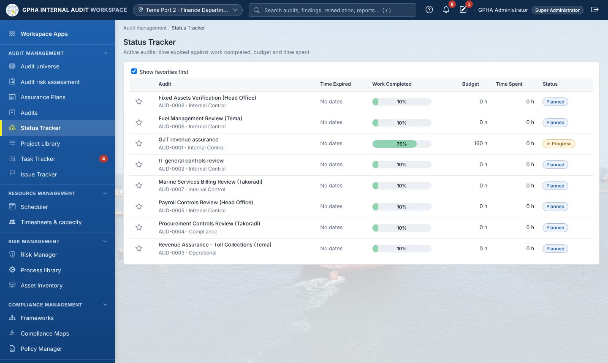{width=100%}

One line per audit: time expired, work completed, budget, time spent and status. Star your favourite audits and tick *Show favorites first*.

## 4.6 Project Library

{width=100%}

Reusable audit programmes (project templates) with objectives, risks, controls and procedures. Use **Apply audit programme** in an audit's Fieldwork tab to load one.

## 4.7 Task Tracker

{width=100%}

Task Tracker gathers everything assigned to you or by you. It has three tabs:

| Tab | Contents |
|--------------|---------------------------------------------|
| **Priorities** | Everything waiting for you, across all apps: evidence requests, agreed actions, policies to attest, risks to assess, indicators to record, compliance to assess, third parties to review, tasks. Counts show items waiting, overdue, and due within 7 days. Each item has its action button. |
| **To-dos** | Tasks: *Assigned to me*, *Assigned by me*, *Closed*. **New to-do** creates one; change the status and select **Save**. |
| **Requests** | All evidence requests you can see, with requester, description, linked item, owner, due date, status and files |

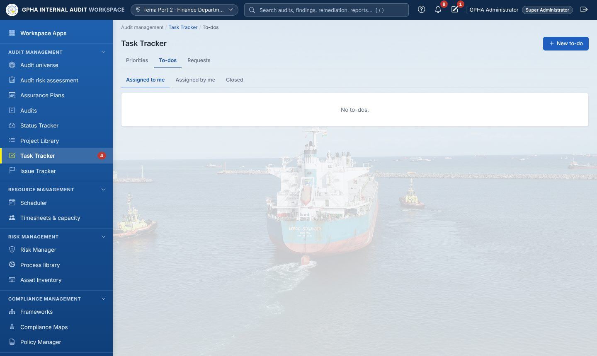{width=100%}

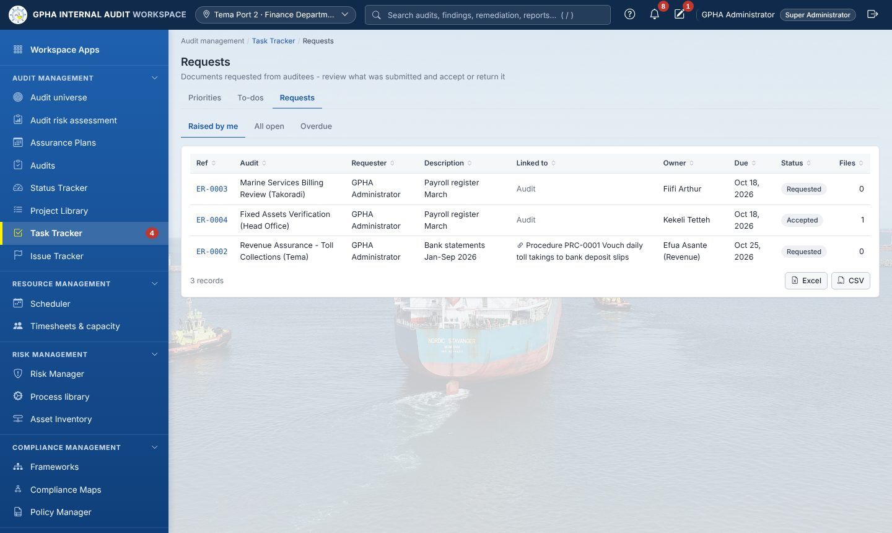{width=100%}

The red number on **Task Tracker** in the sidebar is the number of priorities waiting for you.

## 4.8 Issue Tracker and remediation

{width=100%}

**Issues** lists every issue you can see, across audits, with KPI charts by type and severity. **Actions** (Remediation & Follow-up) tracks the agreed actions:

{width=100%}

| Step | Who |
|---------------------------------------------|-------------------|
| Action raised from an issue, with owner and due date (default by severity: High 30, Medium 60, Low 90 days) | Auditor |
| Progress updates and implementation evidence; status Not / Partially / Fully Implemented | Action owner |
| **Validation** (follow-up testing): Effective, or Not Effective (reopened) | A different auditor |
| Closure (electronic signature) after validation | Authorised manager |
| Overdue actions escalate: owner → Audit Managers (14 days) → CAE (30 days) → Audit Committee | Automatic |

The **Statutory reports** tab produces the quarterly follow-up report and the annual statement on implementation of recommendations, in Word and Excel, and keeps a register of what was submitted.

# 5. Resource management

## 5.1 Scheduler

{width=100%}

A timeline, by quarter or year, of engagement windows and auditor bookings: engagement roles, leave, training and other work. Fieldwork dates must stay inside the planned quarter; moving to another quarter needs a plan change request. Overlaps are highlighted and resource managers are told.

## 5.2 Timesheets & capacity

{width=100%}

Record **daily time** in quarter hours. Time on an audit must name the audit, with a cap of 24 hours a day. Managers see **team capacity**, available against planned hours, the **skills matrix**, and **budget versus actual** per audit.

# 6. Risk management

## 6.1 Risk Manager

{width=100%}

The enterprise risk register. Each risk has:

- category, owner, cause and consequence;
- inherent, residual and target likelihood × impact scores (5 × 5);
- appetite and treatment;
- a review date.

Tabs: **Register**, **Heat maps**, **Strategy** (strategic objectives), **Indicators** (KRIs).

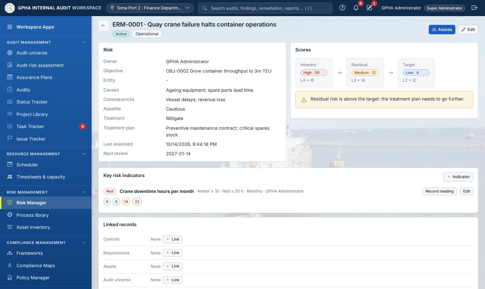{width=100%}

On a risk record, **Assess** records a new assessment, which is kept in the history. **Key risk indicators** have amber and red thresholds; **Record reading** adds a value. **Linked records** connect the risk to controls, requirements, assets and the audit universe. GIAW warns when the residual risk is above the target. Risk owners see overdue reviews in their Task Tracker.

## 6.2 Process library

{width=100%}

Business processes linked to org units, risks, controls and auditable entities. Use **Bulk add** for many at once.

## 6.3 Asset Inventory (including third parties)

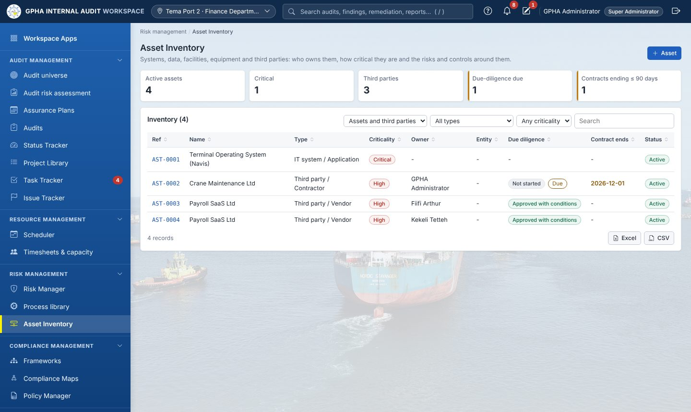{width=100%}

Systems, data sets, facilities, equipment and **third parties** (vendors and contractors), with owner, criticality and classification. For third parties you also record the contract reference and dates, due-diligence status and risk rating.

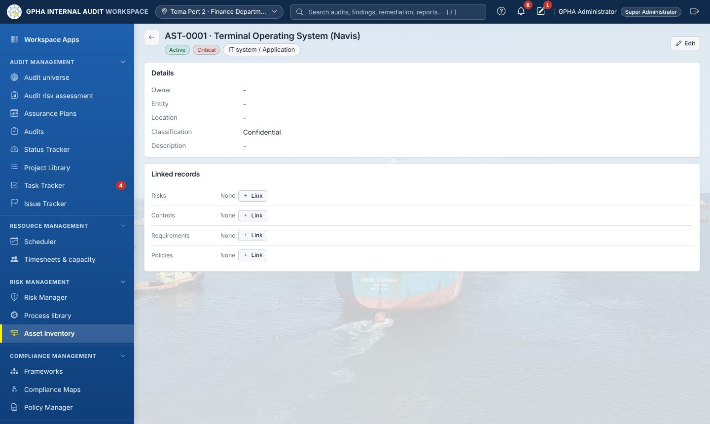{width=100%}

Record **due-diligence assessments** (date, rating, outcome, areas reviewed, findings). Critical and High third parties are re-assessed on a cycle (12 months by default), and the owner is reminded in Task Tracker. Contracts expiring within 90 days are flagged.

# 7. Compliance management

## 7.1 Frameworks

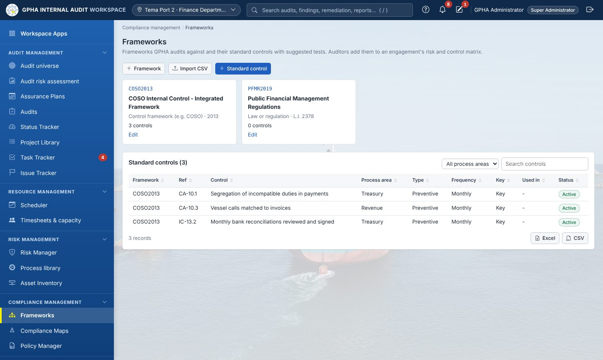{width=100%}

Frameworks GPHA audits against (COSO, ISO 31000, COBIT, PFM Regulations, GPHA procedures…) and their **standard controls**, typed in or imported from CSV. The library shows where each control is used.

## 7.2 Compliance Maps

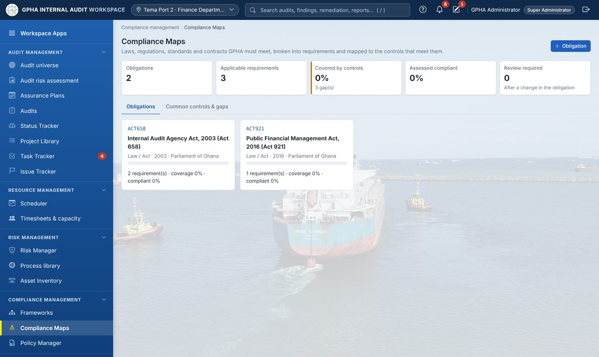{width=100%}

Obligations (laws, regulations, directives, standards, contracts, GPHA policies) broken into **requirements**. Each requirement has an owner, status and the controls that meet it. Owners assess their requirements from Task Tracker. A changed obligation flags its requirements for review.

## 7.3 Policy Manager

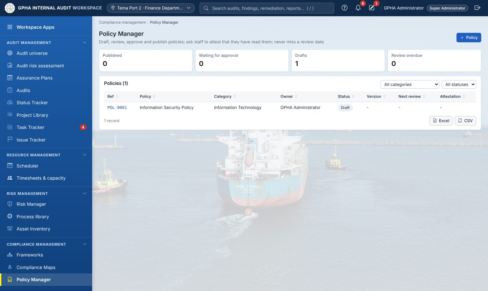{width=100%}

Draft a policy, send it for approval (never by its own author), publish a version, then run an **attestation campaign**. Staff read the policy and confirm it, or decline with a comment, from their Task Tracker.

# 8. Analytics and reporting

## 8.1 Analytics

{width=100%}

Headline KPIs against the configured targets (plan delivery, actions closed on time, overdue actions, days to report, satisfaction, time utilisation), the 5 × 5 inherent-risk heat map, findings raised per month by rating, and repeat findings across audits.

## 8.2 Results, Storyboards and Robots

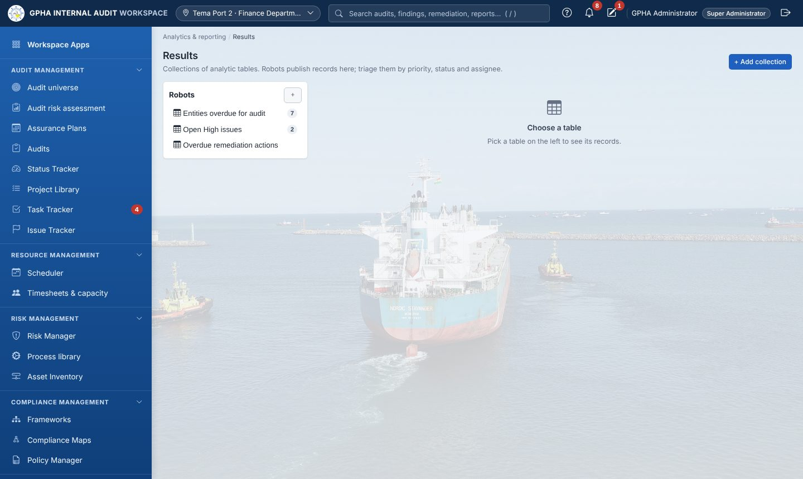{width=100%}

**Results** holds collections of analytic tables. Each record has a priority, status (New, Open, Under Review, Closed, False Positive), assignee and published flag. **Interpretations** (charts) and **Triggers** (automatic assign, notify, status or priority) work on these tables.

{width=100%}

**Storyboards** combine text, charts and metrics from Results and can be shared read-only.

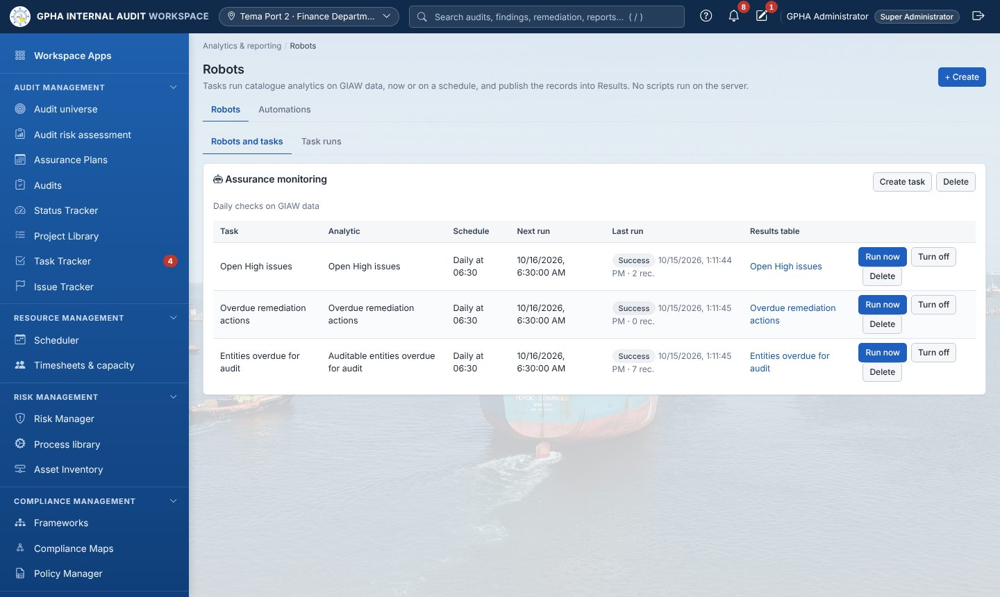{width=100%}

**Robots** run fixed analytics on a schedule (for example *open High issues*, *overdue actions*) and publish into Results. **Run now** runs a task immediately; **Task runs** shows the history.

## 8.3 Audit Committee

{width=100%}

| Tab | Contents |
|------------------------|---------------------------------------------|
| **Committee pack** | Plan delivery, reports issued and ratings, open findings by risk and age, action status, most overdue actions, items for decision. **Download** produces the Word pack. |
| **Meetings & decisions** | Meetings register, attendance, quorum, minutes (approved, then locked), decisions on recommendations (close, withdraw, extend, escalate) |
| **Governance portal** | Read-only view of approved plans, issued reports and dashboards |
| **Port portfolio** | Audit coverage and results by port |

## 8.4 Quality (QAIP)

{width=100%}

Engagement quality reviews, post-audit satisfaction surveys, the yearly QAIP summary with the weakest checklist areas, and the internal assessment report (Word). The tabs also hold **Professional practice** (charter, declarations, CPD, external assessments) and **Service feedback**.

# 9. For auditees (management and staff of audited units)

{width=100%}

You see only the audits you have been added to, and only issues that Internal Audit has published.

1. **Open Task Tracker › Priorities.** Everything waiting for you is listed with an action button.

   {width=100%}

2. **Answer evidence requests** (Requests tab, or the item in Priorities):
   - open the request;
   - **upload** your files;
   - write a short response;
   - select **Submit**.

   If Internal Audit returns it, the request comes back to you with a comment.

   {width=100%}

3. **Respond to issues**: give the management response, the responsible officer and the target date.
4. **Update your actions**: record progress and upload implementation evidence. Internal Audit validates and closes the action. You cannot close it yourself.
5. **Attest to policies** and **assess your risks** when they appear in Priorities.

{width=100%}

# 10. Frequently asked questions

| Question | Answer |
|--------------------------------------------|---------------------------------------------|
| I cannot see an app my colleague sees. | Apps follow your job role. Ask the system owner if you need more access. |
| I cannot approve something I prepared. | That is deliberate (segregation of duties). Another authorised person must sign. |
| My form disappeared when the browser closed. | Reopen the form and select *Restore*, or open **My Drafts**. |
| The auditee cannot see my issue. | Publish it. Unpublished issues stay internal. |
| The auditee cannot be chosen for a request. | Add them under **Auditees with access** on the audit's Dashboard first. |
| The audit will not close. | Check **Closure readiness** on the Dashboard; every item must be green. |
| The screen looks wrong after an update. | Press **Ctrl+F5**. |
| I am locked out. | Wait 15 minutes or ask an administrator to unlock your account. |

# 11. Quick reference cards

**Auditor**

1. Task Tracker › Priorities every morning.
2. Audit › Fieldwork: RCM, tests, sign-offs.
3. Request evidence; review and accept it.
4. Add issues, then publish.
5. Validate actions in Remediation.

**Manager**

1. Assurance Plans: prepare, review, distribute.
2. Start engagements and allocate teams.
3. Review sign-offs and clear review notes.
4. Approve the report through the chain.
5. Close audits (electronic signature).
6. Committee pack each quarter.

**Auditee**

1. Task Tracker › Priorities.
2. Submit the requested evidence.
3. Respond to published issues.
4. Update actions with evidence.
5. Attest to policies and assess your risks when asked.
