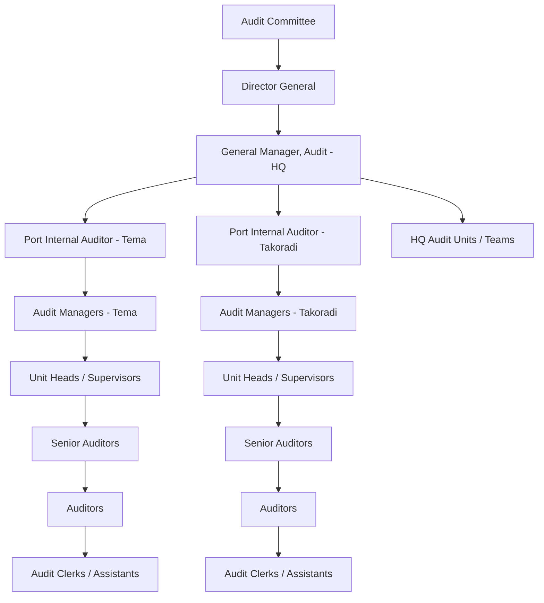
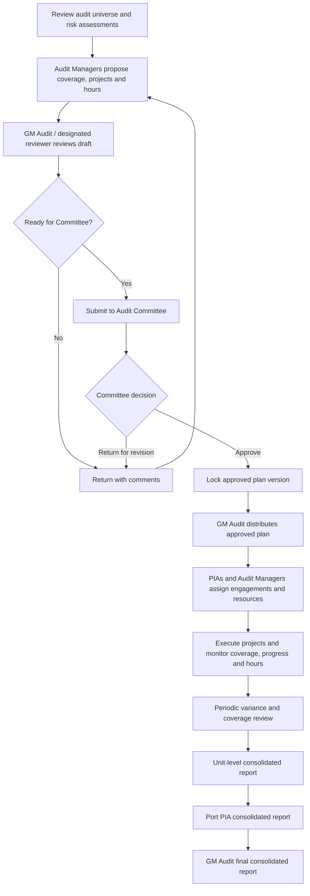
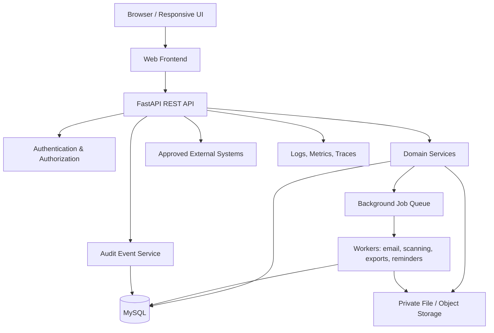
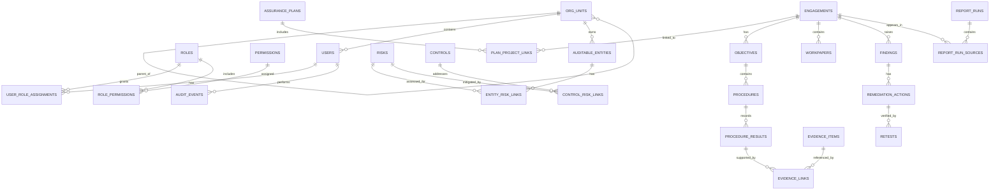

# GPHA INTERNAL AUDIT WORKSPACE (GIAW)
## Enterprise Functional, Technical, UX, Data, Workflow and Implementation Blueprint

**Document:** `giaw.md`  
**Product:** GPHA Internal Audit Workspace (GIAW)  
**Organization:** Ghana Ports and Harbours Authority (GPHA)  
**Primary reference platform:** Diligent One Platform, formerly Diligent HighBond  
**Required backend:** Python + FastAPI  
**Required database:** MySQL  
**Document status:** Implementation blueprint and requirements baseline  
**Version:** 1.0  
**Prepared:** 14 October 2026

---

## 1. Purpose, scope and interpretation

GIAW is a proposed integrated workspace for planning, executing, reviewing, reporting and monitoring internal audit work across GPHA. It should replace fragmented paper, Word and Excel processes with governed digital workflows, controlled evidence, traceable approvals and consolidated reporting.

This blueprint translates publicly documented Diligent One / HighBond product concepts into a GPHA-specific design. It is **not** a claim to reproduce Diligent's proprietary source code, private implementation details, exact database schema, undocumented internal APIs or every private screenshot. The public help pages describe user-facing behavior and configurable workflows; GIAW should implement equivalent business outcomes with its own code, UI, schema and visual identity.

### 1.1 Design principles

1. One integrated platform with clearly separated domain modules.
2. Begin as a **modular monolith**: one deployable FastAPI application, well-separated Python domains and shared governance. Split services only when scale, team boundaries or reliability justify it. This resolves the false choice between “modular apps” and “monolith”: GIAW is one platform containing multiple domain applications.
3. MySQL is the transactional system of record; uploaded files live in private object/file storage, not as large blobs in ordinary relational rows.
4. All sensitive operations require authentication, authorization and audit logging.
5. Workflow transitions are explicit, validated and permission-controlled.
6. Data ownership follows GPHA organizational hierarchy and engagement assignments.
7. Forms, table columns, statuses, labels and required fields should be configurable where safe.
8. Audit records, approval events and evidence references must be traceable.
9. Design for low-bandwidth conditions, desktop-first audit work and responsive tablets/phones.
10. Use AI as an assistive feature, never as an unreviewed approver or final audit decision-maker.

## 2. Reference research and evidence boundaries

### 2.1 Primary references

- Diligent One Platform Help Center: https://help.diligentoneplatform.com/helpdocs/d1p/en-us/Content/global_topics/index.htm
- Diligent One Platform API Reference: https://docs-apis.highbond.com/#section/Making-requests
- Diligent One overview: https://help.diligentoneplatform.com/helpdocs/d1p/en-us/Content/diligent_one_platform_overview.htm
- Projects overview: https://help.diligentoneplatform.com/helpdocs/d1p/en-us/Content/projects/landing_page/executing_projects_in_projects.html
- Project workflows and types: https://help.diligentoneplatform.com/helpdocs/d1p/en-us/Content/projects/creating_projects/workflows_and_project_types.html
- Creating projects: https://help.diligentoneplatform.com/helpdocs/d1p/en-us/Content/projects/creating_projects/creating_projects.html
- Assurance Plans overview: https://help.diligentoneplatform.com/helpdocs/d1p/en-us/Content/projects/planning_projects/defining_assurance_plans.htm
- Getting started with Assurance Plans: https://help.diligentoneplatform.com/helpdocs/d1p/en-us/Content/projects/planning_projects/assurance-plans-get-started.htm
- Evidence workflow: https://help.diligentoneplatform.com/helpdocs/d1p/en-us/Content/projects/fieldwork/gathering_evaluating_evidence.htm
- Issues and remediation: https://help.diligentoneplatform.com/helpdocs/d1p/en-us/Content/projects/fieldwork/managing_issues/managing_issues_and_remediation.html

### 2.2 What public documentation establishes

The help center lists applications such as Projects, Assurance Plans, Issue Tracker, Scheduler, Timesheets, Frameworks, Evidence Hub, Activity Center, AI Reporting, Reports and Issue Manager. The Projects documentation describes projects as a place to define objectives, risks and controls, perform tests and compile reporting information. Project workflows define which components are available. The documented Workplan workflow emphasizes steps/procedures and recording outcomes; the Internal Control workflow emphasizes narratives, walkthroughs, and control design/operating-effectiveness testing.

The Assurance Plans documentation describes annual planning, scope/coverage, strategic-risk alignment, resources, progress and linked projects. The documented plan setup includes a name, description, available hours and planning-period dates; an assurance plan can contain up to 100 projects in the referenced product documentation. GIAW must not assume it must copy that product limit: make limits configurable.

Evidence work can include executing procedures or testing controls, requesting documentation, documenting issues, and collaborating with clients/team members. Issues can have owners, remediation plans/actions and retesting outcomes.

The API reference documents bearer-token authentication, HTTP methods (`GET`, `POST`, `PUT`/`PATCH`, `DELETE`), JSON API and JSON content types, pagination, and rate limits. The public reference currently says most endpoints are limited to six requests per second, while Groups and Users have stricter limits of three requests per minute. These are Diligent API limits, not GIAW limits.

### 2.3 What cannot be assumed

Public docs do not establish Diligent's private technology stack, internal source code, exact internal database schema, all proprietary screen assets, or implementation details not published in the help/API reference. GIAW technology choices below are recommendations for a new system, not assertions about Diligent's stack.

### 2.4 Screenshot and image strategy

Do not copy or hotlink proprietary screenshots as if they were GIAW assets. Build original screens from the interface specifications below. During implementation, capture approved reference screenshots for internal analysis if your organization has lawful access, then create original GPHA-branded mockups and acceptance screenshots. Use neutral placeholders in wireframes until actual GPHA logos, approved branding and records are supplied.

---

## 3. Product outcomes and success criteria

GIAW should enable GPHA Internal Audit to:

- Maintain a configurable audit universe aligned to HQ, Tema Port and Takoradi Port.
- Register organizational entities, sub-entities, departments, units and auditable areas.
- Maintain risk assessments, controls, audit universe ratings and risk-based priorities.
- Prepare, review, approve and distribute annual Assurance Plans.
- Create engagements/projects from plans, templates or prior-period roll-forward.
- Define objectives, scope, criteria, risks, controls, procedures and sampling plans.
- Request, upload, classify, review and preserve audit evidence.
- Record walkthroughs, test results, exceptions, findings and recommendations.
- Assign corrective actions, monitor deadlines, obtain management responses and retest remediation.
- Support reviewer notes, preparer/reviewer sign-offs and controlled approvals.
- Capture audit hours, schedules, resource allocations and progress.
- Produce Unit Head consolidated reports, Port Internal Auditor consolidated reports and GM Audit final consolidated reports.
- Preserve a defensible audit trail of who did what, when, and under which authority.
- Provide dashboards and exportable reports with access controls.
- Reduce duplicated data entry and improve consistency without eliminating professional judgment.

### 3.1 Suggested acceptance indicators

Set baselines after discovery. Suggested targets:
- 100% of published reports linked to an approved engagement and source workpapers.
- 100% of approval and status transitions written to immutable-style audit history.
- All evidence downloads and access-controlled changes logged.
- 0 cross-port data exposure in automated authorization tests.
- 95%+ of common list pages return within 2 seconds under agreed test load.
- Report totals reconcile to source engagements and findings.
- Backups are tested through documented restoration drills.

---

## 4. Organizational model and governance

### 4.1 GPHA reporting hierarchy



The organizational chart is a starting configuration, not a hard-coded structure. Administrators must be able to add HQ departments, ports, departments, units, teams and future organizational levels without code changes.

### 4.2 Entity model

Use a single hierarchical `org_units` table with `parent_id`, `unit_type`, `code`, `name`, `active`, `valid_from`, `valid_to` and optional metadata. Example `unit_type` values: `HQ`, `PORT`, `DEPARTMENT`, `UNIT`, `TEAM`, `OTHER`. A separate `auditable_entities` table may point to an organizational unit and add audit-specific attributes.

Rules:
- Each organizational unit has at most one parent in the hierarchy.
- Prevent cycles when moving units.
- Store an optional `port_scope_id` or derive scope from ancestors; do not use labels alone for authorization.
- Historic engagements retain the organizational unit identity used at the time.
- A user's access may be global, HQ-only, a specific port, one unit, or an explicitly assigned engagement.
- Cross-port access is granted only through explicit roles/permissions.

### 4.3 Roles (initial proposal)

| Role | Typical permissions |
|---|---|
| Platform Administrator | Platform configuration, technical settings, access administration; no automatic right to alter audit conclusions |
| Organization Administrator | Org hierarchy, users, roles, templates and lookup values |
| Audit Committee Member | Read approved plans and designated governance reports; approve plans if formally authorized |
| Director General | Read authorized executive summaries; approve only where policy requires |
| GM Audit | HQ oversight, plan distribution, portfolio monitoring, final consolidated reports and designated approvals |
| Port Internal Auditor (PIA) | Port portfolio oversight, review/approval, port consolidated reporting |
| Audit Manager | Prepare plans, manage assigned engagements, assign staff, review work |
| Unit Head / Supervisor | Supervise unit-level engagements, review assigned work, prepare consolidated unit report |
| Senior Auditor | Lead fieldwork, review subordinate work if assigned, draft findings |
| Auditor | Perform assigned audit procedures, record tests, upload evidence, draft workpapers |
| Audit Assistant / Clerk | Administrative support and evidence indexing within assigned access |
| Auditee / Management Action Owner | Respond to requests, provide documents, respond to findings and update assigned actions |
| Read-only Reviewer | Read explicitly granted records and reports |
| System Auditor | Read audit/security logs; cannot modify the logs |

Roles are not enough by themselves. Implement permissions plus scope attributes and engagement assignments. Apply least privilege, separation of duties, and explicit denial by default.

### 4.4 Approval and separation-of-duties rules

- A preparer should not be the sole final approver of their own plan or report when policy requires independent review.
- A reviewer cannot approve an object they are not authorized to review.
- A finding cannot be closed solely because an action owner marks it complete; the designated auditor must verify evidence and retest where applicable.
- Changes after approval must create a new version or reopen the workflow with reason, depending on record type.
- Approval authority and thresholds must be configurable in policy, not inferred from job title text.

---

## 5. Functional application map

Treat each item as a domain module in the integrated workspace. Some modules share the same backend and design system; they are not separate applications that must be independently deployed.

| Module | Main purpose | Key objects | Main users |
|---|---|---|---|
| 1. Workspace Dashboard | Role-specific work overview | KPIs, tasks, overdue items | All roles |
| 2. Organization Administration | Manage hierarchy and scope | Org units, ports, departments | Administrators |
| 3. Users, Roles & Access | Identity, access, delegations | Users, roles, permissions | Administrators |
| 4. Audit Universe | Register auditable areas | Auditable entities, coverage | Audit Managers, PIAs |
| 5. Risk Management | Assess and prioritize risk | Risks, scores, assessments | Auditors, managers |
| 6. Controls Library | Maintain control catalogue | Controls, owners, mappings | Auditors, managers |
| 7. Assurance Planning | Annual/multi-period plans | Plans, projects, resources | Managers, GM Audit, Committee |
| 8. Engagements / Projects | Manage audit engagements | Engagements, scope, objectives | Audit teams |
| 9. Project Templates & Roll-forward | Standardize repeat audits | Templates, versions, mappings | Managers, admins |
| 10. Planning & Scoping | Set objectives, scope and criteria | Objectives, risks, programs | Audit teams |
| 11. Workplan Procedures | Execute planned audit steps | Procedures, results | Auditors |
| 12. Internal Control Testing | Narratives, walkthroughs, tests | Narratives, controls, tests | Auditors |
| 13. Workpapers | Record audit reasoning and review | Workpapers, review notes | Audit teams |
| 14. Evidence Hub | Store, classify and review evidence | Evidence, files, requests | Audit teams, auditees |
| 15. Requests & Collaboration | Request information and comments | Requests, comments, mentions | Audit teams, auditees |
| 16. Findings / Issues | Document exceptions and impact | Findings, criteria, causes | Auditors, managers |
| 17. Recommendations & Actions | Track corrective measures | Actions, owners, due dates | Auditors, management |
| 18. Retesting & Closure | Validate remediation | Retests, closure approvals | Auditors, reviewers |
| 19. Reviews & Sign-offs | Manage quality review | Review notes, sign-offs | Reviewers, managers |
| 20. Scheduler & Resource Planning | Allocate staff and timelines | Assignments, calendars | Managers |
| 21. Timesheets | Record effort and utilization | Time entries, approvals | Audit teams |
| 22. Reporting & Consolidation | Produce reports at three levels | Report runs, snapshots | Unit Heads, PIAs, GM Audit |
| 23. Activity Center & Notifications | Tasks, alerts and history | Activities, notifications | All roles |
| 24. Frameworks / Object Library | Reusable audit content | Frameworks, objectives, procedures | Managers, admins |
| 25. Document & Records Management | Versions, retention, exports | Documents, versions, policies | Authorized users |
| 26. Search | Search accessible content | Search index | All roles |
| 27. Analytics & Dashboards | Trend and portfolio analysis | Metrics, aggregates | Managers, executives |
| 28. Administration & Configuration | Lookups, fields, workflow rules | Settings, metadata | Administrators |
| 29. Integration & API | Secure system integration | API clients, jobs, webhooks | Technical admins |
| 30. AI Assistance (later phase) | Drafting and retrieval assistance | AI runs, citations, feedback | Authorized auditors |

### 5.1 Navigation layout

Left navigation, with menu items filtered by permissions:
- Home
- Organization
- Audit Universe
- Risks & Controls
- Assurance Plans
- Engagements
- Fieldwork
- Workpapers
- Evidence
- Findings & Actions
- Schedule & Timesheets
- Reports
- Activity Center
- Frameworks & Templates
- Administration

Top bar:
- GPHA / GIAW brand
- Global search
- Current scope selector (HQ / Tema / Takoradi, if permitted)
- Create button (permission-filtered)
- Notifications
- Help
- User profile / sign out

A scope selector changes the visible working context but is not a substitute for server-side authorization.

---

## 6. End-to-end business workflows

### 6.1 Annual Assurance Plan



Recommended plan statuses:
`DRAFT`, `IN_REVIEW`, `RETURNED_FOR_REVISION`, `SUBMITTED_FOR_APPROVAL`, `APPROVED`, `DISTRIBUTED`, `ACTIVE`, `COMPLETED`, `ARCHIVED`, `CANCELLED`.

Store approval events separately with actor, role snapshot, decision, comments, timestamp, plan version and attachment references. Do not simply overwrite `status` without history.

Plan fields:
- Plan code (generated)
- Plan name (required, max length configurable)
- Description
- Planning period start/end
- Fiscal year
- Total available hours
- Planned hours
- Contingency hours
- Reserve/emerging-risk hours
- Strategic/objective links
- Risk coverage summary
- Entity/port coverage
- Prepared by / owner
- Reviewer
- Approval authority
- Status
- Version
- Submitted/approved/distributed dates
- Decision comments
- Created/updated timestamps

Plan-project linking fields:
- Assurance plan ID
- Engagement/project ID
- Planned start/end
- Planned hours
- Priority
- Risk rationale
- Entity coverage
- Resource assumptions
- Link status
- Added by / date

Allow a project to be linked to more than one plan only if policy permits; show its contribution without double-counting the same planned hours in portfolio totals. Make project-count and resource limits configurable.

### 6.2 Engagement lifecycle

`PROPOSED → APPROVED_FOR_EXECUTION → PLANNING → READY_FOR_FIELDWORK → FIELDWORK → REVIEW → REPORT_DRAFT → REPORT_REVIEW → REPORT_APPROVED → ISSUED → FOLLOW_UP → CLOSED`

Additional transitions:
- `ON_HOLD` with reason and approver.
- `CANCELLED` with reason and approval.
- `REOPENED` only by an authorized role, preserving previous closure history.

Each transition validates required fields, permissions, blockers, review status and evidence. Status labels may be customized; stable internal codes should not change.

### 6.3 Project workflow patterns

**Workplan pattern**
1. Define objectives and scope.
2. Create procedures/steps.
3. Assign preparers and due dates.
4. Record procedure results and link evidence.
5. Raise exceptions/findings where necessary.
6. Reviewer records notes and sign-off.
7. Compile report and close.

**Internal Control pattern**
1. Define process narrative and risks.
2. Map relevant controls.
3. Perform walkthroughs and document design.
4. Define test attributes, populations, samples and expected results.
5. Execute tests and attach evidence.
6. Record deviations and assess significance.
7. Raise findings/actions as required.
8. Review, report and follow up.

Allow project type and workflow to determine available components. Do not show irrelevant tabs in a project.

### 6.4 Evidence and information requests

1. Auditor creates request with description, owner, due date, confidentiality, engagement and requested format.
2. Auditee receives an authorized notification and opens a secure upload page.
3. Uploaded file is virus-scanned and stored privately.
4. System computes checksum, records metadata and creates a version.
5. Auditor classifies the evidence and links it to a procedure/test/workpaper.
6. Reviewer marks accepted, rejected or clarification required with comments.
7. Every action is recorded in activity history.
8. Access expires or is revoked when request access is no longer needed.

Evidence statuses: `REQUESTED`, `SUBMITTED`, `UNDER_REVIEW`, `ACCEPTED`, `REJECTED`, `CLARIFICATION_REQUESTED`, `SUPERSEDED`, `RESTRICTED`, `ARCHIVED`.

### 6.5 Finding, action and retest

Finding fields include title, reference, engagement, entity, condition, criteria, cause, effect/risk, rating, recommendation, management response, owner, due date, status, evidence links, approval state and report inclusion state.

Action lifecycle:
`DRAFT → ASSIGNED → IN_PROGRESS → SUBMITTED_FOR_VERIFICATION → VERIFIED / RETURNED → CLOSED`
Overdue status may be a calculated flag rather than a destructive replacement of workflow state.

Retest records:
- Finding/action
- Retest objective
- Retest date and tester
- Evidence reviewed
- Test procedure and result
- Effective/partially effective/ineffective outcome
- Reviewer sign-off
- Closure recommendation
- Closure decision and rationale

### 6.6 Reporting hierarchy (mandatory)

**Level 1 — Unit Heads Consolidated Reports**
- Unit-level engagement status, work completed, planned versus actual hours, findings by severity, overdue actions, key risks and management responses.
- Only include engagements and records within the authorized unit scope.
- Clearly distinguish period activity from cumulative open items.

**Level 2 — Port Internal Auditors Consolidated Reports**
- Consolidate approved unit reports for Tema or Takoradi.
- Include port-wide coverage, engagement progress, finding severity, overdue remediation, resource utilization, significant emerging risks and unit exceptions.
- Include source-report lineage and reconciliation totals.

**Level 3 — GM Audit HQ Final Consolidated Reports**
- Consolidate HQ and both port reports into an authority-wide view.
- Include annual plan delivery, audit universe coverage, major findings, repeat findings, overdue actions, risk themes, resource utilization, report issuance, and exceptions requiring executive/committee attention.
- Preserve port and unit drill-downs only for authorized viewers.
- Every consolidated number must trace to its source record and reporting period.

Use snapshot-based report runs. A finalized report stores the parameters, reporting period, data cutoff, source record IDs/version references, generation time and approving user. Corrections produce a new version, not silent mutation of an issued report.

---

## 7. Screen-by-screen interface specification

### 7.1 Common interface conventions

- Use a consistent page header: breadcrumb, title, description, scope chip, primary action.
- Put common filters above tables; support search, sort, column selection, saved views and pagination.
- Use status chips with text and accessible color contrast.
- Table rows open a detail page or side panel; avoid hiding essential actions in hover-only controls.
- Forms show required indicators, inline validation, server errors, unsaved-change warnings and clear cancel/save behavior.
- Destructive actions require confirmation and reason when the record is governed.
- Use responsive tables: on narrow screens, show key columns and allow row expansion.
- Empty states explain how to create the first record and what permission is required.
- Show last updated, owner and record status on detail pages.
- Never rely on client-side hiding as the only access control.

### 7.2 Screen catalogue

The screen list below is an initial implementation scope, not a claim that it exhausts every Diligent interface. Screen access and fields depend on user permissions and configuration.

#### A. Platform and dashboard

| ID | Screen | Layout / columns / attributes | Main actions |
|---|---|---|---|
| UI-001 | Sign in | Email/username, password or SSO, MFA step, support link | Sign in, recover account |
| UI-002 | Dashboard | KPI cards; my tasks table; overdue requests; engagement progress; recent activity | Open item, filter scope |
| UI-003 | My Work | Task, type, engagement, due date, priority, status, assigned by | Open, complete, delegate if allowed |
| UI-004 | Notifications | Date, type, source, message, read state | Open source, mark read |
| UI-005 | Global Search | Query, type filter, scope, result title, type, owner, updated date | Open authorized result |
| UI-006 | User Profile | Name, email, role display, scope, preferences, sessions | Update permitted preferences, sign out |
| UI-007 | Help / Release Notes | Search, topic, version, contact path | Open guidance |

Dashboard cards should be role-specific. Examples: annual plan progress, engagements by status, overdue actions, findings by severity, hours used versus available, pending approvals, overdue evidence requests. All numbers must respect scope and reporting cutoff.

#### B. Organization and security administration

| ID | Screen | Table/form fields | Main actions |
|---|---|---|---|
| UI-010 | Organization Tree | Code, name, type, parent, active, port scope | Create child, edit, move, deactivate |
| UI-011 | Organization Unit Detail | Name, code, type, parent, manager, effective dates, metadata | Save, view linked entities |
| UI-012 | Users List | Name, username/email, status, roles, scope, last login | Invite, edit, deactivate |
| UI-013 | User Detail | Identity, roles, org scope, engagement assignments, MFA, status | Grant/revoke access, reset invitation |
| UI-014 | Roles | Role name, description, permission count, active | Create role, clone, retire |
| UI-015 | Permission Matrix | Module, resource, action, scope, role grants | Change grants, compare |
| UI-016 | Access Review | User, role, scope, last activity, reviewer, decision | Confirm, revoke, record rationale |
| UI-017 | Audit Log | Actor, action, resource, timestamp, IP/session metadata, outcome | Filter, export with permission |
| UI-018 | System Settings | Fiscal year, workflow rules, file limits, retention, notification settings | Validate, save |

Access changes should be logged and, for privileged roles, require a second-person review where policy dictates.

#### C. Audit universe, risk and controls

| ID | Screen | Table columns / form attributes | Main actions |
|---|---|---|---|
| UI-020 | Audit Universe List | Entity code, name, org unit, category, owner, inherent risk, residual risk, last audit, next review | Create, edit, import |
| UI-021 | Auditable Entity Detail | Name, process, objectives, owner, location, linked risks, controls, audit history | Edit, assess, plan engagement |
| UI-022 | Risk Register | Risk ID, title, category, likelihood, impact, inherent score, control effectiveness, residual score, owner, status | Assess, map controls |
| UI-023 | Risk Assessment Form | Context, cause, event, impact, likelihood, impact score, rationale, assessor, date | Save draft, submit, review |
| UI-024 | Risk Detail | Description, scoring history, linked entities, controls, engagements, treatment | Update, link |
| UI-025 | Controls Library | Control ID, title, objective, owner, frequency, type, design status, linked risk | Create, edit, map |
| UI-026 | Control Detail | Description, control owner, frequency, evidence, design assessment, test history | Add test, link risk |
| UI-027 | Risk Heat Map | Risk score, likelihood, impact, entity, period | Drill down, export |
| UI-028 | Risk-to-Plan Coverage | Risk, rating, planned engagement, coverage status, residual gap | Add coverage, justify exclusion |

Scoring formula must be configurable. A default could be likelihood × impact, but the organization must approve the scale, thresholds, treatment of control effectiveness and aggregation rules before production.

#### D. Assurance planning

| ID | Screen | Columns / attributes | Main actions |
|---|---|---|---|
| UI-030 | Assurance Plans List | Plan code, name, period, owner, status, total hours, planned hours, progress, version | Create, open, duplicate |
| UI-031 | Create Plan Panel | Name, description, planning period, fiscal year, available hours, scope | Create draft |
| UI-032 | Plan Overview | Summary cards, status timeline, coverage, resource utilization, linked projects | Edit draft, submit |
| UI-033 | Plan Projects Tab | Project, entity, risk rationale, priority, planned dates/hours, status | Add/link/remove if allowed |
| UI-034 | Plan Coverage Tab | Entity/category, risk rating, covered by, gap, rationale | Add coverage, record gap |
| UI-035 | Plan Resources Tab | Role/person, available hours, assigned hours, period, utilization | Allocate, rebalance |
| UI-036 | Plan Review Panel | Version, submitted by, submitted date, comments, decision | Return, approve, reject |
| UI-037 | Plan Distribution | Recipients, ports/units, message, effective date, attachments | Publish/distribute |
| UI-038 | Plan Change History | Version, field/change summary, actor, timestamp, reason | Compare versions |
| UI-039 | Plan Monitoring | Planned versus actual progress/hours, projects at risk, coverage gaps | Reforecast, export |

#### E. Engagement/project management

| ID | Screen | Columns / attributes | Main actions |
|---|---|---|---|
| UI-040 | Engagement List | Engagement ID, title, type, entity, port, manager, lead, dates, status, risk, progress | Create, filter, export |
| UI-041 | Create Engagement | Title, type, plan link, entity, objectives, scope, manager, team, dates, workflow type | Save draft |
| UI-042 | Engagement Overview | Status, owner, dates, progress, budget hours, risks, milestones, recent activity | Edit, transition |
| UI-043 | Team & Assignments | User, role on engagement, work package, allocation, due date | Assign, remove |
| UI-044 | Scope & Objectives | Objective, scope inclusion/exclusion, criteria, limitations, approval state | Add, approve |
| UI-045 | Engagement Risks | Risk, rating, linked objective, response, residual rating | Link, assess |
| UI-046 | Engagement Timeline | Milestone, start/end, owner, dependency, status | Schedule, reschedule |
| UI-047 | Template Library | Template, version, workflow, type, owner, last used | Preview, create from |
| UI-048 | Roll-forward Wizard | Source project, target period, fields to carry, assignments to clear, review | Preview, execute |
| UI-049 | Engagement Activity | Actor, activity, timestamp, linked object, comment | Filter, open object |

#### F. Planning, fieldwork and workpapers

| ID | Screen | Columns / attributes | Main actions |
|---|---|---|---|
| UI-050 | Work Program | Objective, procedure ID, procedure, preparer, due date, status, result | Add, reorder, assign |
| UI-051 | Procedure Detail | Purpose, steps, population, sample, expected result, actual result, conclusion, evidence links | Save, submit for review |
| UI-052 | Test Plan | Control, test objective, attributes, population, sampling method, sample size, period | Build, approve |
| UI-053 | Walkthrough Record | Process, participants, date, narrative, control points, evidence, conclusion | Save, review |
| UI-054 | Control Test Execution | Test step, sample item, expected/actual, pass/fail/NA, exception, evidence | Record result |
| UI-055 | Workpaper Index | Ref, title, type, preparer, reviewer, status, version, linked objective | Create, reorder |
| UI-056 | Workpaper Editor | Reference, purpose, methodology, work performed, result, conclusion, evidence | Save draft, submit |
| UI-057 | Review Notes | Note ID, workpaper, reviewer, comment, priority, owner, due date, status | Create, resolve, reopen |
| UI-058 | Sign-off Panel | Prepared by/date, reviewed by/date, status, review notes outstanding | Sign off, return |
| UI-059 | Fieldwork Progress | Procedures total/completed, tests passed/failed, evidence outstanding, issues raised | Drill down |
| UI-060 | Sampling Worksheet | Population source, sample method, sample count, selection, exceptions | Generate selection, record |
| UI-061 | Procedure Results Table | Step, outcome, result, exception count, evidence count, reviewer state | Edit, open |

Workpaper content should support structured fields plus controlled rich text. Preserve version history and link files/evidence by immutable identifiers. A workpaper is not “review complete” while required review notes remain open.

#### G. Evidence and requests

| ID | Screen | Columns / attributes | Main actions |
|---|---|---|---|
| UI-070 | Evidence Hub | Evidence ID, title, type, source, confidentiality, owner, date, review status, checksum status | Upload, search |
| UI-071 | Evidence Detail | Metadata, versions, uploader, timestamps, linked workpapers/tests, access history | Preview, download if authorized |
| UI-072 | Upload Evidence | File, title, type, period, source, confidentiality, engagement, notes | Upload, cancel |
| UI-073 | Evidence Request List | Request ID, request, recipient, engagement, due date, status, reminders | Create, remind |
| UI-074 | Create Request | Description, required documents, owner, due date, secure access, confidentiality | Send request |
| UI-075 | Auditee Upload Portal | Request summary, instructions, file picker, comments, declaration | Submit files |
| UI-076 | Evidence Review Queue | Item, engagement, submitter, submitted date, status, assigned reviewer | Accept, reject, clarify |
| UI-077 | Evidence Version History | Version, checksum, uploader, timestamp, change note | Compare metadata |
| UI-078 | Evidence Access Log | Actor, file, action, timestamp, outcome | Review, export |

File controls: allowlist formats, maximum size, MIME/signature checks, malware scanning, private storage, short-lived signed download URLs, encryption in transit/at rest, checksums, retention policy and logging. Do not treat a filename or extension as proof that a file is safe.

#### H. Findings, actions and follow-up

| ID | Screen | Columns / attributes | Main actions |
|---|---|---|---|
| UI-080 | Findings Register | Finding ID, title, engagement, entity, rating, owner, due date, status, report state | Create, filter |
| UI-081 | Finding Form | Condition, criteria, cause, effect, rating, recommendation, owner, management response | Save, submit |
| UI-082 | Finding Detail | Full narrative, evidence, linked risk/control, action plan, approvals, history | Review, issue |
| UI-083 | Management Response | Response, responsible manager, committed action, due date, disagreement reason | Submit response |
| UI-084 | Actions Register | Action ID, finding, action, owner, due date, priority, status, overdue days | Assign, remind |
| UI-085 | Action Detail | Deliverables, owner, due date, evidence, progress, management comments | Update, submit |
| UI-086 | Retest Queue | Finding, action, owner, due date, evidence submitted, assigned tester | Start retest |
| UI-087 | Retest Form | Test objective, procedure, evidence, result, conclusion, reviewer | Submit, return |
| UI-088 | Closure Approval | Finding/action, retest outcome, outstanding risk, rationale, decision | Approve, reject |
| UI-089 | Repeat Findings | Prior finding, current finding, entity, recurrence, severity trend | Compare, report |

#### I. Scheduling, timesheets and reporting

| ID | Screen | Columns / attributes | Main actions |
|---|---|---|---|
| UI-090 | Resource Calendar | Person, engagement, dates, allocation, leave/unavailable blocks | Assign, reschedule |
| UI-091 | Capacity Planner | User/role, available hours, committed hours, utilization, period | Rebalance |
| UI-092 | Timesheet Entry | Date, engagement, activity code, hours, note, billable/internal flag if used | Save, submit |
| UI-093 | Timesheet Approval | User, period, submitted hours, exceptions, approver, status | Approve, return |
| UI-094 | Reports Catalogue | Report name, scope, period, owner, last run, classification | Run, schedule |
| UI-095 | Report Builder | Dataset, filters, grouping, columns, calculations, sort, access scope | Preview, save |
| UI-096 | Unit Consolidated Report | Unit, period, engagements, hours, findings, actions, risks, source lineage | Draft, submit |
| UI-097 | Port Consolidated Report | Port, unit reports, coverage, progress, high risks, overdue actions | Reconcile, submit |
| UI-098 | GM Audit Consolidated Report | HQ/Tema/Takoradi, annual plan, coverage, major findings, resources, exceptions | Review, approve, issue |
| UI-099 | Report Preview | Title, period, filters, charts/tables, footnotes, classification, data cutoff | Export, submit |
| UI-100 | Report Version History | Version, creator, cutoff, approvals, issue date, checksum | Compare, retrieve |
| UI-101 | Metrics Dashboard | Coverage, cycle time, repeat findings, overdue actions, utilization | Drill down |
| UI-102 | Activity Center | Activity, actor, object, timestamp, status, scope | Filter, open |
| UI-103 | Notification Settings | Event, channel, recipient rule, digest frequency | Configure |
| UI-104 | Scheduled Jobs | Job, schedule, owner, last result, next run, error | Pause, retry |
| UI-105 | Export Center | Export type, requested by, status, expiration, file | Download if permitted |

#### J. Frameworks, administration and integrations

| ID | Screen | Columns / attributes | Main actions |
|---|---|---|---|
| UI-110 | Framework Library | Name, version, type, owner, active, updated | Create, import |
| UI-111 | Framework Detail | Objectives, risks, controls, procedures, mappings, version | Edit draft, publish |
| UI-112 | Field Configuration | Module, field key, label, type, required, validation, visibility | Configure |
| UI-113 | Lookup Manager | Lookup type, code, label, active, sort order | Add, retire |
| UI-114 | Workflow Designer (controlled) | Object type, states, transitions, roles, required fields | Validate, publish |
| UI-115 | Retention Policies | Record type, retention period, legal hold, disposal method | Approve, activate |
| UI-116 | API Clients | Client name, scopes, owner, last used, expiry | Create, revoke |
| UI-117 | Integration Jobs | Source, destination, schedule, status, rows, errors | Run, retry |
| UI-118 | System Health | API latency, error rate, queue backlog, storage, backup status | Inspect, alert |
| UI-119 | AI Assistant (future) | Prompt, source documents, cited passages, draft, reviewer state | Draft, verify |
| UI-120 | AI Usage Audit | User, task, sources, model/version, output reference, reviewer action | Inspect, export |

### 7.3 Core table interaction requirements

Every large list should support:
- Server-side pagination, sorting and filtering.
- Search across explicitly selected fields.
- Column show/hide and safe saved views.
- Stable row identifiers and accessible row actions.
- Export that applies the same server-side authorization and filters.
- Bulk actions only when each record's permissions and transition rules are checked.
- Visible result count and clear empty/error/loading states.
- Avoid returning all rows to the browser for client-side filtering.

### 7.4 Original visual design direction

Use a restrained enterprise audit interface:
- Primary brand: GPHA-approved navy/blue; neutral backgrounds; semantic success/warning/danger colors only where meaningful.
- Typography: system font stack or a licensed readable sans-serif.
- Layout: 12-column responsive grid, consistent spacing scale, 8px base rhythm.
- Forms: labels above controls; help text near complex fields; validation beside the field.
- Tables: sticky header for long tables, compact row density option, horizontal overflow only where necessary.
- Charts: labels, legends and accessible text summaries; do not communicate status by color alone.
- Print/PDF reports: formal cover page, confidentiality marking, report metadata, executive summary, scope/methodology, findings, action plan and appendices.
- All screens must use original GPHA branding and assets supplied/approved by GPHA.

---

## 8. Dataflow and system architecture

### 8.1 Logical architecture



### 8.2 Request lifecycle

1. Browser sends HTTPS request with session or access token.
2. Middleware assigns request ID and validates request size/content type.
3. Authentication resolves identity.
4. Authorization evaluates role, permission, organizational scope and object assignment.
5. Pydantic schema validates input.
6. Domain service checks business rules and state transition.
7. SQLAlchemy transaction updates MySQL records.
8. Audit event is written as part of the transaction or via a reliable transactional outbox.
9. Background work is queued after commit.
10. API returns a stable response schema and request ID.
11. UI updates and shows a useful success/error state.

### 8.3 Main dataflows

**Plan-to-engagement:** Audit universe → risk assessment → draft plan → plan review → committee approval → plan distribution → engagement linkage → execution progress → consolidated reports.

**Procedure-to-finding:** Objective → risk/control → procedure/test → evidence → result/exception → finding → management response → action → retest → closure.

**Document flow:** Request/upload → malware scan → private storage → metadata/checksum → evidence review → linkage to workpaper → report citation → retention/archival.

**Reporting flow:** Scoped source records → validated report query → aggregation → reconciliation → draft snapshot → review → approval → issued immutable version → authorized export.

**Notification flow:** Domain event → notification rule → recipient/scope resolution → queue → email/in-app notification → delivery status/retry → activity history.

---

## 9. Recommended technology stack

> **Recorded project decision (15 October 2026): the GIAW stack is FastAPI + MySQL.** Backend: Python 3.12+, FastAPI, Pydantic v2, SQLAlchemy 2.x, Alembic. Database: MySQL 8 (InnoDB, utf8mb4). Front end: the server-served plain JavaScript single-page app in `app/static` (HTML, CSS, JS; no build step) with the GIAW design system (`app/static/js/ui.js` and the CSS tokens in `app/static/css/styles.css`). React, TypeScript, Vite, Tailwind, Celery and Redis are **not** used. Any change to this stack needs a new recorded decision.

### 9.1 Required and recommended components

| Layer | Recommendation | Reason |
|---|---|---|
| Backend | Python 3.12+ and FastAPI | Typed REST APIs, OpenAPI docs, async support |
| Validation | Pydantic v2 | Input/output schema validation |
| ORM | SQLAlchemy 2.x | Explicit data access and transactions |
| Migrations | Alembic | Versioned, reviewable schema changes |
| Database | MySQL 8.0+ / supported current LTS | Relational transactional records |
| Frontend | Plain JavaScript SPA served by FastAPI (`app/static`), no build step | Recorded decision; simple deployment on GPHA servers |
| UI styling | GIAW design system: CSS tokens + shared components (`ui.js`) | Consistent responsive design |
| Forms | Shared form framework (`forms.js`): autosaved drafts, inline and server validation | Predictable form behavior |
| API client | `api.js` fetch wrapper (cookies + CSRF) against the FastAPI OpenAPI contract | Reduce frontend/backend drift |
| Authentication | OIDC/SSO if available; otherwise secure server-managed session or short-lived JWT design | Enterprise identity |
| Authorization | Application RBAC + organization scope + engagement assignment checks | Fine-grained access |
| File storage | Private S3-compatible object storage or secured managed file store | File size, versioning and scalable retention |
| Malware scanning | ClamAV or approved enterprise scanning service | Upload safety |
| Background jobs | In-process asyncio tasks in the FastAPI app | Reminders, escalations, backups |
| Email | GPHA-approved SMTP/transactional relay | Notifications |
| PDF/Excel exports | Approved report renderer; openpyxl for XLSX; controlled PDF generation | Formal reports and exports |
| Testing | pytest, HTTPX on MySQL; Playwright browser tests (`tests/ui`) | Regression confidence |
| Observability | Structured logs, metrics, tracing, error reporting | Production diagnosis |
| Deployment | Docker; managed VM/container platform approved by GPHA | Repeatable deployment |
| CI/CD | Automated lint, tests, migrations check, dependency scan, deploy approval | Safer releases |
| Secrets | Environment injection / secret manager | Never commit credentials |

Versions are recommendations and should be pinned and security-reviewed when the implementation repository is created. Check current vendor support before deployment.

### 9.2 Why modular monolith first

Use one FastAPI deployment but divide the code into domain packages. This keeps transactions and deployment manageable for an initial internal system. Separate services only if a domain develops independent scaling, security, availability or ownership needs. Avoid starting with many microservices, distributed transactions and service-to-service authentication before the core workflow is proven.

### 9.3 Suggested repository structure

```text
giaw/
  backend/
    app/
      main.py
      core/
        config.py
        security.py
        permissions.py
        logging.py
        errors.py
        database.py
      api/
        deps.py
        router.py
        v1/
          auth.py
          organization.py
          users.py
          audit_universe.py
          risks.py
          controls.py
          assurance_plans.py
          engagements.py
          workpapers.py
          evidence.py
          findings.py
          actions.py
          reports.py
          notifications.py
          admin.py
      modules/
        organization/
        identity/
        audit_universe/
        risk/
        controls/
        assurance_planning/
        engagements/
        fieldwork/
        workpapers/
        evidence/
        findings/
        remediation/
        scheduling/
        timesheets/
        reporting/
        notifications/
        frameworks/
        documents/
        integrations/
      models/
      schemas/
      repositories/
      services/
      workflows/
      tasks/
      migrations/
      tests/
    pyproject.toml
    alembic.ini
  frontend/
    src/
      app/
      components/
      layouts/
      features/
      api/
      hooks/
      routes/
      types/
      styles/
    package.json
  infra/
    docker/
    deployment/
    monitoring/
  docs/
    architecture/
    api/
    user-guides/
    decisions/
  scripts/
  .env.example
  README.md
```

Keep module ownership clear. Do not create empty folders simply to make the tree look enterprise-grade; add packages as they are implemented. Never commit `.env`, passwords, signing keys or production data.

---

## 10. API design and integration

### 10.1 API conventions

- Prefix: `/api/v1`
- JSON request/response bodies.
- UUIDs or opaque stable identifiers for externally exposed records.
- UTC timestamps in ISO 8601 format; store the relevant local business timezone for display/scheduling.
- Standard pagination: `page`, `page_size`, `sort`, `filter`; enforce maximum page size.
- Use consistent errors: `code`, `message`, `details`, `request_id`.
- Use `401` for unauthenticated requests, `403` for forbidden access, `404` where appropriate to avoid leaking protected records, `409` for conflicts, `422` for validation errors, and `429` for rate limiting.
- Use optimistic concurrency (`version` or `ETag`) on important editable records.
- Use idempotency keys for retryable create operations where duplicate submission would be harmful.
- Version API contracts and document them through OpenAPI.
- Never expose internal database IDs or fields unless required.
- Enforce authorization at every endpoint and at object lookup; do not rely on frontend filtering.

### 10.2 Example endpoint map

| Method | Endpoint | Purpose |
|---|---|---|
| GET | `/api/v1/me` | Current user and effective scope |
| GET/POST | `/api/v1/org-units` | List/create organizational units |
| GET/PATCH | `/api/v1/org-units/{id}` | Read/update unit |
| GET/POST | `/api/v1/auditable-entities` | Audit universe |
| GET/POST | `/api/v1/risks` | Risks |
| GET/POST | `/api/v1/controls` | Controls |
| GET/POST | `/api/v1/assurance-plans` | Assurance plans |
| GET/PATCH | `/api/v1/assurance-plans/{id}` | Plan details/update |
| POST | `/api/v1/assurance-plans/{id}/submit` | Submit for review |
| POST | `/api/v1/assurance-plans/{id}/decisions` | Record approval/return decision |
| POST | `/api/v1/assurance-plans/{id}/distribute` | Distribute approved plan |
| GET/POST | `/api/v1/engagements` | Engagements |
| POST | `/api/v1/engagements/{id}/transitions` | Validated lifecycle transition |
| GET/POST | `/api/v1/engagements/{id}/procedures` | Work program |
| POST | `/api/v1/procedures/{id}/results` | Record procedure result |
| GET/POST | `/api/v1/evidence-requests` | Evidence requests |
| POST | `/api/v1/evidence-requests/{id}/uploads` | Initiate secure upload |
| POST | `/api/v1/evidence/{id}/reviews` | Accept/reject/clarify evidence |
| GET/POST | `/api/v1/findings` | Findings |
| GET/POST | `/api/v1/actions` | Remediation actions |
| POST | `/api/v1/actions/{id}/retests` | Create retest |
| GET/POST | `/api/v1/report-runs` | Generate report snapshots |
| POST | `/api/v1/report-runs/{id}/approve` | Approve report |
| GET | `/api/v1/activity` | Authorized activity feed |
| GET | `/api/v1/audit-events` | Restricted audit log access |

### 10.3 Example request and response

Create a draft assurance plan:

```http
POST /api/v1/assurance-plans
Content-Type: application/json
Authorization: Bearer <short-lived-access-token>
Idempotency-Key: <unique-request-key>
```

```json
{
  "name": "FY2027 Internal Audit Assurance Plan",
  "description": "Risk-based assurance coverage for the planning period.",
  "period_start": "2027-01-01",
  "period_end": "2027-12-31",
  "fiscal_year": "FY2027",
  "available_hours": 18000
}
```

Example response:

```json
{
  "id": "plan_opaque_id",
  "plan_code": "GIAW-AP-2027-0001",
  "name": "FY2027 Internal Audit Assurance Plan",
  "status": "DRAFT",
  "version": 1,
  "created_at": "2026-10-14T20:00:00Z"
}
```

The example values are illustrative. Production plan codes, available hours, fiscal-year conventions and date rules must be configured and approved by GPHA.

### 10.4 Diligent API lessons relevant to GIAW

The reference API uses bearer-token authentication, standard HTTP methods, JSON/JSON:API content types, pagination and rate limiting. GIAW should apply the same broad API design principles but should not use a Diligent token as GIAW authentication or assume Diligent's exact rate limits apply. If integrating with Diligent or another external system, isolate the connector, store secrets securely, respect the provider's current terms and rate limits, implement retry/backoff for transient failures, and do not scrape undocumented endpoints.

---

## 11. MySQL logical data model

### 11.1 Modeling rules

- Use InnoDB, foreign keys and explicit indexes.
- Use `utf8mb4`.
- Store money/precise quantities using appropriate `DECIMAL`; hours may use `DECIMAL(7,2)`.
- Store dates as `DATE` and timestamps consistently in UTC.
- Use stable IDs; UUIDs are suitable for external-facing IDs.
- Include `created_at`, `updated_at`, `created_by`, `updated_by` on mutable business records.
- Use `deleted_at` only for records where soft deletion is lawful and meaningful. For approved audit records, prefer archive/status and immutable history.
- Add optimistic `version_no` for records that need conflict detection.
- Use join tables for many-to-many relations.
- Use JSON columns only for genuinely flexible metadata, not as a substitute for normal relational columns.
- Use row-level scope checks in application services; MySQL alone will not enforce every business authorization rule.

### 11.2 Entity relationship diagram (conceptual)



### 11.3 Core table catalogue

The list is the recommended initial logical schema. Add columns only with a documented purpose and migration.

#### Identity and organization

**`users`**
- `id` (PK), `public_id` (unique), `username` (unique), `email` (unique), `display_name`
- `org_unit_id` (FK), `job_title`, `employee_code` (if approved), `status`
- `auth_provider`, `mfa_enrolled`, `last_login_at`, `created_at`, `updated_at`

**`org_units`**
- `id`, `public_id`, `parent_id` (self-FK), `code` (unique within parent or organization policy), `name`, `unit_type`
- `manager_user_id`, `active`, `valid_from`, `valid_to`, `metadata_json`
- `created_at`, `updated_at`

**`roles`**
- `id`, `code` (unique), `name`, `description`, `is_privileged`, `active`

**`permissions`**
- `id`, `code` (unique), `module`, `resource`, `action`, `description`

**`user_role_assignments`**
- `id`, `user_id`, `role_id`, `scope_org_unit_id`, `engagement_id` (nullable), `valid_from`, `valid_to`, `granted_by`, `created_at`

**`role_permissions`**
- `role_id`, `permission_id`, `effect` (allow/deny, with deny precedence defined), `constraints_json`

#### Audit universe, risks and controls

**`auditable_entities`**
- `id`, `public_id`, `entity_code`, `name`, `description`, `org_unit_id`, `category`, `owner_user_id`
- `inherent_risk_rating`, `residual_risk_rating`, `last_audit_date`, `next_review_date`, `status`

**`risks`**
- `id`, `public_id`, `risk_code`, `title`, `description`, `category`, `cause`, `event`, `impact_description`
- `likelihood_score`, `impact_score`, `inherent_score`, `control_effectiveness_score`, `residual_score`
- `owner_user_id`, `status`, `assessment_date`, `assessed_by`, `version_no`

**`entity_risk_links`**
- `id`, `auditable_entity_id`, `risk_id`, `relevance`, `rationale`, `created_at`

**`controls`**
- `id`, `public_id`, `control_code`, `title`, `description`, `control_type`, `frequency`, `owner_user_id`
- `design_status`, `operating_status`, `status`, `created_at`, `updated_at`

**`control_risk_links`**
- `control_id`, `risk_id`, `relationship_type`, `rationale`

#### Assurance planning and engagements

**`assurance_plans`**
- `id`, `public_id`, `plan_code`, `name`, `description`, `period_start`, `period_end`, `fiscal_year`
- `available_hours`, `planned_hours`, `contingency_hours`, `status`, `version_no`
- `owner_user_id`, `submitted_at`, `approved_at`, `distributed_at`, `created_at`, `updated_at`

**`plan_project_links`**
- `id`, `assurance_plan_id`, `engagement_id`, `planned_start`, `planned_end`, `planned_hours`
- `priority`, `risk_rationale`, `coverage_notes`, `created_by`, `created_at`

**`approval_events`**
- `id`, `object_type`, `object_id`, `object_version`, `stage`, `decision`, `actor_user_id`, `actor_role_code`
- `comments`, `decided_at`, `correlation_id`

**`engagements`**
- `id`, `public_id`, `engagement_code`, `title`, `engagement_type`, `workflow_type`, `org_unit_id`
- `auditable_entity_id`, `assurance_plan_id` (optional shortcut; link table remains canonical for multiple plans)
- `manager_user_id`, `lead_user_id`, `period_start`, `period_end`, `status`, `risk_rating`
- `budget_hours`, `actual_hours`, `progress_percent`, `version_no`, `created_at`, `updated_at`

**`engagement_assignments`**
- `id`, `engagement_id`, `user_id`, `assignment_role`, `allocation_hours`, `start_date`, `end_date`, `status`

**`objectives`**
- `id`, `engagement_id`, `objective_code`, `title`, `description`, `criteria`, `status`, `sort_order`

**`engagement_risks`**
- `engagement_id`, `risk_id`, `response`, `assessment_score`, `rationale`

#### Fieldwork and workpapers

**`procedures`**
- `id`, `engagement_id`, `objective_id`, `procedure_code`, `title`, `purpose`, `steps_text`
- `population_description`, `sampling_method`, `sample_size`, `expected_result`, `assigned_user_id`
- `due_date`, `status`, `sort_order`, `version_no`

**`procedure_results`**
- `id`, `procedure_id`, `performed_by`, `performed_at`, `result_status`, `actual_result`, `conclusion`
- `exception_count`, `review_status`, `reviewed_by`, `reviewed_at`, `version_no`

**`workpapers`**
- `id`, `public_id`, `engagement_id`, `workpaper_ref`, `title`, `workpaper_type`, `content_json` or structured content fields
- `preparer_id`, `reviewer_id`, `status`, `version_no`, `prepared_at`, `reviewed_at`

**`review_notes`**
- `id`, `object_type`, `object_id`, `reviewer_id`, `assignee_id`, `comment`, `priority`, `status`, `due_date`
- `resolved_by`, `resolved_at`, `resolution_note`, `created_at`

**`signoffs`**
- `id`, `object_type`, `object_id`, `object_version`, `signoff_type`, `user_id`, `decision`, `comments`, `signed_at`

**`walkthroughs`**
- `id`, `engagement_id`, `process_name`, `date_performed`, `participants_json`, `narrative`, `conclusion`, `prepared_by`, `review_status`

**`control_tests`**
- `id`, `engagement_id`, `control_id`, `test_objective`, `population_description`, `sampling_method`, `sample_size`
- `test_period_start`, `test_period_end`, `result`, `exceptions_count`, `conclusion`, `performed_by`, `review_status`

#### Evidence and documents

**`evidence_items`**
- `id`, `public_id`, `evidence_code`, `title`, `description`, `evidence_type`, `source_type`, `confidentiality`
- `uploaded_by`, `uploaded_at`, `review_status`, `retention_class`, `status`

**`document_versions`**
- `id`, `evidence_item_id`, `version_no`, `storage_key`, `original_filename`, `media_type`, `size_bytes`
- `sha256_checksum`, `scan_status`, `uploaded_by`, `uploaded_at`, `change_note`

**`evidence_links`**
- `id`, `evidence_item_id`, `target_type`, `target_id`, `relationship_type`, `linked_by`, `linked_at`

**`evidence_requests`**
- `id`, `request_code`, `engagement_id`, `title`, `description`, `requested_from_user_id` (nullable for external contact model)
- `owner_user_id`, `due_at`, `status`, `confidentiality`, `created_by`, `created_at`

**`evidence_reviews`**
- `id`, `evidence_item_id`, `reviewer_id`, `decision`, `comments`, `reviewed_at`

#### Findings and remediation

**`findings`**
- `id`, `public_id`, `finding_code`, `engagement_id`, `auditable_entity_id`, `title`
- `condition_text`, `criteria_text`, `cause_text`, `effect_text`, `risk_rating`, `recommendation_text`
- `management_response`, `owner_user_id`, `due_date`, `status`, `report_status`, `created_at`, `updated_at`

**`remediation_actions`**
- `id`, `action_code`, `finding_id`, `title`, `description`, `owner_user_id`, `due_date`
- `priority`, `status`, `management_update`, `submitted_at`, `verified_at`, `closed_at`

**`retests`**
- `id`, `remediation_action_id`, `tester_user_id`, `test_date`, `procedure_text`, `evidence_summary`
- `result`, `conclusion`, `reviewer_id`, `review_status`, `created_at`

#### Schedule, time and reporting

**`calendar_assignments`**
- `id`, `user_id`, `engagement_id`, `title`, `start_at`, `end_at`, `allocation_hours`, `status`

**`timesheet_entries`**
- `id`, `user_id`, `engagement_id`, `work_date`, `activity_code`, `hours`, `description`, `status`, `approved_by`, `approved_at`

**`report_definitions`**
- `id`, `code`, `name`, `description`, `report_type`, `configuration_json`, `minimum_permission`, `active`

**`report_runs`**
- `id`, `report_definition_id`, `reporting_level`, `org_unit_id`, `period_start`, `period_end`, `data_cutoff_at`
- `filters_json`, `status`, `created_by`, `created_at`, `approved_by`, `approved_at`, `issued_at`
- `version_no`, `storage_key`, `sha256_checksum`

**`report_run_sources`**
- `id`, `report_run_id`, `source_type`, `source_id`, `source_version`, `inclusion_reason`

#### Platform governance

**`notifications`**
- `id`, `recipient_user_id`, `event_type`, `title`, `body`, `target_type`, `target_id`, `read_at`, `created_at`

**`activity_events`**
- `id`, `actor_user_id`, `event_type`, `object_type`, `object_id`, `summary`, `occurred_at`, `metadata_json`

**`audit_events`**
- `id`, `event_id` (unique), `actor_user_id`, `action`, `object_type`, `object_id`, `before_hash`, `after_hash`
- `request_id`, `occurred_at`, `ip_address` (where lawful), `user_agent`, `outcome`, `metadata_json`

**`workflow_transitions`**
- `id`, `object_type`, `from_status`, `to_status`, `permission_code`, `required_conditions_json`, `active`

**`outbox_events`**
- `id`, `event_type`, `aggregate_type`, `aggregate_id`, `payload_json`, `created_at`, `published_at`, `retry_count`

**`integration_jobs`**
- `id`, `integration_name`, `job_type`, `status`, `started_at`, `finished_at`, `rows_processed`, `error_summary`

**`system_settings`**
- `id`, `setting_key` (unique), `setting_value_json`, `updated_by`, `updated_at`

### 11.4 Essential indexes and constraints

At minimum:
- Unique indexes on `users.username`, `users.email`, `assurance_plans.plan_code`, `engagements.engagement_code`, `findings.finding_code`.
- Indexes on all foreign keys.
- Composite indexes for common lists: `(org_unit_id, status, updated_at)`, `(engagement_id, status)`, `(owner_user_id, status, due_date)`, `(status, due_date)`.
- Evidence lookup by `(evidence_item_id, version_no)` and unique checksum only where deduplication/privacy rules permit.
- Report lookup by `(reporting_level, org_unit_id, period_start, period_end, status)`.
- Audit events by `(object_type, object_id, occurred_at)` and `(actor_user_id, occurred_at)`.
- Foreign-key delete rules should usually restrict deletion of referenced audit records.
- Prevent duplicate join rows with composite unique constraints.
- Use transactions for approval, state transition, report issuance and action closure.

### 11.5 Audit record immutability

“Immutable” should be implemented through controls, not just a UI promise:
- No ordinary update/delete endpoint for audit events and issued report snapshots.
- Append-only event records; restrict database privileges.
- Hash critical snapshots and source documents.
- Optionally chain event hashes or export signed logs to protected storage.
- Record correction as a new event/version.
- Define retention, legal hold and authorized disposal policy with GPHA records/legal stakeholders.
- Administrators should not be able to silently alter the audit history through ordinary application screens.

---

## 12. Workflow engine and business rules

Implement a reusable, explicit state-transition service rather than scattered `if status == ...` logic across routes.

Each transition definition contains:
- Object type
- From status
- To status
- Required permission
- Scope requirements
- Required fields
- Required related-object states
- Separation-of-duties rules
- Whether comments/reason are mandatory
- Side effects/events
- Notification rules

Example: `assurance_plan: SUBMITTED_FOR_APPROVAL → APPROVED`
- Caller has `assurance_plan.approve` within the relevant scope.
- Caller is an approved authority for this stage.
- Caller is not the preparer where separation of duties applies.
- Plan version matches the version submitted.
- Required review conditions are satisfied.
- Decision and approval event are written atomically.
- Approved plan version is locked; any change uses a controlled revision.
- Distribution event is queued only after the transaction commits.

Use a transactional outbox so notifications and integrations are not lost if a worker is temporarily unavailable.

---

## 13. Documents, records and version control

### 13.1 Document classes

- Evidence supplied by auditees.
- Auditor-generated workpapers.
- Audit programs and templates.
- Draft and issued reports.
- Management responses and action evidence.
- Governance approvals and meeting/decision records.
- Exported datasets and administrative records.

### 13.2 Metadata

Common fields:
- Document ID, title, document class, engagement, entity, owner, source, confidentiality, retention class, created date, uploader, version, checksum, scan status, review status, storage key, legal-hold flag.

### 13.3 Versioning behavior

- Never overwrite a previously reviewed/issued document without retaining the prior version.
- A new version records uploader, time, reason and checksum.
- Issued reports are snapshots; correction creates a new version with a reason.
- Draft autosave must not create an unbounded number of meaningless versions; define autosave and formal-version rules separately.
- A file may be linked to multiple records without duplicating its binary contents, subject to access and retention policy.
- Link access must not leak a file through a less-restricted parent record.
- Keep storage keys opaque; never expose raw server paths.

### 13.4 Retention and disposal

Configure retention by record class, engagement type and legal hold. Do not invent a legal retention period. GPHA must approve the retention schedule with its legal, records-management, security and audit stakeholders. A deletion request must check retention/hold rules and be logged.

---

## 14. Notifications and collaboration

### 14.1 Events that can trigger notifications

- Plan submitted, returned, approved or distributed.
- Engagement assigned, reassigned, placed on hold or due soon.
- Evidence request created, due soon, overdue or submitted.
- Evidence accepted, rejected or clarification requested.
- Review note created, assigned, overdue or resolved.
- Finding issued or management response requested.
- Action assigned, due soon, overdue or submitted for verification.
- Retest required, passed or failed.
- Report submitted, returned, approved or issued.
- Timesheet due or returned.
- Access granted, revoked or privileged role changed.

### 14.2 Notification rules

- Resolve recipients from explicit assignments and authorized scope.
- Do not send confidential finding details in email subject/body unless policy allows it.
- Prefer in-app notifications with email pointers to secure pages.
- Support digest, quiet hours and reminder escalation where approved.
- Store delivery attempt, provider response, retry count and final outcome.
- Avoid duplicate alerts using idempotency keys and event identifiers.
- Never notify a user of a record they cannot access.

### 14.3 Collaboration objects

Comments and mentions should be linked to a target object and have author, timestamp, visibility, edit policy and history. Comments must not silently replace formal management responses or approval decisions. Use formal review notes for quality review and ordinary comments for collaboration.

---

## 15. Security, privacy and resilience

### 15.1 Authentication and session security

- Prefer GPHA identity provider / OIDC / SSO if available.
- Require MFA for privileged roles and where policy requires.
- Use secure, HttpOnly, SameSite cookies for server-managed sessions where practical.
- If JWTs are used, keep access tokens short-lived and design revocation/refresh securely.
- Use Argon2id or an approved password hashing scheme if managing passwords locally.
- Rate-limit login and recovery endpoints.
- Prevent user enumeration in account recovery.
- Terminate sessions after deactivation or privileged access revocation.

### 15.2 Authorization

- Deny by default.
- Check every API request, object, operation and organizational scope.
- Test direct-object-reference attacks (changing IDs in URLs).
- Enforce port/unit boundaries server-side.
- Restrict exports and bulk operations.
- Use explicit permissions such as `plan.read`, `plan.create`, `plan.submit`, `plan.approve`, `evidence.download`, `finding.close`, `report.issue`, `admin.user.manage`.
- Scope permissions by org unit and engagement assignment where appropriate.
- Recheck access for generated/downloaded files.

### 15.3 Application and infrastructure security

- HTTPS only; secure headers; CSRF protection for cookie-authenticated state changes.
- Validate all input and use parameterized ORM queries.
- Protect against SQL injection, XSS, SSRF, path traversal, malicious uploads and mass assignment.
- Use secrets management; no credentials in source control.
- Encrypt backups and sensitive storage.
- Patch runtime, dependencies and OS; scan dependencies and container images.
- Separate dev/test/staging/production and use synthetic test data outside production.
- Restrict database network access to application services.
- Use least-privilege database accounts and separate migration credentials.
- Centralize security logs; alert on suspicious privilege changes and repeated failures.
- Document incident response, restore procedures and recovery objectives.

### 15.4 Privacy

Collect only necessary personal data. Define lawful purpose, access, retention and deletion rules. Avoid putting sensitive personal data into logs, notifications or AI prompts. Apply GPHA policy and applicable Ghanaian law, including data-protection requirements, with legal review.

### 15.5 Backup and recovery

Define and approve RPO/RTO. Suggested starting discussion points, not guarantees:
- Daily full backup plus frequent transaction-log/binlog backups as appropriate.
- Encrypted off-host backups with restricted access.
- Regular restoration drills in an isolated environment.
- Documented recovery steps for MySQL, object storage, secrets and application configuration.
- Monitor backup success and backup age.
- Ensure uploaded evidence and database references are restored consistently.

---

## 16. Reporting, metrics and reconciliation

### 16.1 Minimum report catalogue

1. Annual Assurance Plan.
2. Plan approval and revision history.
3. Plan-versus-actual progress.
4. Audit universe and coverage gaps.
5. Risk assessment summary / heat map.
6. Engagement status and milestone report.
7. Unit Heads Consolidated Report.
8. Port Internal Auditors Consolidated Report.
9. GM Audit Final Consolidated Report.
10. Findings by severity, age, entity and owner.
11. Overdue actions and management response.
12. Repeat findings and recurrence trends.
13. Evidence requests outstanding.
14. Staff utilization and timesheet summary.
15. Quality review and open review notes.
16. Report issuance and approvals register.
17. Access review and privileged-user report.
18. Activity/audit trail report.

### 16.2 Metric definitions

Every KPI needs a formal definition:
- **Plan completion:** completed eligible projects / eligible projects, with explicit treatment of cancelled/on-hold projects.
- **Hours utilization:** approved hours recorded / available hours, with defined period and role scope.
- **Coverage:** auditable entities covered by qualifying work / auditable entities in the selected universe; document the meaning of “covered.”
- **Overdue action:** open action where due date is before the reporting cutoff.
- **Repeat finding:** finding linked to a prior finding under an approved matching rule.
- **Finding age:** days since the finding's agreed start date to cutoff or closure.
- **Evidence completeness:** required evidence items accepted / required evidence items expected.
- **Report timeliness:** reports issued on or before the approved due date / reports due.

Do not average ordinal risk labels without an approved scoring method. Report definitions must identify data source, filter, cutoff, formula, rounding and exclusions.

### 16.3 Consolidation controls

- A unit report must identify the reporting period and source engagements.
- A port report reconciles unit totals and lists missing/unsubmitted unit reports.
- The GM report reconciles HQ and both port reports, flags missing sources and identifies late submissions.
- Do not silently treat missing unit reports as zero.
- Avoid double-counting engagements linked to multiple plans or organizational categories.
- Freeze source versions at report approval.
- Include preparer, reviewer, approver, generated date, cutoff and classification.

---

## 17. Testing strategy

### 17.1 Automated tests

- Unit tests for scoring, status transitions, report calculations and permission policies.
- API integration tests using a temporary test database.
- Migration tests from an empty database and from the prior release.
- Role/scope matrix tests for HQ, Tema, Takoradi and cross-port access.
- Negative tests: unauthorized approval, direct object ID manipulation, download after revocation, duplicate submissions, stale version update.
- Workflow tests: plan returned and resubmitted; report correction after issuance; action retest failed; user deactivated with active assignments.
- File tests: oversized, spoofed MIME, malware test fixture, checksum mismatch, inaccessible storage object.
- Export tests: filtered rows, authorization, formulas, escaping spreadsheet values.
- Load tests for list pages, dashboards and report runs.
- Accessibility tests: keyboard navigation, focus, contrast, form errors and screen-reader labels.
- Backup/restore tests and disaster-recovery exercise.
- Security scanning and dependency review.

### 17.2 Minimum release gates

A release cannot go to production unless:
- Critical tests pass.
- No unresolved critical/high security issue without formally approved risk acceptance.
- Database migration has been reviewed and tested.
- Backup and rollback plans are documented.
- Permission tests pass for all roles and scopes.
- Logs do not expose secrets or sensitive content.
- User acceptance testing is signed off by designated GPHA representatives.

---

## 18. Implementation roadmap

### Phase 0 — Discovery and governance
- Confirm GPHA organizational hierarchy and source-of-truth data.
- Approve workflow states, delegated authority, report templates and risk scoring.
- Agree data classification, retention, SSO, hosting and recovery objectives.
- Inventory current Word/Excel forms and reports.
- Create a requirements traceability matrix.

### Phase 1 — Platform foundation
- Repository, CI, environments, FastAPI, MySQL, migrations.
- Authentication, RBAC, organizational scope, audit events.
- Base layout, navigation, design system, common tables/forms.
- Organization tree, users and role administration.

### Phase 2 — Audit universe and annual planning
- Auditable entities, risk register, controls.
- Assurance Plan create/edit, plan-project links, review/approval, revision history.
- Committee decision workflow and GM Audit distribution.
- Initial plan coverage and resource dashboard.

### Phase 3 — Engagements and fieldwork
- Engagement lifecycle, assignments, objectives and scope.
- Workplan procedures and Internal Control workflow.
- Workpapers, review notes, sign-offs and progress.
- Templates and controlled roll-forward.

### Phase 4 — Evidence and findings
- Evidence requests, secure upload, malware scan, metadata and versioning.
- Findings, management responses, action owners and due dates.
- Retesting and closure approvals.

### Phase 5 — Reporting and resource management
- Scheduler, assignments and timesheets.
- Unit, port and GM Audit consolidated reports.
- Reconciliation, report snapshots, approval and export.
- Dashboards and activity center.

### Phase 6 — Hardening and deployment
- Security review, load testing, accessibility, restore drills.
- User acceptance testing, training and migration rehearsal.
- Production release with monitored pilot.
- Feedback cycle and controlled enhancements.

### Phase 7 — Optional advanced capabilities
- Integrations with approved GPHA systems.
- AI-assisted summaries/drafting with source citations and reviewer approval.
- Advanced analytics and trend detection.
- Offline-capable workflows only after conflict resolution and security design are proven.

---

## 19. Data migration from paper, Word and Excel

1. Inventory source spreadsheets, reports, registers and document folders.
2. Assign an owner and quality rating to each source.
3. Map columns to GIAW fields; preserve original source references.
4. Clean duplicate entities and normalize codes under an approved mapping.
5. Define migration rules for missing dates, unknown owners, closed records and conflicting statuses.
6. Import into staging, not production.
7. Run validation reports: row counts, required fields, duplicate codes, invalid foreign keys and totals.
8. Obtain business-owner sign-off on samples and reconciliations.
9. Migrate documents into controlled storage with checksums and metadata.
10. Preserve legacy files read-only according to retention policy.
11. Record migration batch ID, source file, imported-by identity, time, counts, failures and resolution.
12. Do not fabricate missing audit evidence or silently infer approvals.

---

## 20. Operational procedures and administration

Create runbooks for:
- User onboarding/offboarding and access review.
- Privileged account changes.
- Plan approval and plan revision.
- Engagement setup and assignment.
- Evidence upload/review and rejected evidence.
- Report generation, review, issuance and correction.
- Action escalation and overdue handling.
- File retention, legal hold and authorized disposal.
- Backup restore and disaster recovery.
- Incident response and security event triage.
- Release deployment and rollback.
- Integration credentials rotation.
- AI feature approval, model/source review and output verification (if AI is enabled).

Keep configuration changes versioned and reviewed. Workflow configuration must be validated against all existing records before activation.

---

## 21. AI architecture (optional, controlled)

Potential uses:
- Summarize authorized evidence.
- Draft a workpaper section from auditor notes.
- Suggest a risk/control mapping for human review.
- Identify duplicate or recurring findings.
- Draft an executive summary from approved report data.
- Search internal audit manuals and approved templates with citations.

Controls:
- Do not train a public model on confidential audit data without explicit approval and contract review.
- Enforce document-level access before retrieval; retrieved content must inherit source permissions.
- Provide source citations/links for material factual statements.
- Mark AI-generated drafts as drafts.
- Require an auditor to verify every material conclusion.
- Never let AI autonomously approve plans, issue reports, close findings or change access rights.
- Log model/version, user, task, source references, output reference and reviewer action, subject to privacy policy.
- Defend against prompt injection inside uploaded documents; treat file content as untrusted data.
- Provide an off switch and a manual workflow.

---

## 22. Requirements traceability

| Requirement | Module | Core data | Acceptance evidence |
|---|---|---|---|
| Configurable HQ/Tema/Takoradi hierarchy | Organization | `org_units` | Admin can add/move units without code; scope tests pass |
| Risk-based annual plan | Risks, Assurance Planning | `risks`, `assurance_plans` | Plan shows risk rationale and coverage gaps |
| Committee approval | Assurance Planning | `approval_events` | Unauthorized user cannot approve; version locked after approval |
| GM distribution | Assurance Planning, Notifications | Plan, notifications | Distribution logged with recipients and timestamp |
| Engagement execution | Engagements, Fieldwork | `engagements`, `procedures` | Procedure results and evidence link to objective |
| Evidence traceability | Evidence, Documents | `evidence_items`, `document_versions` | Checksum, versions, review and access history available |
| Findings and remediation | Findings, Actions | `findings`, `remediation_actions`, `retests` | Action closure requires authorized verification |
| Three-level consolidation | Reporting | `report_runs`, `report_run_sources` | Unit → port → GM report reconciliation |
| Separation of duties | Access, Workflow | roles, permissions, approvals | Negative tests block self-approval where prohibited |
| Audit trail | Platform governance | `audit_events` | Sensitive changes are traceable and not ordinarily editable |
| FastAPI + MySQL | Architecture | API and DB | OpenAPI available; migrations reproducible |
| Responsive UI | Frontend | UI components | Keyboard/accessibility and mobile/tablet tests pass |

---

## 23. Implementation prompts for AI coding assistants

Use these as task-scoped prompts, not as a request to generate the entire production system in one pass. Commit and test after each slice.

### Prompt 1 — Repository and architecture

> You are the senior engineer implementing GPHA Internal Audit Workspace (GIAW). Read `giaw.md` first. Build a modular-monolith backend using Python, FastAPI, Pydantic v2, SQLAlchemy 2.x, Alembic and MySQL. Keep the existing plain JavaScript front end served by FastAPI (no React). Preserve clear domain boundaries. Before coding, inspect the existing repository and report the current structure, gaps, risks and a proposed incremental plan. Do not delete or rewrite files without explaining why. Do not invent GPHA policies. Add tests and documentation for every implemented feature.

### Prompt 2 — Authorization first

> Implement authentication integration points and server-side authorization for GIAW. Model roles, permissions, organizational scope and engagement assignments. Deny by default. Add tests proving users cannot access another port's records by changing a URL ID or API parameter. Ensure exports and file downloads enforce the same policy. Do not rely on frontend-only hiding. Document the permission matrix and any assumptions requiring GPHA approval.

### Prompt 3 — Annual Assurance Plan workflow

> Implement the Assurance Plan domain according to `giaw.md`. Include draft creation, risk/entity coverage, linked engagements, resource hours, versioning, review comments, submission, return for revision, approval and GM Audit distribution. Store each approval decision in an append-only event table. Validate state transitions in a domain service and commit state changes atomically. Prevent unauthorized or prohibited self-approval. Add API, service and UI tests for the complete lifecycle.

### Prompt 4 — Evidence and files

> Implement secure evidence requests and uploads. Store binary content in private storage and metadata/version records in MySQL. Validate size, media type and file signature; scan files before making them available. Compute SHA-256 checksums. Generate short-lived authorized download URLs or stream files through a protected endpoint. Record upload, download and review events. Test unauthorized access, malicious-file fixtures, oversized files and version history.

### Prompt 5 — Consolidated reports

> Implement three reporting levels: Unit Heads, Port Internal Auditors, and GM Audit HQ. Define every metric and cutoff. Reconcile child reports to parent reports and flag missing reports rather than counting them as zero. Save immutable report-run snapshots with source references, parameters, data cutoff, approver, issue date and checksum. Add fixtures that prove totals reconcile across HQ, Tema and Takoradi.

### Prompt 6 — UI implementation

> Build the screen catalogue in `giaw.md` using reusable accessible components. Use server-side pagination, sorting and filtering. Implement loading, empty, validation, permission-denied and server-error states. Use a consistent responsive layout, keyboard navigation and clear focus states. Keep the visual identity original to GPHA; do not copy proprietary logos or screenshot assets. Bind every control to a working API or clearly mark it as not yet implemented—never create decorative buttons that appear functional.

### Prompt 7 — Safe cleanup and performance

> Audit this repository for dead code, duplicate components, unused dependencies, inefficient queries, missing indexes, N+1 ORM behavior, excessive frontend rerenders, oversized bundles and unbounded data loading. First produce a report with file paths, evidence, impact and proposed changes. Do not delete migrations, tests, configuration or business logic merely because they appear unused. Make small changes, run the full test suite and compare performance before/after. Preserve all documented behavior and produce a change log.

### Prompt 8 — Security review

> Perform a threat-model-driven security review of GIAW. Examine authentication, session handling, authorization scope, object-level access, upload handling, export leakage, SQL injection, XSS, CSRF, SSRF, secrets, logs, dependency vulnerabilities, audit-log integrity and backup recovery. Produce findings ranked by severity with reproduction tests and fixes. Do not claim the system is secure without test evidence.

---

## 24. Definition of done for each module

A module is not done merely because its page renders. It is done when:
- Business owner has approved the requirements.
- Database schema and migrations are reviewed.
- API contract and error behavior are documented.
- Permission and scope checks exist on every operation.
- UI supports loading, empty, validation, success and failure states.
- Audit/history behavior is implemented for governed changes.
- Automated unit and integration tests pass.
- Accessibility and responsive behavior are checked.
- Logs contain request IDs but no secrets or unnecessary sensitive content.
- User guide and administrative instructions are updated.
- No critical/high-risk defects remain without formally documented risk acceptance.

---

## 25. Decisions GPHA must approve before production

1. Official organization tree and authoritative source of organizational data.
2. Role/permission matrix and delegated approval authority.
3. Whether the Audit Committee approves directly in GIAW or the decision is recorded by an authorized secretary/administrator.
4. Risk scoring model and risk-rating thresholds.
5. Fiscal-year rules and annual planning calendar.
6. Engagement categories and standard workflow types.
7. Report templates, required sections and signature/approval rules.
8. Confidentiality classes and auditee access rules.
9. Records retention schedule, legal hold and disposal process.
10. Hosting location, identity provider, email relay and file storage.
11. Backup/recovery objectives and incident response ownership.
12. Approved integrations and migration sources.
13. Whether AI is allowed, which data it may process and required review controls.
14. Accessibility, browser support and performance acceptance targets.
15. Formal UAT sign-off owners.

---

## 26. Reference notes

This blueprint is based on publicly available product documentation and engineering recommendations. The references below should be revisited during implementation because vendor help pages and API behavior can change.

1. **Diligent One Platform Help Center** — application catalogue and links to modules:  
   https://help.diligentoneplatform.com/helpdocs/d1p/en-us/Content/global_topics/index.htm
2. **Diligent One Platform API Reference** — authentication, HTTP methods, content types, pagination and rate-limit guidance:  
   https://docs-apis.highbond.com/#section/Making-requests
3. **Diligent One Platform overview** — application purposes:  
   https://help.diligentoneplatform.com/helpdocs/d1p/en-us/Content/diligent_one_platform_overview.htm
4. **Projects overview** — plan, manage, execute and report work:  
   https://help.diligentoneplatform.com/helpdocs/d1p/en-us/Content/projects/landing_page/executing_projects_in_projects.html
5. **Workflows and project types** — Workplan and Internal Control patterns:  
   https://help.diligentoneplatform.com/helpdocs/d1p/en-us/Content/projects/creating_projects/workflows_and_project_types.html
6. **Creating projects** — project structure and templates:  
   https://help.diligentoneplatform.com/helpdocs/d1p/en-us/Content/projects/creating_projects/creating_projects.html
7. **Assurance Plans overview** — annual coverage and resources:  
   https://help.diligentoneplatform.com/helpdocs/d1p/en-us/Content/projects/planning_projects/defining_assurance_plans.htm
8. **Getting started with Assurance Plans** — plan fields, project linking and plan workflow:  
   https://help.diligentoneplatform.com/helpdocs/d1p/en-us/Content/projects/planning_projects/assurance-plans-get-started.htm
9. **Gathering, evaluating and documenting evidence**:  
   https://help.diligentoneplatform.com/helpdocs/d1p/en-us/Content/projects/fieldwork/gathering_evaluating_evidence.htm
10. **Issues and remediation** — findings, actions, owners and retesting:  
    https://help.diligentoneplatform.com/helpdocs/d1p/en-us/Content/projects/fieldwork/managing_issues/managing_issues_and_remediation.html

---

## 27. Final architecture statement

GIAW should be implemented as **one integrated, modular platform** using **FastAPI + MySQL**, with separate domain modules, a responsive web frontend, private evidence storage, explicit workflow services, role-and-scope authorization, background processing, versioned documents and traceable reporting.

The first production milestone should focus on the trusted foundation and the annual Assurance Plan lifecycle: organization hierarchy → audit universe/risk → plan preparation → review/approval → distribution → engagement execution. Evidence, findings/remediation and the three-level consolidated reporting workflow follow as the next critical capabilities.

The purpose of this document is to establish a buildable, testable starting specification. It is not a substitute for GPHA's formal policy decisions, security assessment, legal review, detailed user acceptance criteria or verification against each current vendor help page.
