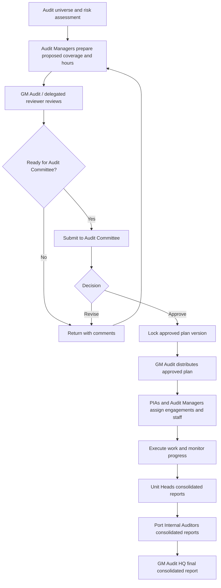
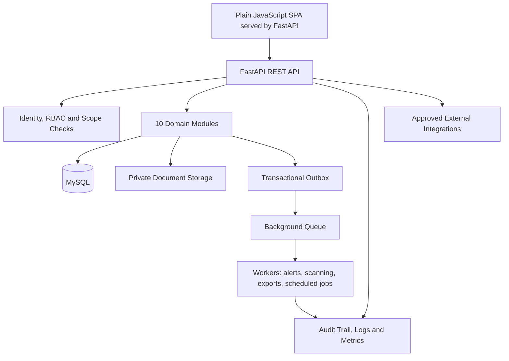

# GPHA INTERNAL AUDIT WORKSPACE (GIAW)
# MAIN PROJECT BLUEPRINT

**Canonical filename:** `mainBLUEPRINT.md`  
**Project:** GPHA Internal Audit Workspace (GIAW)  
**Organization:** Ghana Ports and Harbours Authority (GPHA)  
**Blueprint status:** Main project governance and delivery plan  
**Version:** 1.0  
**Date:** 14 October 2026  
**Required backend:** Python + FastAPI  
**Required database:** MySQL  
**Detailed functional specification:** `giaw.md`

---

## 1. Purpose and authority of this blueprint

This document is the **main blueprint and implementation roadmap** for GIAW. It organizes the project into exactly **10 major modules** and **20 ordered delivery phases**. It governs project scope, dependencies, delivery order, acceptance criteria and the relationship between modules.

`giaw.md` remains the detailed functional and technical reference containing screen specifications, workflows, data entities, API patterns, security requirements, report requirements and coding prompts. If this main blueprint defines the delivery order and `giaw.md` defines detailed behavior, use both together. Where a conflict is discovered, document it as a decision and update the documents rather than silently implementing contradictory requirements.

The purpose is to build a GPHA-specific integrated internal audit platform inspired by publicly documented Diligent One / HighBond capabilities. GIAW must implement its own code, schema, interfaces and GPHA branding. This is not a claim to reproduce Diligent's proprietary source code, undocumented internals or every private screen.

## 2. Product vision

GIAW will provide one secure, integrated workspace for:
- Managing GPHA's configurable HQ, Tema Port and Takoradi Port organizational hierarchy.
- Maintaining the audit universe, risks and controls.
- Preparing, reviewing, approving and distributing annual Assurance Plans.
- Managing audit engagements, planning, fieldwork, workpapers and review.
- Requesting, storing, reviewing and tracing evidence.
- Managing findings, management responses, remediation and retesting.
- Scheduling audit resources and recording time.
- Producing reconciled reports at three levels: Unit Heads → Port Internal Auditors → GM Audit HQ.
- Preserving role-based access, document history and audit trails.

## 3. Non-negotiable architecture decisions

> **Recorded project decision (15 October 2026): the GIAW stack is FastAPI + MySQL.** Backend: Python 3.12+, FastAPI, Pydantic v2, SQLAlchemy 2.x, Alembic. Database: MySQL 8 (InnoDB, utf8mb4). Front end: the server-served plain JavaScript single-page app in `app/static` (HTML, CSS, JS; no build step) with the GIAW design system (`app/static/js/ui.js` and the CSS tokens in `app/static/css/styles.css`). React, TypeScript, Vite, Tailwind, Celery and Redis are **not** used. Any change to this stack needs a new recorded decision.

1. **Integrated platform, modular monolith first.** GIAW is one platform containing 10 business modules with clear domain boundaries. Begin with one deployable FastAPI backend and separate module packages; do not start with unnecessary microservices.
2. **Backend:** Python + FastAPI, Pydantic, SQLAlchemy 2.x and Alembic migrations.
3. **Database:** MySQL with InnoDB, foreign keys, indexes, migrations, `utf8mb4` and reviewed backup/restore procedures.
4. **Frontend:** server-served plain JavaScript single-page app with the GIAW design system and reusable components (`app/static`). Recorded decision of 15 October 2026 replaces the earlier React + TypeScript suggestion.
5. **Documents:** private object/file storage; MySQL stores metadata, access relationships, version references and checksums.
6. **Security:** deny-by-default authorization using roles, permissions, organizational scope and engagement assignment.
7. **Workflow:** explicit, tested state transitions and recorded approval events; do not scatter workflow logic across API routes.
8. **Auditability:** governed changes, approvals, downloads, exports and issued report versions must be traceable.
9. **Reporting:** preserve lineage to source records and reconcile each reporting level.
10. **AI:** optional and later-stage; never permit an AI system to approve plans, issue final reports, close findings or grant access autonomously.

## 4. The 10 major modules

These are the project's top-level modules. Supporting services such as identity, notifications, file storage and audit logging are shared platform capabilities rather than additional top-level business modules.

### Module 1 — Platform Foundation, Organization and Access
**Purpose:** Provide the secure platform shell and GPHA organizational hierarchy.

**Includes**
- Login, logout, identity-provider integration and user profile.
- Users, roles, permissions, delegations and access reviews.
- Configurable organization tree: HQ, Tema, Takoradi, departments, units and teams.
- Scope-aware authorization and engagement assignments.
- Common navigation, dashboard shell, configuration, audit trail and system settings.

**Primary entities:** `users`, `org_units`, `roles`, `permissions`, `user_role_assignments`, `role_permissions`, `audit_events`, `system_settings`.

**Acceptance outcome:** A user can access only authorized screens and records. HQ/Tema/Takoradi structures are configurable without source-code changes. Privileged changes are logged.

### Module 2 — Audit Universe, Risk and Controls
**Purpose:** Establish risk-based audit coverage and reusable control information.

**Includes**
- Auditable entity register and organizational mapping.
- Risk register and periodic risk assessments.
- Configurable likelihood/impact scales and approved scoring.
- Controls library and risk-control mapping.
- Audit history, coverage gaps, heat maps and risk-based priorities.

**Primary entities:** `auditable_entities`, `risks`, `entity_risk_links`, `controls`, `control_risk_links`.

**Acceptance outcome:** Audit Managers can explain why an area is prioritized and identify risks/areas not covered by a proposed plan.

### Module 3 — Assurance Planning and Governance Approvals
**Purpose:** Manage annual assurance planning from draft to approval and distribution.

**Includes**
- Annual plan setup, planning period, available hours and coverage.
- Proposed audits/projects, planned hours, priority and risk rationale.
- Resource allocation and plan versioning.
- Review comments, return for revision, submission and approval decisions.
- Audit Committee decision record and GM Audit distribution.
- Plan monitoring and change history.

**Primary entities:** `assurance_plans`, `plan_project_links`, `approval_events`, `calendar_assignments` (planning allocations as appropriate).

**Acceptance outcome:** A plan follows a controlled, traceable lifecycle and an approved version cannot be silently changed.

### Module 4 — Engagements, Audit Planning and Frameworks
**Purpose:** Turn approved plan coverage into executable audit engagements.

**Includes**
- Engagement/project creation and lifecycle.
- Workplan and Internal Control workflow patterns.
- Engagement team assignments, objectives, scope, criteria and milestones.
- Risk response, reusable frameworks, project templates and roll-forward.
- Engagement progress, activity history and status controls.

**Primary entities:** `engagements`, `engagement_assignments`, `objectives`, `engagement_risks`, framework/template tables.

**Acceptance outcome:** Authorized users can create engagements from approved plans and templates, assign staff, and track progress with enforced lifecycle rules.

### Module 5 — Fieldwork, Testing and Workpapers
**Purpose:** Execute audit procedures and preserve the evidence-based audit reasoning.

**Includes**
- Work programs and procedures.
- Control narratives, walkthroughs and control tests.
- Sampling plans, test attributes, populations and sample outcomes.
- Procedure results, exceptions and conclusions.
- Workpaper creation, references, versioning, review notes and sign-offs.
- Preparer/reviewer controls and fieldwork completion tracking.

**Primary entities:** `procedures`, `procedure_results`, `workpapers`, `review_notes`, `signoffs`, `walkthroughs`, `control_tests`.

**Acceptance outcome:** Every completed procedure has a recorded result and conclusion; important conclusions link to supporting evidence and review history.

### Module 6 — Evidence, Documents and Collaboration
**Purpose:** Securely collect, classify, version, review and link audit evidence.

**Includes**
- Evidence Hub and secure information requests.
- Auditee upload portal and request reminders.
- Private storage, metadata, checksum, version history and malware scanning.
- Evidence acceptance/rejection/clarification workflows.
- Links to procedures, tests, workpapers, findings and reports.
- Comments, mentions, notifications and access history.
- Retention classes and legal-hold controls.

**Primary entities:** `evidence_items`, `document_versions`, `evidence_links`, `evidence_requests`, `evidence_reviews`, `notifications`, collaboration records.

**Acceptance outcome:** Evidence access is authorized and logged, versions are preserved, and files cannot be retrieved merely by guessing a URL or storage key.

### Module 7 — Findings, Recommendations and Remediation
**Purpose:** Record audit issues and follow corrective actions through verified closure.

**Includes**
- Finding register, condition/criteria/cause/effect and risk rating.
- Recommendations and management responses.
- Action owners, deliverables, due dates, reminders and escalation.
- Retesting, verification and closure approval.
- Repeat findings and recurrence analysis.
- Finding history and report-inclusion controls.

**Primary entities:** `findings`, `remediation_actions`, `retests`, related evidence links and approval events.

**Acceptance outcome:** Action owners cannot unilaterally close findings. Closure follows authorized verification and, where required, a documented retest.

### Module 8 — Scheduling, Resources and Timesheets
**Purpose:** Plan audit capacity and record time spent.

**Includes**
- Staff calendar and engagement allocation.
- Planned versus available hours and utilization.
- Milestones, assignment conflicts and resource rebalancing.
- Timesheet entry, submission, approval and correction history.
- Planned versus actual effort for engagement and portfolio reporting.

**Primary entities:** `calendar_assignments`, `timesheet_entries`, engagement assignments and resource allocations.

**Acceptance outcome:** Managers can see resource commitments and approved actual hours without double-counting hours across reports.

### Module 9 — Reporting, Consolidation and Analytics
**Purpose:** Produce controlled operational and executive reporting with source lineage.

**Includes**
- Report catalogue, filters, report builder and scheduled runs.
- Plan delivery, audit universe coverage, risk, engagement and finding reports.
- Unit Heads consolidated reports.
- Port Internal Auditors consolidated reports for Tema and Takoradi.
- GM Audit HQ final consolidated reports.
- Reconciliation, source snapshots, approvals, issue versions, PDF/XLSX exports.
- Dashboards, KPIs, trend analysis and authorized drill-downs.

**Primary entities:** `report_definitions`, `report_runs`, `report_run_sources`, reporting snapshots and metric definitions.

**Acceptance outcome:** Unit reports reconcile into port reports; port and HQ reports reconcile into the GM Audit view. Missing source reports are flagged, not treated as zero. Issued reports are versioned snapshots.

### Module 10 — Integrations, Operations and Advanced Assistance
**Purpose:** Operate, monitor and extend GIAW safely after the core audit workflows are reliable.

**Includes**
- Versioned REST API and OpenAPI documentation.
- Approved external-system connectors and integration jobs.
- Background tasks for notifications, scanning, reminders and exports.
- Operational health, structured logs, metrics, backup and restore monitoring.
- Controlled data import/migration tools.
- Optional AI-assisted drafting, search and summarization with citations and human verification.
- Release automation, security scanning and operational runbooks.

**Primary entities:** `integration_jobs`, `outbox_events`, system/operation logs, AI run records if enabled.

**Acceptance outcome:** Integrations are permission-controlled, retryable and observable. AI remains assistive and all material output is reviewed by an authorized human.

---

## 5. Mapping the 10 modules to 20 delivery phases

The 20 phases are ordered implementation increments. A phase may deliver part of a module; each module may span multiple phases. Phase completion requires the acceptance criteria to pass, not just the UI to render.

| Phase | Phase name | Primary module(s) | Main deliverables | Exit criteria |
|---:|---|---|---|---|
| 1 | Discovery, governance and requirements baseline | 1–10 (cross-cutting) | Confirm processes, roles, org hierarchy, source forms, report templates, risk scoring, hosting and data policies; create traceability matrix | Business owners approve requirements and unresolved policy decisions are logged |
| 2 | Repository, environments and engineering standards | 1, 10 | Repository layout, branch rules, coding standards, CI checks, dev/test/staging plan, secrets handling | Clean build pipeline runs; no production secrets in repository |
| 3 | FastAPI, MySQL and shared platform foundation | 1 | FastAPI app, MySQL connection, SQLAlchemy models, Alembic migrations, standard errors, request IDs, health checks | Empty database can be migrated reproducibly; API documentation is available |
| 4 | Identity, roles, permissions and audit trail | 1 | Authentication integration, RBAC, organization scope checks, audit events, session/security baseline | Automated tests block unauthorized actions and cross-port data access |
| 5 | GPHA organization hierarchy and administration | 1 | Configurable HQ/Tema/Takoradi tree, units, user administration, lookups and settings | Admin can create/change org units without code changes; hierarchy cycles are prevented |
| 6 | Audit universe and auditable entities | 2 | Entity register, ownership, audit history, search/filter/import and coverage fields | Entity data is validated and scope-aware; duplicate codes are controlled |
| 7 | Risk assessment and controls library | 2 | Risk register, scoring, assessments, control library, risk-control mappings, heat map | Approved scoring rules calculate consistently and are covered by tests |
| 8 | Assurance Plan creation and coverage design | 3 | Plan draft, fiscal period, available hours, proposed audits, priorities, risk rationale and entity coverage | Plan can be created and checked for missing required information |
| 9 | Assurance Plan review, approval and distribution | 3 | Review notes, return/resubmit, approval events, version locking and GM Audit distribution | Full approval lifecycle passes positive and negative tests; history is traceable |
| 10 | Engagements, assignments and project templates | 4 | Engagement lifecycle, team assignments, objectives, scope, milestones, templates and roll-forward | Approved plan coverage can be converted into assigned engagements with traceable linkage |
| 11 | Workplan and Internal Control workflows | 4, 5 | Workflow-type configuration, work program, procedures, narratives, walkthroughs and control-test setup | Each workflow shows relevant components and blocks invalid transitions |
| 12 | Fieldwork execution, testing and workpapers | 5 | Procedure results, samples, exceptions, workpapers, review notes, preparer/reviewer sign-offs | Workpaper completion and review blockers are enforced; changes are versioned |
| 13 | Evidence requests, uploads and document versioning | 6 | Secure requests, upload portal, private storage, metadata, checksums, scan status and versions | Only authorized users can upload/download; suspicious or invalid files are quarantined |
| 14 | Findings, management responses and remediation | 7 | Finding register, recommendations, management response, action owners, deadlines, reminders and retesting | Action closure requires authorized verification; overdue items are accurately identified |
| 15 | Scheduling, resource planning and timesheets | 8 | Calendars, capacity, allocation, timesheet entry/submission/approval and utilization | Planned and approved actual hours reconcile with agreed rules |
| 16 | Unit Heads consolidated reporting | 9 | Unit report templates, reporting periods, data cutoff, findings/actions/progress and source lineage | Unit totals reconcile to eligible source records; missing values are handled explicitly |
| 17 | Port Internal Auditor and GM Audit consolidation | 9 | Port report aggregation, HQ/port roll-up, reconciliation, report review and issuance snapshots | Unit → port → GM totals reconcile and every figure has source lineage |
| 18 | Dashboards, notifications, exports and analytics | 6, 8, 9, 10 | In-app/email notifications, task center, KPIs, authorized drill-downs, PDF/XLSX exports and scheduled jobs | Notifications do not leak restricted information; exports enforce permissions and filters |
| 19 | Integrations, migration, security and recovery hardening | 1, 6, 9, 10 | Approved integrations, legacy import rehearsal, threat review, load/accessibility tests, backup restore and runbooks | No unresolved critical defect without formal risk acceptance; restore and migration rehearsals pass |
| 20 | User acceptance, pilot, production release and improvement | 1–10 | Training, UAT sign-off, production deployment, monitoring, support handover and prioritized backlog | Named business owners sign off; rollback, support, recovery and release procedures are ready |

### 5.1 Module-to-phase coverage matrix

`●` = primary delivery; `○` = supporting dependency or shared capability.

| Module | P1 | P2 | P3 | P4 | P5 | P6 | P7 | P8 | P9 | P10 | P11 | P12 | P13 | P14 | P15 | P16 | P17 | P18 | P19 | P20 |
|---|:---:|:---:|:---:|:---:|:---:|:---:|:---:|:---:|:---:|:---:|:---:|:---:|:---:|:---:|:---:|:---:|:---:|:---:|:---:|:---:|
| 1. Platform, organization and access | ● | ● | ● | ● | ● | ○ | ○ | ○ | ○ | ○ | ○ | ○ | ○ | ○ | ○ | ○ | ○ | ○ | ● | ● |
| 2. Audit universe, risk and controls | ○ |  |  |  |  | ● | ● | ○ |  | ○ | ○ | ○ |  | ○ |  | ○ | ○ | ○ | ○ | ○ |
| 3. Assurance planning and approvals | ○ |  |  | ○ | ○ | ○ | ○ | ● | ● | ○ |  |  |  |  | ○ | ○ | ○ | ○ | ○ | ○ |
| 4. Engagements, planning and frameworks | ○ |  |  | ○ |  | ○ | ○ | ○ | ○ | ● | ● | ○ | ○ | ○ | ○ | ○ | ○ | ○ | ○ | ○ |
| 5. Fieldwork, testing and workpapers | ○ |  |  | ○ |  |  | ○ |  |  | ○ | ● | ● | ○ | ○ |  | ○ | ○ | ○ | ○ | ○ |
| 6. Evidence, documents and collaboration | ○ |  |  | ○ |  |  |  |  |  | ○ | ○ | ○ | ● | ○ |  | ○ | ○ | ● | ● | ○ |
| 7. Findings and remediation | ○ |  |  | ○ |  |  |  |  |  | ○ | ○ | ○ | ○ | ● |  | ○ | ○ | ○ | ○ | ○ |
| 8. Scheduling, resources and timesheets | ○ |  |  |  |  |  |  | ○ |  | ○ | ○ |  |  |  | ● | ○ | ○ | ● | ○ | ○ |
| 9. Reporting, consolidation and analytics | ○ |  |  | ○ |  | ○ | ○ | ○ | ○ | ○ | ○ | ○ | ○ | ○ | ○ | ● | ● | ● | ○ | ○ |
| 10. Integrations, operations and assistance | ○ | ● | ● | ○ |  | ○ | ○ | ○ | ○ | ○ | ○ | ○ | ○ | ○ | ○ | ○ | ○ | ● | ● | ● |

## 6. Mandatory business workflows

### 6.1 Annual Assurance Plan workflow



Recommended states:
`DRAFT → IN_REVIEW → RETURNED_FOR_REVISION / SUBMITTED_FOR_APPROVAL → APPROVED → DISTRIBUTED → ACTIVE → COMPLETED → ARCHIVED`.

Use stable internal state codes and validate every transition. Record actor, role, decision, timestamp, comments and plan version. GPHA must confirm formal delegated approval authority.

### 6.2 Engagement workflow

`PROPOSED → APPROVED_FOR_EXECUTION → PLANNING → READY_FOR_FIELDWORK → FIELDWORK → REVIEW → REPORT_DRAFT → REPORT_REVIEW → REPORT_APPROVED → ISSUED → FOLLOW_UP → CLOSED`

`ON_HOLD`, `CANCELLED` and `REOPENED` require explicit permissions, reasons and history.

### 6.3 Evidence workflow

`REQUESTED → SUBMITTED → UNDER_REVIEW → ACCEPTED / REJECTED / CLARIFICATION_REQUESTED → SUPERSEDED or ARCHIVED`

The uploaded binary must be scanned and stored privately. Evidence approval must not be confused with audit conclusion approval.

### 6.4 Finding and action workflow

`DRAFT → REVIEW → ISSUED → ACTION_IN_PROGRESS → SUBMITTED_FOR_VERIFICATION → RETEST → CLOSED`

The action owner may update progress and submit evidence, but the designated auditor/reviewer controls verification and closure.

### 6.5 Consolidated reporting workflow

1. Unit Head prepares and submits the unit report.
2. Port Internal Auditor checks completeness, reconciles unit totals and submits the port report.
3. GM Audit reconciles HQ and both port reports and issues the authority-wide report.
4. Missing source reports are flagged; they must not silently count as zero.
5. Every issued report preserves reporting period, data cutoff, source record/version references, approver, issue timestamp and checksum.

---

## 7. Technical implementation blueprint

### 7.1 Suggested stack

| Layer | Standard |
|---|---|
| Language/runtime | Supported Python 3.x release |
| API backend | FastAPI |
| Validation | Pydantic |
| ORM | SQLAlchemy 2.x |
| Schema migrations | Alembic |
| Database | MySQL 8.0+ or a currently supported approved version |
| Frontend | Plain JavaScript SPA served by FastAPI from `app/static` (no build step) |
| Styling/components | GIAW design system: CSS tokens in `styles.css`, shared components in `ui.js` |
| Background tasks | In-process asyncio tasks in the FastAPI app (escalations, backups, schema watch) |
| File storage | Private upload directory, encrypted at rest, SHA-256 checked, served only through authorized endpoints |
| File safety | Allow-listed types and size limits; malware scanning (e.g. ClamAV) still to be configured |
| Testing | pytest + HTTPX on a MySQL test database; Playwright browser tests in `tests/ui` |
| Deployment | Docker and an approved GPHA environment |
| Observability | Structured logs, metrics, traces and alerts |
| API docs | FastAPI OpenAPI documentation |

Pin versions when the repository is created and check current support/security status. This stack is GIAW's recorded choice (FastAPI + MySQL); it is not a claim about Diligent's private stack.

### 7.2 Architecture



### 7.3 Repository layout

Actual layout of the repository (GPHAIAWORKSPACE):

```text
app/
  main.py                 # FastAPI app, middleware, router registration
  core/                   # config, database, auth deps, permissions, access/scope rules, paging, errors
  platform/               # module 1: auth, users, roles, organizations, apps, notifications, history, backups ...
  domains/
    audit/                # modules 4-6: audits, RCM, working papers, evidence, reports, methodology, capacity ...
    assurance/            # modules 2-3 and 9: universe, plans and plan cycle, committee, governance, QAIP, scheduler
    issues/               # module 7: remediation (CAPA), follow-up, nonconformances
    grc/                  # risk, compliance, policies, assets
  services/               # analytics and search, documents, AI
  static/                 # front end: index.html, css/, js/ (ui.js design system), vendor/
alembic/                  # migrations
tests/                    # pytest (MySQL) and tests/ui (Playwright)
docs/ui/                  # UI redesign records
scripts/  deploy/
```

The original suggested layout is kept below for reference only:

```text
giaw/
  backend/
    app/
      main.py
      core/                 # configuration, auth, permissions, DB, errors
      api/v1/               # versioned API routers
      modules/
        platform/
        audit_universe/
        assurance_planning/
        engagements/
        fieldwork/
        evidence/
        findings/
        resources/
        reporting/
        integrations/
      models/
      schemas/
      repositories/
      services/
      workflows/
      tasks/
      migrations/
      tests/
    pyproject.toml
    alembic.ini
  frontend/
    src/
      app/
      layouts/
      components/
      features/
      api/
      routes/
      types/
      styles/
  infra/
  docs/
  scripts/
  .env.example
  README.md
```

Do not create empty folders for appearance alone. Keep domain rules in services/workflows, input/output contracts in schemas, and database operations in well-defined repository/service boundaries.

### 7.4 API conventions

- Base prefix: `/api/v1`.
- JSON payloads and consistent error shape: `code`, `message`, `details`, `request_id`.
- Server-side pagination, filtering and sorting with maximum page sizes.
- Authentication plus object-level permission and organizational scope checks on every request.
- Use transactions for approvals, state transitions, report issuance and closure.
- Use optimistic concurrency/version numbers for governed records.
- Use idempotency keys for retryable create operations where duplicate creation would be harmful.
- Rate-limit sensitive endpoints and document rate limits.
- Never treat hidden frontend controls as authorization.
- Never expose raw file paths, secrets or internal-only fields.

### 7.5 Initial API groups

- `/api/v1/auth`, `/api/v1/me`
- `/api/v1/org-units`, `/api/v1/users`, `/api/v1/roles`, `/api/v1/permissions`
- `/api/v1/auditable-entities`, `/api/v1/risks`, `/api/v1/controls`
- `/api/v1/assurance-plans`, `/api/v1/assurance-plans/{id}/submit`, `/decisions`, `/distribute`
- `/api/v1/engagements`, `/api/v1/engagements/{id}/transitions`
- `/api/v1/procedures`, `/api/v1/workpapers`, `/api/v1/review-notes`
- `/api/v1/evidence-requests`, `/api/v1/evidence`, `/api/v1/evidence/{id}/reviews`
- `/api/v1/findings`, `/api/v1/actions`, `/api/v1/actions/{id}/retests`
- `/api/v1/timesheets`, `/api/v1/report-runs`, `/api/v1/activity`, `/api/v1/audit-events`

Exact schemas should follow the detailed requirements in `giaw.md`.

---

## 8. Data and records principles

The detailed schema in `giaw.md` is the starting data model. Implement it incrementally through reviewed Alembic migrations.

Core data groups:
1. Identity, roles, permissions and organization.
2. Audit universe, risks and controls.
3. Assurance plans, approval events and plan-project links.
4. Engagements, assignments, objectives and risks.
5. Procedures, test results, workpapers, review notes and sign-offs.
6. Evidence, document versions, requests and evidence links.
7. Findings, actions and retests.
8. Calendar assignments and timesheets.
9. Report definitions, report runs and report-source lineage.
10. Notifications, activity events, audit events, integration jobs and outbox events.

Data rules:
- MySQL uses InnoDB, `utf8mb4`, foreign keys and appropriate indexes.
- Keep uploaded binary files out of ordinary relational rows; store metadata and storage keys in MySQL.
- Preserve history for approvals, findings, issued reports and evidence versions.
- Do not silently delete approved records or overwrite issued documents.
- Apply retention and legal-hold policy approved by GPHA.
- Use scope-aware queries and test cross-port boundaries.
- Define each KPI and report calculation, period, cutoff and exclusion rule.
- Never fabricate missing source records during migration.

---

## 9. Security and governance gates

Every phase must follow these controls:
- Deny-by-default access.
- Least privilege and separation of duties.
- Server-side organizational and engagement scope enforcement.
- Audit trail for sensitive actions, approvals, downloads and exports.
- HTTPS, secure session/token design, MFA where required and secrets management.
- File size/type/signature validation, malware scanning, checksums and private storage.
- Input validation, parameterized queries, output escaping and CSRF/XSS/SSRF/path-traversal defenses.
- Dependency and container scanning, patching and reviewed migrations.
- Encrypted backups, restore drills and documented RPO/RTO.
- No production secrets or real confidential data in source control or ordinary development fixtures.
- Formal review of retention, privacy and applicable Ghanaian legal obligations.

A release cannot proceed with an unresolved critical security issue unless a formally authorized risk acceptance is recorded. Authorization tests must cover HQ, Tema, Takoradi, unit scope, engagement assignment and revoked access.

---

## 10. Quality, test and release strategy

### Required test layers
1. Unit tests for scoring, calculations, workflow transitions and permissions.
2. API integration tests against a test MySQL database.
3. Migration tests from an empty database and from the previous supported schema.
4. Role/scope matrix tests, including direct object ID manipulation.
5. End-to-end workflow tests for annual planning, evidence, finding closure and consolidated reporting.
6. File security, checksum, access revocation and version tests.
7. Report reconciliation and export-authorization tests.
8. Accessibility and responsive-interface tests.
9. Load/performance tests on list pages, dashboards and report generation.
10. Backup restoration and deployment rollback exercises.

### Definition of done

A phase is complete only when:
- Requirements and assumptions are documented.
- Database migrations are reproducible and reviewed.
- APIs have validation, documented error behavior and access controls.
- UI states cover loading, empty, validation, success, denied access and failure.
- Workflow and audit-history rules are implemented.
- Automated tests pass.
- Security and accessibility checks are performed.
- User guidance and operating notes are updated.
- Acceptance criteria are signed off by the designated owner.

---

## 11. Project governance and change control

### Decision owners
- **Business owner:** designated GPHA Internal Audit leadership.
- **Workflow and reporting owners:** GM Audit and delegated Audit Managers/PIAs, subject to formal GPHA approval.
- **Security/hosting owner:** GPHA IT/security stakeholders.
- **Records and retention owner:** GPHA-authorized records/legal stakeholders.
- **Implementation owner:** assigned technical lead/development team.
- **User acceptance owners:** named representatives from HQ, Tema and Takoradi.

### Change control
For each proposed change:
1. Describe the business problem.
2. Identify affected module(s), phases, data, permissions and reports.
3. Assess security, privacy, migration and backward compatibility.
4. Add acceptance criteria and tests.
5. Obtain approval from the appropriate owner.
6. Update `mainBLUEPRINT.md`, `giaw.md`, API contracts or schema docs as applicable.
7. Implement in a small change set and record the release note.

Never treat AI-generated code as approved merely because it compiles.

---

## 12. Delivery status tracking template

Use this table in project reviews and update it as work progresses.

| Phase | Status | Owner | Planned start | Planned finish | Actual finish | Blockers / decision |
|---:|---|---|---|---|---|---|
| 1 | Partial | GIAW team | TBD | TBD | - | GPHA operating picture received; decisions in section 13 still open |
| 2 | Partial | GIAW team | TBD | TBD | - | Repository, ruff, pytest (MySQL) and browser tests in place; no CI pipeline yet |
| 3 | Partial | GIAW team | TBD | TBD | - | FastAPI, MySQL, Alembic, health check done; `/api/v1` prefix and request IDs outstanding |
| 4 | Mostly done | GIAW team | TBD | TBD | - | 5 roles, permission matrix, audit trail, port/team scope on audits and their records (Oct 2026); aggregate dashboards still authority-wide |
| 5 | Partial | GIAW team | TBD | TBD | - | Organization tree exists; the Audit Universe still uses a separate locations list (decision 13) |
| 6 | Done | GIAW team | TBD | TBD | - | Entity register, import, coverage; to be attached to the organization tree |
| 7 | Partial | GIAW team | TBD | TBD | - | Risk Manager, controls library, links done; scoring formula fixed at likelihood x impact (decision 4) |
| 8 | Done | GIAW team | TBD | TBD | - | |
| 9 | Done | GIAW team | TBD | TBD | - | Committee decision, version lock, change requests, distribution |
| 10 | Partial | GIAW team | TBD | TBD | - | Plan engagement -> audit, engagement teams (Oct 2026); 12-state lifecycle and roll-forward outstanding |
| 11 | Partial | GIAW team | TBD | TBD | - | Internal Control (RCM) workflow only; Workplan procedures outstanding |
| 12 | Mostly done | GIAW team | TBD | TBD | - | GPHA working-paper template, review chain Unit Head -> Audit Manager -> PIA, review notes |
| 13 | Partial | GIAW team | TBD | TBD | - | Requests, encrypted storage, SHA-256; malware scanning not configured; links to tests/findings outstanding |
| 14 | Done | GIAW team | TBD | TBD | - | Client and management responses, actions, validation; finding closes only after verified remediation (Oct 2026) |
| 15 | Partial | GIAW team | TBD | TBD | - | Scheduler, capacity, time entries; timesheet submission/approval outstanding |
| 16 | Not started | GIAW team | TBD | TBD | - | |
| 17 | Not started | GIAW team | TBD | TBD | - | |
| 18 | Partial | GIAW team | TBD | TBD | - | Notifications, task center, KPIs, exports; registers moving to server paging |
| 19 | Partial | GIAW team | TBD | TBD | - | Backups, restore and verify scripts; security review and load tests outstanding |
| 20 | Not started | GIAW team | TBD | TBD | - | |

---

## 13. Key GPHA decisions to resolve before production

1. Confirm official HQ/Tema/Takoradi hierarchy and authoritative organizational data.
2. Confirm roles, delegated approval authority and separation-of-duties rules.
3. Confirm Audit Committee approval recording method and plan distribution authority.
4. Approve risk scoring scales and thresholds.
5. Confirm fiscal-year and annual planning calendar.
6. Approve standard engagement types and report templates.
7. Approve confidentiality classifications and auditee access model.
8. Approve retention, legal hold and disposal schedule.
9. Confirm hosting, identity provider, email relay, storage and recovery objectives.
10. Approve migration sources and data quality rules.
11. Approve integrations and any AI use cases/data boundaries.
12. Name UAT sign-off owners and production support contacts.
13. Is the Audit Universe the same as the organization tree, or a separate list of auditable areas mapped onto it? (Today the universe uses its own locations list.)
14. Do ad-hoc audits (not in the approved plan) need a plan change request before they start?
15. Confirm which workplace types have an authority-wide view (default: Head Office) and that staff with no workplace see only their engagement teams.
16. Confirm whether Low-rated findings may be closed without a remediation action (default: yes).

---

## 14. Reference documentation and companion files

- **Main project blueprint:** `mainBLUEPRINT.md` — the 10-module structure, 20-phase plan, dependencies, governance and acceptance gates.
- **Detailed functional/technical specification:** `giaw-fastAPI.md` (titled `giaw.md` inside) — module capabilities, screen-by-screen catalogue, data model, API examples, workflows, security, reporting and implementation prompts.
- **UI redesign playbook and records:** `UI_REDESIGN_PROMPTS.md`; `docs/ui/00`–`03` (inventory, reference matrix, design system, data-flow check)
- **Diligent One Platform Help Center:** https://help.diligentoneplatform.com/helpdocs/d1p/en-us/Content/global_topics/index.htm
- **HighBond API reference:** https://docs-apis.highbond.com/#section/Making-requests

Use vendor documentation to validate functional behavior during implementation. Do not assume that public help pages reveal private source code, exact internal schemas or every product screenshot.

---

## 15. Final project directive

Build GIAW as one integrated platform with 10 clear modules and 20 controlled phases, using FastAPI and MySQL. Prioritize the security and organizational foundation, then audit universe and risk, then the complete Assurance Plan approval/distribution lifecycle, then engagement execution and evidence, findings/remediation, and finally reconciled reporting.

**Do not begin by generating every screen at once.** Implement one phase, satisfy its exit criteria, test it against GPHA's approved process, and then proceed. `mainBLUEPRINT.md` controls the project sequence; `giaw.md` provides the detailed implementation requirements.
